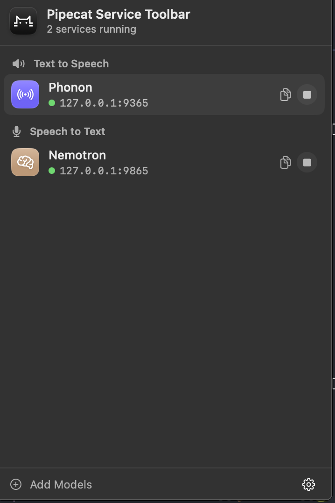
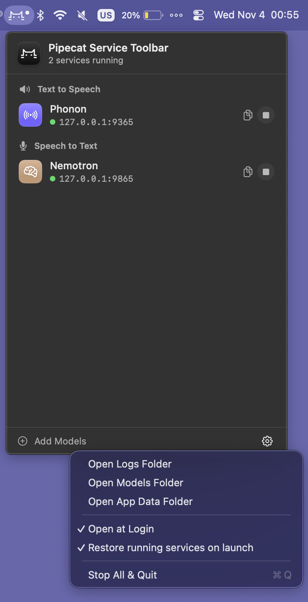

# pipecat-local-tts-server

Standalone local WebSocket **text-to-speech (TTS) server** for the Pipecat
ecosystem: text in, int16-LE mono PCM out over a Unix domain socket or loopback
TCP. It mirrors
[`pipecat-local-stt-server`](https://github.com/vr000m/pipecat-local-stt-server)
with an OpenAI-Realtime-inspired protocol, pluggable backends, and lazy model
imports behind optional extras.

The package is distributed as `pipecat-local-tts-server`; its import name and
module entry point are `tts_server`. The lean base installs only `websockets`,
so a client does not pull an ML runtime.

The server owes every client two contracts:

1. **An exact advertised rate.** `server.hello.audio.rate` is the model's true
   rate. Every audio frame is int16-LE mono PCM at that rate.
2. **A steady response stream.** Once a response starts, each completed model
   segment is emitted immediately so playback can continue without whole-result
   buffering.

## Install

Install a real backend on Apple Silicon:

```sh
uv add "pipecat-local-tts-server[kokoro]"
# or: pip install "pipecat-local-tts-server[kokoro]"
```

For a client-only environment:

```sh
uv add pipecat-local-tts-server
```

When working from this checkout, use `uv sync --extra kokoro` instead. Run
commands through `uv run`, or activate the environment first; bare system
Python will not see the installed dependencies. Installation also provides the
equivalent `pipecat-tts` console script.

See the
[backend guide](https://github.com/vr000m/pipecat-local-tts-server/blob/main/docs/backends.md)
for every extra, model, voice and platform requirement.

## Quickstart

Download Kokoro before the first start, then serve it over a local Unix socket:

```sh
uv run python -m tts_server prefetch --backend kokoro

uv run python -m tts_server serve --backend kokoro \
    --socket-path ~/Library/Caches/pipecat-tts/tts.sock
```

In another shell, probe the server and synthesize a WAV:

```sh
uv run python -m tts_server status \
    --socket-path ~/Library/Caches/pipecat-tts/tts.sock

uv run python examples/reference_client.py \
    --socket-path ~/Library/Caches/pipecat-tts/tts.sock \
    --text "Hello from the local TTS server." \
    --out hello.wav
```

Use `--backend tone` for a dependency-free protocol test with no model weights.
For TCP, authentication, model cache checks, launchd agents, keepalive settings,
and process supervision, see
[Server operations](https://github.com/vr000m/pipecat-local-tts-server/blob/main/docs/operations.md).

## Backends & licenses

The package ships runtime code, not model weights. Weights download on first
`serve` or through `prefetch`, and operators are responsible for their terms.

| Backend | Extra | Streaming | Default model | Weights license |
|---|---|---:|---|---|
| `tone` | base | no | synthetic sine | — |
| `kokoro` | `kokoro` | no | `mlx-community/Kokoro-82M-bf16` | Apache-2.0 |
| `voxtral_tts` | `voxtral_tts` | yes | `mlx-community/Voxtral-4B-TTS-2603-mlx-bf16` | **CC-BY-NC; non-commercial** |
| `pocket_tts` | `pocket_tts` | yes | `mlx-community/pocket-tts` | CC-BY-4.0; attribution required |
| `dia` | `dia` | no | `mlx-community/Dia-1.6B-fp16` | Apache-2.0 |
| `qwen3_tts` | `qwen3_tts` | yes | `mlx-community/Qwen3-TTS-12Hz-0.6B-CustomVoice-bf16` | `apache-2.0` model-card tag; no LICENSE file in the repo |
| `fish_tts` | `fish_tts` | no | `mlx-community/fish-audio-s2-pro` | **Fish Audio Research License; non-commercial, separate commercial agreement required** |
| `phonon` | `phonon` | yes | `gradium/phonon-31m-en` | Apache-2.0 for 31M weights, tokenizer and voices |

Kokoro is the default commercial-safe backend. Voxtral TTS and Fish S2 Pro have
restrictive non-commercial terms. Phonon's supported 31M model is Apache-2.0;
the gated 40M siblings are CC-BY-NC-4.0 and are not supported here. These are
documentation snapshots, not legal advice; re-check upstream terms before use.

The
[backend reference](https://github.com/vr000m/pipecat-local-tts-server/blob/main/docs/backends.md)
is canonical for rates, languages, voices, sampling controls, text/tag dialects,
character limits, truncation guards, quantized aliases, and cancellation caveats.

## macOS menu bar app

[`macos/`](https://github.com/vr000m/pipecat-local-tts-server/tree/main/macos)
contains **Pipecat Service Toolbar**, a native SwiftUI menu bar app that installs
and runs every TTS backend plus local STT services on fixed loopback ports.

<p align="center">
  
  
</p>

```sh
just app-open
just app-install
```

The app restores wanted services, adopts matching external servers without
owning them, and asks before quitting while a client is connected to a server
it started. See the
[macOS guide](https://github.com/vr000m/pipecat-local-tts-server/blob/main/macos/README.md).

## Running the server

`serve` accepts `--backend`, optional `--model`, `--socket-path` or
`--host`/`--port`, `--auth-token-file`, `--log-level`, and `--supervised`.
Unix sockets are recommended for one ad-hoc local server; loopback TCP is useful
for several backends and the macOS app.

```sh
# Explicit model on a Unix socket
uv run python -m tts_server serve --backend kokoro \
    --model mlx-community/Kokoro-82M-bf16 \
    --socket-path ~/Library/Caches/pipecat-tts/tts.sock

# Loopback TCP
uv run python -m tts_server serve --backend kokoro \
    --host 127.0.0.1 --port 8765
```

### Per-backend port convention

The `just tts-*` recipes, plist renderer, tests, and macOS catalog share this
canonical loopback map:

| backend | label | port (on `127.0.0.1`) |
|---|---|---|
| tone | `pipecat.tts-server.tone` | 8665 |
| kokoro | `pipecat.tts-server.kokoro` | 8765 |
| voxtral_tts | `pipecat.tts-server.voxtral_tts` | 8865 |
| pocket_tts | `pipecat.tts-server.pocket_tts` | 8965 |
| dia | `pipecat.tts-server.dia` | 9065 |
| qwen3_tts | `pipecat.tts-server.qwen3_tts` | 9165 |
| fish_tts | `pipecat.tts-server.fish_tts` | 9265 |
| phonon | `pipecat.tts-server.phonon` | 9365 |

```sh
just tts-install kokoro
just tts-list
just tts-status kokoro
```

The detailed lifecycle, endpoint precedence, environment variables, security
rules and troubleshooting notes live in
[Server operations](https://github.com/vr000m/pipecat-local-tts-server/blob/main/docs/operations.md).

## Protocol

The client drives `session.update` → `input_text.append`* →
`input_text.commit`. The server emits gapless `response.audio.delta` frames and
finishes with `response.audio.done`; `response.cancel` provides barge-in.
The commit is the unit of work, and clients must consult advertised backend
capabilities before selecting languages, voices, extras, or chunk sizes.

See the complete
[WebSocket protocol](https://github.com/vr000m/pipecat-local-tts-server/blob/main/docs/protocol.md).

## Examples

- [`examples/reference_client.py`](https://github.com/vr000m/pipecat-local-tts-server/blob/main/examples/reference_client.py)
  is a lightweight wire-protocol oracle that writes the received PCM to WAV.
- [`examples/pipecat_tts_service.py`](https://github.com/vr000m/pipecat-local-tts-server/blob/main/examples/pipecat_tts_service.py)
  provides `LocalTTSService`, a Pipecat `TTSService` adapter with interruption
  and bounded busy-retry handling. Install it with `uv sync --extra examples`.

## Documentation

- [Documentation index](https://github.com/vr000m/pipecat-local-tts-server/blob/main/docs/README.md)
- [Backends](https://github.com/vr000m/pipecat-local-tts-server/blob/main/docs/backends.md)
- [Server operations](https://github.com/vr000m/pipecat-local-tts-server/blob/main/docs/operations.md)
- [WebSocket protocol](https://github.com/vr000m/pipecat-local-tts-server/blob/main/docs/protocol.md)
- [macOS app](https://github.com/vr000m/pipecat-local-tts-server/blob/main/macos/README.md)
- [Profiling](https://github.com/vr000m/pipecat-local-tts-server/blob/main/scripts/profiling/README.md)
- [Live smoke tests](https://github.com/vr000m/pipecat-local-tts-server/blob/main/tests/smoke/README.md)

## Moved reference sections

These compatibility anchors keep older README fragments useful without
duplicating their detailed content.

<a id="environment-variables"></a>
<a id="checking-server-health"></a>
<a id="prefetching-models"></a>
<a id="supervised-mode"></a>

- [Environment variables, health checks, prefetch and supervised mode](https://github.com/vr000m/pipecat-local-tts-server/blob/main/docs/operations.md)

<a id="phonon-capabilities-and-voice-selection"></a>
<a id="voxtral-tts-capabilities-as-shipped"></a>
<a id="pocket-tts-capabilities-as-shipped"></a>
<a id="dia-capabilities-as-shipped"></a>
<a id="dia-cancellation-caveat"></a>
<a id="qwen3-tts-capabilities-as-shipped"></a>
<a id="fish_tts-capabilities-as-shipped"></a>
<a id="kokoro-capabilities-as-shipped"></a>
<a id="kokoro-language-support-advertised--synthesizable"></a>
<a id="kokoro-cancellation-caveat"></a>

- [Backend capabilities, languages, controls, limits and cancellation](https://github.com/vr000m/pipecat-local-tts-server/blob/main/docs/backends.md)

<a id="layout"></a>

- [Repository documentation and development records](https://github.com/vr000m/pipecat-local-tts-server/blob/main/docs/README.md)

## Development

```sh
uv sync --all-extras
uv run ruff format .
uv run ruff check .
uv run pytest
```

Model synthesis smoke tests require Apple Silicon and downloaded weights. The
full test and CI layout is described in `AGENTS.md`; live scripts always use
isolated temporary sockets and never touch the canonical operator socket.
