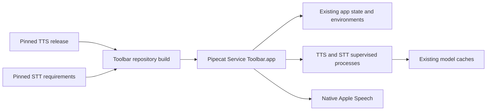

# Task: Extract Pipecat Service Toolbar into its own repository

**Status**: In Progress
**Component**: macos
**Assigned to**: Codex
**Priority**: High
**Branch**: refactor/extract-service-toolbar (TTS); refactor/import-service-toolbar (toolbar)
**Created**: 2026-11-16

## Objective

Prepare two linked migration PRs: import the toolbar into
`pipecat-ai/pipecat-service-toolbar`, then remove its implementation from the TTS
repository after the destination is validated. Preserve existing installations,
model caches, and behaviour while changing where the app is developed and installed from.

## Context

The toolbar manages TTS, Python STT engines, and native Apple Speech. The user has
created `../pipecat-service-toolbar`, whose `origin` is
`https://github.com/pipecat-ai/pipecat-service-toolbar.git`. Its initial commit is
`fa2d2203e5ed1cef72de23be6d997e96a9845e63`; it contains `.gitignore` and `LICENSE`.
The source baseline is `78823eeabf1f36c464243af1bd41b879d058c028`.
These refs are point-in-time observations, not future branch invariants.

## Requirements

- Use two linked PRs with focused commits and regular merges. Destination import
  and validation precede source removal; neither PR independently constitutes a
  completed migration. Preserve existing destination history and app attribution.
- Keep `ai.pipecat.ServiceToolbar`, the application name, signing requirements,
  preference keys/domain, service identities/ports, and app data locations unchanged.
- Preserve layout version 1, per-family environments, `.pipecat-toolbar.json`,
  `.variants`, saved wanted services, restore preference, and last-used models.
- Keep Hugging Face cache resolution, Phonon derived-cache resolution, and
  Moonshine cache forwarding/retention unchanged. Do not migrate, reset, delete,
  or force-download existing user data as part of extraction.
- Retain the currently shipped TTS and STT package versions and environment
  fingerprints for the first extracted app; independent app versioning must not
  implicitly upgrade server packages. Verify artifact provenance before pinning.
- Normal destination builds consume verified, pinned server artifacts without a
  sibling checkout. Preserve explicit local-artifact overrides for development.
- Give the app its own changelog, with toolbar-specific historical entries,
  original dates/versions and source links, identified as history inherited from
  the TTS repository. Add Unreleased extraction notes; do not invent releases or
  erase history from the source changelog.
- Preserve server protocol, supervision, prefetch and CLI functionality here.
  Move app-owned tests and keep server-owned contract coverage intact.

## Review Focus

- No installed-state reset, cache relocation, spurious package refresh, permission
  identity change, or loss of external-server ownership protections.
- Published-artifact compatibility replaces tests that rely on sibling source
  paths; extraction must not silently discard mixed Python/Swift coverage.
- Import retains relevant history and existing copyright notices. Original
  historical plans remain decision records with only material dated corrections.

## Implementation Checklist

Execution is sequential across two repositories. Paths prefixed `TTS:` belong to
this repository; `APP:` belong to the destination. No automatic conduct run is
implied. Each repository keeps its own feature branch; no merges or releases are
part of implementation without a later user instruction.

### Phase 1: Import history and define standalone packaging

**Impl files:** APP: Package.swift, Sources/, Tests/, scripts/, constraints/, docs/, README.md, LICENSE, .gitignore, pyproject.toml, uv.lock, justfile, app-version.json, artifacts/tts.json, constraints/tts.txt
**Test files:** APP: python_tests/test_artifacts.py, python_tests/test_migration_contract.py
**Test command:** `uv run pytest python_tests/test_artifacts.py python_tests/test_migration_contract.py`
**Goal:** Build the imported app from pinned released artifacts without a sibling checkout, retaining original app identity and server fingerprints.

- Split `macos/` history at the recorded source baseline in a disposable clone,
  import it at destination root, and merge that history with destination main on
  the import branch. Never rewrite either existing repository or published refs.
- Preserve original source attribution alongside destination attribution. Record
  source SHA and import mapping; do not import generated build output or secrets.
- Pin the published TTS 0.9.1 wheel with exact URL, filename and SHA-256 after
  checking package availability and archive metadata. Export source lockfile
  constraints without resolving new dependencies. Preserve STT constraints byte
  for byte. Abort extraction if the matching artifact cannot be verified.
- Add app-owned version metadata: initial display version 0.9.1 and a committed
  integer build number at least 474, checked against the currently installed app
  when available. Future releases explicitly increment it; do not derive it from
  filtered Git history. No release/tag is created by this migration.
- Adapt build scripts and unbundled ToolLocator to resolve app-local pinned
  artifacts, with explicit wheel/constraint overrides retained. Keep
  `PIPECAT_TOOLBAR_REPO` as an explicit TTS-source development override; ordinary
  standalone runs must never need it or discover a sibling implicitly.

### Phase 2: Relocate compatibility tests and verify upgrade invariants

**Impl files:** APP: Sources/PipecatToolbarCore/ToolLocator.swift, scripts/, pyproject.toml, python_tests/, Tests/, docs/supervised-contract.json
**Test files:** APP: Tests/PipecatServiceToolbarTests/, python_tests/test_migration_contract.py, python_tests/test_macos_catalog_drift.py, python_tests/test_supervised_contract.py
**Test command:** `uv run pytest && swift test`
**Goal:** Demonstrate compatibility with existing installations and preserve every pre-extraction contract assertion under an explicit owner.

- Inventory tests outside macos that inspect app files or shared fixtures; record
  assertion ownership in `docs/migration.md`. Move app-facing assertions to APP,
  split mixed tests rather than dropping them, retain server assertions in TTS.
- Copy recorded STT fixtures/source excerpts and wire fixtures with provenance;
  consume the pinned installed TTS package in compatibility tests. Where a check
  needs unpublished source-only material, use a recorded fixture pinned to the
  source SHA and retain corresponding producer checks in TTS.
- Change Swift live tests to use APP's lean environment with the pinned package;
  keep live tests mandatory in CI. Adapt shared fixture paths for the new root.
- Add old-install fixtures covering current and pre-variant markers, restore and
  last-used preferences, cache override precedence, family/variant IDs, stable
  signing/bundle identity and external-server ownership. Assert no install,
  reset, model-download or model-delete effect occurs solely due to extraction.
- Keep runtime state/cache/policy files byte-identical where possible and prove
  differences are restricted to packaging/development-path integration.
- Run Swift and Python suites, shell-script tests, pinned tone-server integration,
  a complete app build, and isolated UI smoke. Compare old/new bundle metadata
  and signing requirements without replacing or launching the user's live app.

### Phase 3: Complete standalone documentation, changelog and CI

**Impl files:** APP: README.md, CHANGELOG.md, AGENTS.md, docs/, justfile, .github/workflows/test.yml, .gitignore
**Test files:** APP: python_tests/test_docs.py
**Test command:** `uv run pytest python_tests/test_docs.py && uv run ruff format --check . && uv run ruff check .`
**Goal:** The new repository is independently understandable, buildable, and testable, with complete toolbar release history.

- Extract every app-relevant Added/Changed/Fixed entry from historical source
  releases with dates and provenance, preserving meaning. Keep unrelated server
  entries in TTS only. Add Unreleased migration notes without publishing a release.
- Move app recipes, screenshots and app docs; adjust links, source-relative paths,
  installation instructions and contributor commands. Preserve historic plans,
  appending one migration-location correction only where references are stale.
- Create CI for Python compatibility/shell tests and Swift build/test on macOS;
  validate artifacts and dependencies from a clean checkout with no sibling repo.
- Finish destination validation before editing source removals. Record exact
  commands, results, baseline hashes and any unresolved environment limitations.

### Phase 4: Remove app ownership from TTS and prepare linked PRs

**Impl files:** TTS: macos/ (remove), justfile, .github/workflows/test.yml, AGENTS.md, README.md, CHANGELOG.md, docs/, tests/; APP: docs/migration.md
**Test files:** TTS: tests/test_backend_registry.py, tests/test_supervised_contract.py, tests/test_justfile_recipes.py, tests/test_request_lifecycle.py, tests/test_supervised_smoke_helpers.py
**Test command:** `uv run pytest`
**Goal:** The TTS repository remains a complete standalone server, while no retained test or command requires the deleted app tree.

- Remove only app-owned files after the destination passes Phase 2/3 gates.
  Preserve server/launchd commands, supervised smoke tooling, protocol and server
  contract files; move cross-repository consumer checks to APP per the ownership
  inventory. Do not skip broken tests to achieve extraction.
- Retain historical changelog records and link to the new toolbar changelog.
  Update active docs/agent instructions; repair old source paths using pinned
  historical links or concise dated corrections rather than rewriting history.
- Run full TTS tests, Ruff format and check, package build, lean import and tone
  smoke. Existing native SentencePiece teardown SIGBUS must be reported explicitly
  if repeated; no claim of a clean exit from assertion counts alone.
- Scan explicitly staged paths and create focused commits before reviewing each
  repository's committed diff from its own base. Run documentation, code and
  security checks; resolve findings, commit fixes, and repeat affected checks.
- Push both branches and create linked PRs. Destination
  PR merges first when later authorised; source removal PR states that dependency.
  Require clean CI on both PR heads. No release, installed-app replacement or merge
  is implicit in this phase.

## Technical Specifications

The user confirmed the architecture boundary with “go ahead” on 2026-11-16.
The existing app and server runtime contracts stay unchanged; package acquisition,
repository-relative test paths and documentation ownership are the migration seams.

### Verified Codebase Facts

Explore completed on 2026-11-16. These path/pattern/dependency facts are part of
the plan contract; correcting them after review requires marker renewal.

- `macos/scripts/build_app.sh:25-34` builds the source wheel and exports root
  `uv.lock`; lines 54-55 derive the app version from that wheel and the build
  number from the source commit count (473 at the recorded baseline).
- `macos/Sources/PipecatToolbarCore/ToolLocator.swift:94-125` resolves bundled
  artifacts, explicit overrides and checkout fallback. Lines 48-56 define TTS
  fingerprints as wheel filename and STT fingerprints as joined requirements.
- `macos/Sources/PipecatToolbarCore/AppPaths.swift:8-17,45-80` defines layout,
  cache precedence and environment paths. `EnvironmentManager.swift:122-124`
  compares fingerprints to classify ready versus outdated environments.
- `PreferencesDomain.swift`, `WantedServiceStore.swift` and `LastUsedStore.swift`
  in the same core directory own the standard/override defaults domain,
  `restore.wanted`, `restoreOnLaunch`, `lastUsed.tts`, and `lastUsed.stt`.
- Source `pyproject.toml` is version `0.9.1`, Python `>=3.12`, with backend
  `mlx-audio==0.6.1` and example `pipecat-ai==1.4.0` pins. Swift tools are 6.0,
  macOS target v15, with no external Swift dependencies. Bundled uv is 0.12.5;
  the catalog pins STT to 0.6.0, mlx-whisper to 0.4.3 and moshi_mlx to 0.3.0.
- `tests/_macos_catalog.py`, `test_macos_catalog_drift.py`,
  `test_backend_registry.py`, and `test_supervised_contract.py` inspect the Swift
  tree. Swift `CoreTests.swift` and `ConnectionCountLiveTests.swift` read source
  root fixtures or `.venv`; these are explicit extraction dependencies.
- Source and destination both use BSD 2-Clause, with Varun Singh and Pipecat
  copyright notices respectively. Preserve the existing notice on imported work.

### Ownership Inventory

| Area | Destination disposition | Source disposition |
|---|---|---|
| `macos/Package.swift`, `Sources/`, `Tests/`, scripts and STT constraints | Import as standalone app package/build tooling | Remove after destination validation |
| `macos/README.md`, `macos/docs/`, app screenshots | Import and repair repository-relative references | Keep discoverable links to destination; preserve historical provenance |
| Root app recipes and macOS app CI job | Move with build/install/test behaviour | Retain server/launchd recipes and backend smoke CI |
| Mixed catalog/contract tests and root STT fixtures | Import app-facing compatibility assertions and fixtures | Retain server-facing assertions; inventory each assertion before splitting |
| `docs/supervised-contract.json`, server runtime and CLI | Consume a recorded contract with explicit source revision | Retain authoritative TTS contract and emitter coverage |
| `CHANGELOG.md` | New toolbar-only history and Unreleased section | Retain old release records; add extraction notice |

### Changelog and Version Continuity

The app was introduced in source release 0.7.0 (2026-10-25). Preserve app-relevant
Added/Changed/Fixed entries from 0.7.0, 0.8.0, 0.8.1, 0.8.2, 0.8.3, 0.9.0 and
0.9.1 with original dates, attribution and links to the source release/commit.
These are inherited release records, not claims that the destination previously
published those versions. The initial migration adds no runtime dependency bump.
App-owned version metadata starts at display version 0.9.1 and build number
474 or higher if the installed-app comparison requires it; release bumps are
explicit and independent of server package versions. Actual installed signatures, versions, markers and cache
contents have not been inspected and must not be inferred from source alone.

### Integration Seams

| Seam | Writer | Caller | Contract |
|---|---|---|---|
| Server packages | TTS/STT repositories | Toolbar build/install | Exact versions and verified artifacts; stable first-import fingerprints |
| Runtime control | Server CLIs | Toolbar | Existing prefetch JSON, supervised ready/error events, stdin EOF and wire protocols |
| Installed state | Existing toolbar | Extracted toolbar | Same identity, paths, markers, preferences and ownership rules |
| Model caches | Backends/operators | Toolbar and server children | Existing cache roots and environment overrides; no extraction-triggered downloads |

## Architecture & Call Flow



```mermaid
sequenceDiagram
    participant Build as New repository build
    participant Packages as Pinned server artifacts
    participant App as Installed toolbar
    participant State as Existing state and caches
    participant Server as Supervised server
    Build->>Packages: Resolve and verify exact artifacts
    Build-->>App: Build app with unchanged identity
    App->>State: Read existing preferences and environment markers
    App->>Server: Probe existing environment; start using existing CLI
    Server->>State: Reuse configured model cache
    Server-->>App: Existing ready/status/wire events
```

| Step | Trigger | Enters context | Cleared/persisted | Turn boundary |
|---|---|---|---|---|
| Build | Build from destination checkout | Pinned packages, constraints, app source | Verified artifacts bundled; source checkout not required | Build completion |
| Launch | User starts replacement app | Existing preferences, layout and environment markers | Existing state retained | App process launch |
| Start | User starts/restores service | Existing environment, model paths, endpoint | Cache reused; child owned only when app starts it | Supervised child process |
| Quit | Existing shutdown policy | Owned children and active connections | Preferences/cache retained; external processes untouched | App process exit |

## Testing Notes

Required evidence includes old-install fixtures consumed by the extracted app,
unchanged cache/identity constants, no-op environment fingerprint comparisons,
live tone-server integration, Swift tests and macOS build/smoke, and the retained
TTS Python suite. Use isolated fixtures and test preferences; do not exercise
destructive tests against the user's real installation or shared model cache.

## Acceptance Criteria

- Destination builds and tests without the source repository being present.
- Existing-install fixtures retain preferences, markers, environment readiness,
  cache paths and external-server ownership across the replacement app.
- Source continues to build/install/test as a standalone TTS package.
- Toolbar changelog, documentation, attribution and CI are complete in destination.
- Both linked PRs identify their merge dependency and passing validation evidence.

<!-- reviewed: 2026-11-17 @ 295456c7240b7629a1b11908af2b8505f6dcdb4e -->

## Progress

- Architecture confirmed by the user. Five review lenses and the contradiction
  pass completed: one sequencing finding, corrected by placing commits before
  committed-diff review. No other findings. Implementation authorised by the
  user's “go ahead”; no merge or publication is authorised.
- [x] Phase 1: Import history and define standalone packaging
- [x] Phase 2: Relocate compatibility tests and verify upgrade invariants
- [x] Phase 3: Complete standalone documentation, changelog and CI
- [x] Phase 4: Remove app ownership from TTS and prepare linked PRs
- [ ] Cutover: both PRs green, then destination-first regular merges when authorised

## Findings

- Plan review: raw 1, merged 0, unique 1, related 0, contradictions 0. The
  sequencing correction follows the already-authorised commit/review workflow.
- Published 0.9.1 wheel SHA-256 is
  `d9e6d15eed78009eb6ca5384ef45dd314e9343670d9149c2902715ee9ae7d5f1`; all 24
  packaged runtime files match the source baseline byte for byte.
- Installed app read-only check: 0.9.1/build 468, expected bundle ID and
  certificate-based designated requirement. No app state or cache was changed.

- `AppPaths.swift` currently uses layout version 1 and existing app-named paths.
- `Tools.fingerprint(for:)` identifies TTS environments by wheel filename.

## Issues & Solutions

- macOS treats `Tests` and `tests` as one directory. Destination Python tests now
  use `python_tests/`; Swift retains `Tests/`. Phase paths above reflect this.
- The installed toolbar remains running. Its quit/relaunch UI-smoke script was
  not run because it would interfere with that instance. Isolated debug rendering
  produced 39 nonempty snapshots; one catalog rendering was visually inspected.
  Swift lifecycle and real tone-server tests passed without touching that app.
- Source full-suite assertions pass, but Python exits 138 during native shutdown,
  matching the pre-existing SentencePiece teardown failure. No runtime workaround
  or dependency change was introduced.

## Final Results

Implementation and review are complete. The linked PRs are open; cutover remains
pending their CI and a later merge instruction.

- [Toolbar import PR #1](https://github.com/pipecat-ai/pipecat-service-toolbar/pull/1)
  must merge before [TTS removal PR #35](https://github.com/vr000m/pipecat-local-tts-server/pull/35).
- Logic and security reviews found no defects. Architecture and documentation
  each reported the same minor checkout-instruction issue; `35be747` fixes both,
  independently verified by the documentation reviewer. Review reconciliation:
  raw 2, unique 2, related 1, dropped 0. No unresolved code findings.
- Latest CI status is recorded on the linked PRs rather than frozen into this plan.

- Destination history import `22b7cf8`: 103 app files initially byte-identical;
  standalone packaging/tests `3a625a2`; changelog/docs/CI `861a7f9`.
- Fresh destination checkout outside both repositories: 337 Python tests passed,
  3 optional upstream-source checks skipped; 512 Swift tests passed; pinned wheel
  acquisition succeeded. No sibling checkout was used.
- Signed app build succeeded: bundle identity and designated signing requirement
  equal the installed app. TTS wheel fingerprint, STT constraints and semantic
  TTS dependency pins match. App build advances 468 to 474; display version 0.9.1.
- Migration regression fixtures cover 21 Python-backed services; 60 runtime,
  identity and STT constraint files remain byte-identical.
- Ownership inventory covers 126 original tests with 145 retained owner mappings.
- Source: 807 passed, 5 skipped, then native shutdown exit 138; wheel build passed;
  supervised tone smoke 6 passed, 0 skipped, 0 failed. Runtime/dependencies/operator
  scripts are unchanged. Active source documentation links: 61 checked.
- Evidence logs live in `/private/tmp/pipecat-toolbar-migration/`; no installation,
  preference reset, real model download, cache deletion, PR merge or release occurred.
