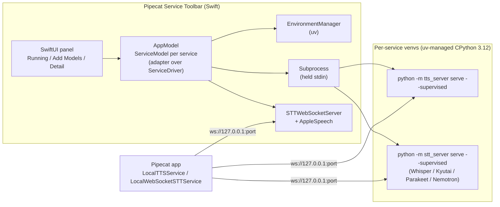
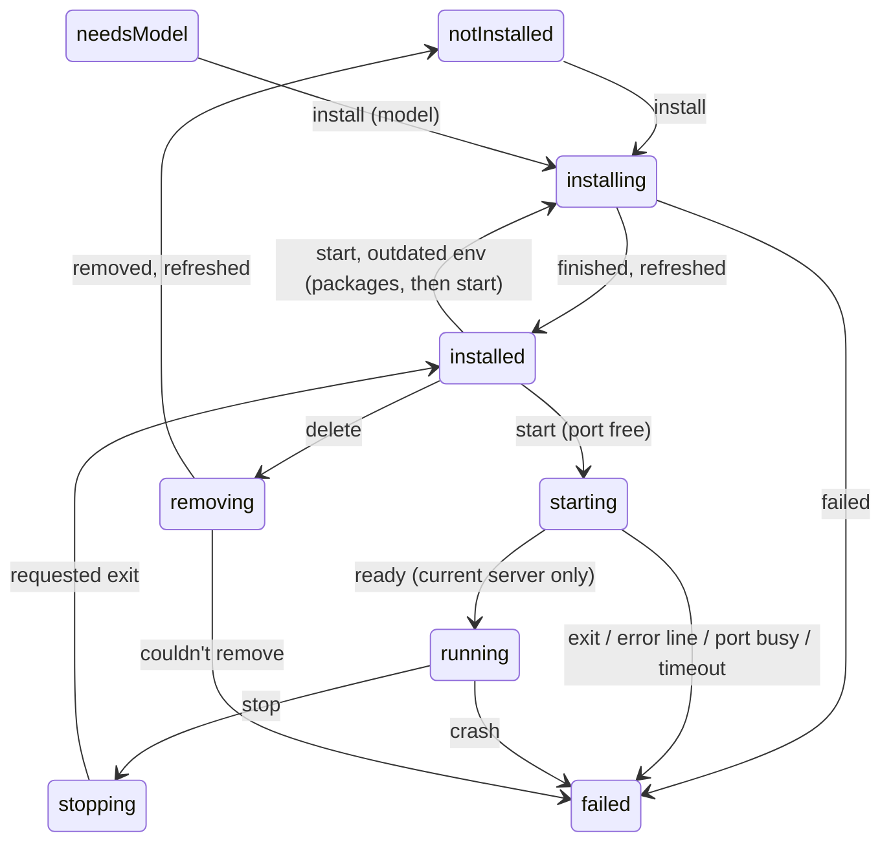
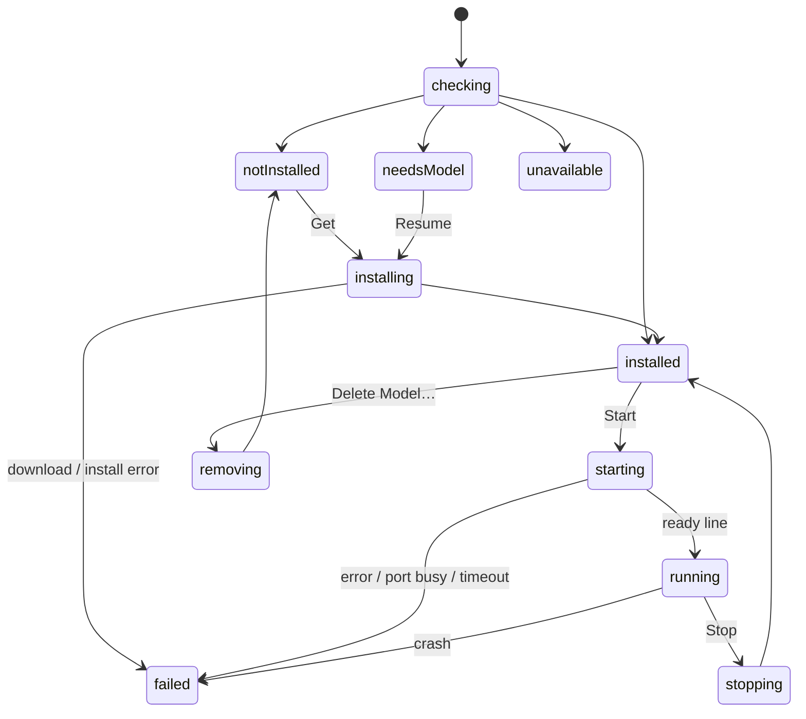

# Architecture

Pipecat Service Toolbar is a SwiftUI menu bar app. It installs local speech
services, runs each on a fixed loopback port, and supervises them. This page
covers how it fits together. For usage, see the [README](../README.md).

## Components



| Layer | Where | Responsibility |
|---|---|---|
| Catalog | `PipecatToolbarCore/Service.swift` | Each service's kind, runtime, port, model, licence and copy strings. |
| Tools | `ToolLocator.swift` | Finds `uv`, the TTS wheel, the `uv.lock` constraints: bundle first, then the overrides below, then the repo checkout. |
| Environments | `EnvironmentManager.swift` (actor) | Python, venvs, packages and model prefetch. Runs the offline cache checks and removal (which also probes outdated environments, falls back to the model's folder under `AppPaths.hubDir`, and throws `RemovalError` for model folders it cannot delete). It deletes only `models--*` folders directly in `AppPaths.hubDir` and `<backend>/<key>` folders in `AppPaths.derivedModelsDir`, whatever paths the probe reports: every component above the folder must resolve, symlinks included, to exactly that root or `<root>/<backend>`, so a symlinked backend directory can't carry a deletion outside it. Builds every command line by runtime. |
| Processes | `Subprocess.swift` | The async spawn path (one of two; the other is `PortProbe`'s blocking `posix_spawn`, see Ports). `Process` wrapper safe under Swift 6: line streams for stdout and stderr, a held stdin pipe, SIGTERM then SIGKILL to the child's process group. Its exit always resolves (`notLaunched` for a failed launch, or a `stop()` before `run()`, which refuses the launch), and `stop()` returns once no process of the group is left. |
| Ports | `PortProbe.swift` | Whether a loopback port is free and, if not, who holds it (`lsof`, plus the entry's `launchdLabel` agent, named only when its `launchctl print` pid equals the `lsof` pid): the "port busy" failure in the README's Problems section. `clientCounts` is the second spawn path: blocking and synchronous (Quit needs the answer now), not `Subprocess`. |
| Download sizes | `HubSizes.swift`, `ServiceCatalog.snapshots(for:)` | Approximate download size of a service from the public Hugging Face tree API (shown in Add Models before install): the sum over every snapshot its install fetches, each at its pinned revision and through its own file filter (mlx-audio's allow patterns, dia's codec patterns, pocket_tts's `embeddings/*.safetensors`, an "all but docs" filter for the STT repos, an approximation: upstream STT `prefetch` fetches the whole repo or the config-named weights). An STT default model is sized at the commit upstream pins it to (`ServiceCatalog.sttPinnedRevisions`, upstream's `PINNED_REVISIONS`), any other STT model at its `main`. The table sits in `Service.swift` next to the model repos; a lean drift test compares it with `prefetch_specs(model)`. `prefetch --check --json` can't be the source: its events carry no allow patterns, and it needs the installed environment the size is shown before. |
| Lifecycle | `ServiceLifecycle.swift`, `ServiceDriver.swift`, `AppLifecycle.swift` | The per-service state machine and the app-wide one, UI-free. `ServiceLifecycle.reduce(_ state: inout LifecycleState, _ event: LifecycleEvent) -> [LifecycleEffect]` mutates only the state it is handed and does no I/O; it makes every phase change and guard (a ready, exit or ready timeout from a replaced server, or one after Stop or Delete, changes nothing; a requested exit only completes a Stop; an install ending during a removal leaves the phase to it). On quit each layer stops its own work: `ServiceDriver.quit()` first stops new reads and intents, then the reducer's `shutdownRequested` cancels an Apple Speech install (the app runs it; a Python install is the manager's); `EnvironmentManager.shutdown()` stops the install or prefetch step subprocess in flight and every probe, sets `shuttingDown` so no later step or probe starts (the interrupted install unwinds), and waits up to 20 s for busy families; the bootstrap's own `uv build`/`uv export` are stopped through a `ProcessRegistry`. `ServiceDriver` (`@MainActor @Observable`) runs the effects through injectable seams (`ServiceEnvironment` for `EnvironmentManager`, `ServerProcess` for `Subprocess`, `NativeSpeechServer`, the port probe, Apple Speech, the clock and the timeouts in `ServiceDependencies`) and holds the progress the UI shows. `AppLifecycle.reduce(_ phase: inout AppPhase, _ event: AppEvent) -> [AppEffect]` owns bootstrap, Reset and quit the same way ([App lifecycle](#app-lifecycle)). |
| Protocols | `TTSClient.swift`, `TTSRequestMachine.swift`, `TTSRequestDriver.swift`, `STTClient.swift`, `STTWebSocketServer.swift`, `PCMStreamConverter.swift` | WebSocket clients for both wire protocols, the TTS Try it request lifecycle (a pure state machine and the driver that runs it on a connection), plus a native stt-protocol server; `STTWire` is the one definition of the stt audio format. |
| State | `AppModel`, `ServiceModel` (`@MainActor @Observable`) | Page navigation, delete confirmation. `AppModel` is `AppLifecycle`'s adapter: it sends the events, runs the effects (the bootstrap and Reset jobs, the quit shutdown) and reads the derived flags (`AppPhase.allowsReset`, `acceptsServiceActions`) the views enable their buttons from. `ServiceModel` is a thin adapter over its `ServiceDriver`: it publishes the driver's state, forwards intents, and is the driver's `ServiceHost` (the environment manager, paths, Try it sessions, Apple Speech). |
| Audio | `AudioPlayer`, `TryItSession`, `STTTryItSession`, `AppleSpeech` | TTS playback, microphone and sample capture, SpeechAnalyzer. |
| Views | `PanelView`, `ServiceDetailView`, `Components`, `Brand` | Running list, catalog, detail page, right-click menu, catmark artwork. |

`PipecatToolbarCore` has no UI. The test target depends on it alone: unit
tests, the lifecycle tests (`ServiceLifecycleTests` on the reducer,
`ServiceDriverTests` with a fake process and environment) and the opt-in
end-to-end tests.

### Development overrides

`ToolLocator` reads these environment variables (all optional). They apply
only when the app runs without bundled tools (`swift run`, `just app-run`); a
built `.app` always uses its bundle.

| Variable | Overrides |
|---|---|
| `PIPECAT_TOOLBAR_UV` | The `uv` binary (else `~/.local/bin`, `~/.cargo/bin`, Homebrew, `PATH`). |
| `PIPECAT_TOOLBAR_WHEEL` | The TTS server wheel (used only if the file exists). |
| `PIPECAT_TOOLBAR_CONSTRAINTS` | The `uv.lock` constraints file installed with that wheel. |
| `PIPECAT_TOOLBAR_STT_CONSTRAINTS` | The folder of hash-pinned `stt-<engine>.txt` constraints (else `macos/constraints/` of the checkout). Outside the bundle a missing file installs unpinned; a bundled build refuses the install instead (`Tools.constraints(for:)` throws). |
| `PIPECAT_TOOLBAR_REPO` | The repo checkout to build the wheel from when no wheel is given. |
| `PIPECAT_TOOLBAR_E2E` | Set to `1` to run the end-to-end tests (real installs). |

## Runtimes

Each service has one of three `ServiceRuntime` values:

| Runtime | Install | Serve | Services |
|---|---|---|---|
| `ttsServer(extra:)` | `uv pip install "pipecat-local-tts-server[extra] @ <bundled wheel>"` with `uv.lock` constraints, then `python -m tts_server prefetch --json` | `python -m tts_server serve --supervised` | 8 TTS backends |
| `sttHelper(engine:requirements:)` (the case name predates the helper's removal) | `uv pip install --require-hashes <pinned PyPI requirements>` with the engine's `stt-<engine>.txt` constraints, then `python -m stt_server prefetch --backend B --model R --json` (weights follow the repo's `main`) | `python -m stt_server serve --supervised --backend B` (`B` is the entry's expected backend name; Whisper is `mlx`) | Whisper, Kyutai, Parakeet, Nemotron |
| `appleSpeech` | `AssetInventory` model download | `STTWebSocketServer` in-process | Apple Speech |

On first use, all Python services share one uv-managed CPython 3.12, stored under
`~/Library/Application Support/Pipecat Service Toolbar/python`. Each model
family gets its own venv. Kyutai's pins (`mlx<0.27`, `huggingface-hub<0.29`) clash with
the other engines' stacks, which separate venvs make harmless. An environment
marker records what the venv was built from: the wheel name for TTS, the
requirement list for STT. A mismatch triggers a package-only refresh before the
next start.

### Variants

A family can list several weights variants (Phonon full precision, 8-bit and
4-bit; Whisper Turbo to Tiny; Kyutai 1B and 2.6B). Each is a `Service` case with
its own port (the family's port + 1, 2, ...), log and state, so siblings run side
by side. They share the family's venv (`envs/<family>`) and server backend; a
variant only adds `--model` (`phonon-q8`, a Whisper repo) to `prefetch` and
`serve`. `envs/<family>/.variants/` holds one empty file per installed variant;
a venv from before variants counts the service its marker names, and is moved
to variant records (`EnvironmentManager.adoptVariants`, one rename) before any
sibling's install or Cancel changes its marker, so its builder stays installed.
Installing a
second variant downloads only its weights. Installs and removals on one family
are serialized. Deleting a variant keeps the files an installed sibling still
uses (Phonon's variants share one Hugging Face repo; the 8-bit and 4-bit
conversions are their own), and the venv goes with the last variant. In Add
Models, a family's uninstalled variants share one row that expands to list them;
once installed, each is an ordinary row.

## Lifecycle state machine

Each service's phase is `ServiceLifecycle.reduce`'s alone. The UI's intents and
every asynchronous result (install progress and ending, a server's ready line,
`error` line, exit or ready timeout, the port probe, a removal's steps) arrive
as `LifecycleEvent`s; the reducer returns `LifecycleEffect`s, which
`ServiceDriver` runs in order and whose results come back as events.



Every launch gets a `ServerID`; events name the server they come from, so one
from a replaced server is ignored. The guards: a ready flips only the current
server's `starting`; a requested exit only completes a Stop; a removal owns the
phase over an install it cancelled; Start never runs during a removal or with a
server up. The reducer's own quit step (`shutdownRequested`) cancels an Apple
Speech install and waits for it at most `installDrain`; the rest of quit, every
install or download step, every probe and up to 20 s for busy families, is
`EnvironmentManager.shutdown()`'s ([Supervision contract](#supervision-contract),
item 4). Reset of a stale layout is refused while a server, install or removal
is live (`LifecycleState.blocksReset`).

Late async results follow one rule (`ServiceLifecycle.reduce`): a result is
applied only if the owner it was issued for is still current, and the phase
still permits it. For a one-shot read (a refresh: `environmentRead`, then
`refreshed`) the owner is the epoch it was issued under. For work with a
lifetime it is the slot that work was recorded in: `install`, `probe` and
`removal` hold the epoch they started under, and `server`/`native` the
`ServerID` of the launch (readiness, `error` lines, the ready timeout and the
exit name it). A stale result changes no state, the epoch included (a stale
native bind only releases the server it holds: `discardNative`).
`LifecycleState.epoch` advances on every event except the closed non-owning set
(`cancelInstallRequested`, `environmentRead`, `supervisedError`: none changes a
phase, a slot or `requested`, or issues tagged work) and except an event whose
guard rejects it (no change, no effect). It advances before the event runs, so
the work it issues is tagged with the new epoch and any older read is stale:
a second refresh, a sibling's change (`environmentChanged`), Start, Stop, Delete
or an install each invalidate the read in flight. A read orphaned that way is
dropped when `LifecycleState.dropsOrphanedRead(after:)` holds, and issued again
otherwise; its doc comment is the one statement of the rule. In short: live work
owning the phase (`hasLiveWork`, every end of which re-reads or shows a failure,
a completed Stop included) or the event that entered `.failed` (a retry's equal
`launchFailed` included) drops it, so a failure is replaced only by a read issued
while it is shown (Dismiss's, a bootstrap's or Reset's), never by the one its
failing event orphaned.
`.external` is the exception: it counts as live work but has no end that re-reads
until the server is lost, and its `isInstalled` reads the `requested` and
environment the read records. So every transition into External issues a read
itself (`adopt`, the one producer of `.external`: discovery, a Start-path probe, the
`EADDRINUSE` chain), because the owner it ends (a Start-path probe) or an earlier one
may have dropped the read in flight; and while External, an orphaned read is issued
again. The invariant: once a transition into `.external` has run, a read under the
current epoch is in flight or has landed since. Its answer records those fields and
never moves the External phase; it never carries a start, and staying External
(a re-probe's found) issues none.
A current read re-reads the environment but moves the phase only when nothing
owns it, so Reset, Try Again or a sibling's refresh never hides a running server
or undoes a Delete (nor a failure, as above). A port probe lives only while the phase is `starting` with
no server, so a launch ends it and its late answer can't fail the server; Cancel
during it drops it and re-reads the phase. A probe that ends any other way than
its own answer (Stop, a launch, a removal, a second Start) is cancelled
(`cancelProbe`, keyed by its tag, always the first effect, so Stop's re-read
and its cache probe never delay it): the driver keeps each probe task until it
ends, its `lsof` is stopped on cancel (`PortProbe.collect`), and the driver's
`shutdown()` cancels and waits for every probe, so none outlives Stop or quit. The package refresh before a start
(`refreshThenStart`) is a flag on its read: if the read is orphaned (Delete
during it) the start is dropped with it, so a stale read never starts a service.
An Apple Speech refresh that finds the system already downloading the model
attaches an install task to that download, so its progress and Cancel work; a
Cancel sticks (`declinedSystemDownload`): while the system still reports
downloading, the refresh reads it as not installed until the status moves on or
the user presses Install. A launched server's output readers belong to its
`ServerID`: they stop at its exit and drop any line read once it is no longer
current, so a descendant holding the pipes can't write into the next launch.
`ServiceLifecycleTests.everyKindIsClassified` checks {every event kind} x {every
phase} x {current, stale} against an independent, compile-time exhaustive
classification table; the other tables cover refresh x owner, the port probe
(and its cancel), and every exit.

## App lifecycle

The app-wide phase is `AppLifecycle.reduce`'s alone (`AppModel` is its
adapter): `idle | bootstrapping | resetting | ready | failed(message) |
shuttingDown`, driven by `bootstrap` (launch), `retry` (Try Again), `reset`,
`quit` and the job ends `bootstrapDone`, `bootstrapFailed`, `resetDone`. One
rule: at most one job (a bootstrap or a Reset) runs, and the phase names it. The
intent moves the phase synchronously, before the job's task starts, so a second
Try Again or Reset in the same window is refused. Try Again is offered only in
`failed` (`canRetryBootstrap`). Reset is offered by one predicate the reducer
reads too, `AppPhase.allowsReset(servicesBusy:)`: `ready`/`failed` with no
service's live work (`LifecycleState.blocksReset`). "Checking services…" shows
in `idle` and while a job runs. A Reset swaps the manager out, shuts the old
one down (its probes stopped), deletes the environments, then bootstraps as the
same job's tail. A Python service's Get, Start and Delete are enabled only by
`AppPhase.acceptsServiceActions`: a manager installed and no job in flight (a
Reset takes the manager away while the rows still show the old state), never
after quit; Apple Speech needs neither. The intents refuse them too.
Quit is accepted from every phase but `shuttingDown`: it always runs the full
shutdown (every service's, the bootstrap's subprocesses, the environment
manager's installs and cache probes), even when no service is busy, then waits
for the job in flight; after quit no job's end moves the phase or starts
another. Each service's part starts with `ServiceDriver.quit()`; the app sets its
`quitting` flag (`beginQuit()`) already in the turn that accepts the quit, before the
shutdown task runs: `AppModel.beginShutdown()` (the synchronous half of `shutdownAll()`)
sends `.quit` from `applicationShouldTerminate`'s accepted arms before it returns
`.terminateLater`, and from the power-off observer, never from a deferred task and never
on a Cancel. So a probe answer queued meanwhile launches nothing, and a ready, failure or
exit queued meanwhile is folded with `quitting` and can't move the wanted flag. From then on no
read is issued or lands and no intent starts work, so a refresh the bootstrap
issued late (or one in flight) can't attach an Apple Speech install the
shutdown already passed. The download-size lookup starts only from a bootstrap
that ended the job, and quit cancels it. `AppLifecycleTests` checks {every
phase} x {every event} against an independent table written per event, then per
phase, with no `default` (a new phase or event fails to compile), the Reset
button against the reducer, the action gate, plus the concrete sequences (Try
Again twice, Reset twice, quit during a Reset or a bootstrap).

## Restore and quit guard

**Wanted flag.** The app persists the set of services it should run (`restore.wanted`
in `UserDefaults`, `WantedServiceStore`). `WantedTransition.rule` gives every event kind two
effects in one exhaustive switch, one before quit began and one after, and `next` takes
`quitting` with no default, so a new kind or caller must choose. Before quit: a change into
`failed` (from a phase that was not already `failed`) clears the flag; otherwise
`stopRequested` and `removeRequested` clear it, a service newly running (`ready` or
`nativeBound` while the phase was not already `running`) sets it, anything else keeps it.
Once quit began (`ServiceDriver.quitting`) the failure rule is off and only `stopRequested`
and `removeRequested` clear; every other kind keeps, so a `ready` the shutdown drain still
reads, or a failure the shutdown causes, never changes what the next launch restores. The
driver refuses `remove()` and every other new intent but Stop once quitting, so in practice
only a Stop moves the flag after Quit; which events can arrive is the driver's gate, what each
does to the flag is only `WantedTransition`. Reset clears the whole set.

**Where the set lives.** `restore.wanted` and `restoreOnLaunch` are read and written in the
standard `UserDefaults`, or in the suite named by `PIPECAT_TOOLBAR_DEFAULTS_SUITE`
(`PreferencesDomain`, used by `ui_smoke.sh`); the other preferences (catalog tab, hub-size
cache, Try-it text) are harmless UI state and stay in the standard domain. `AppModel` builds the
`UserDefaultsWantedServiceStore` from its `preferences` and passes it to each `ServiceModel`
(no default); the protocol has only per-service `contains` / `setWanted` plus `read` (restore)
and `removeAll` (Reset), so no store can inherit a whole-set rewrite.

**Restore timing.** `RestorePolicy` plans once per process, after `bootstrapDone` and
the `ready` guard (`RestorePolicy.shouldRun`, which `AppModel` asks), from the stored set
and each service's state. The
`restoreOnLaunch` preference defaults on (its toggle is in the panel's gear menu). A stale or busy port ends `failed` and is not
retried.

**Quit guard.** `applicationShouldTerminate` decides synchronously through
`QuitGuardPolicy.decide`: a drain in progress terminates now; a prompt already showing
answers cancel; a system-initiated quit and the no-client case proceed after the
shutdown; otherwise it asks (Quit anyway / Cancel). An unknown count asks. The ask carries
the whole `QuitPrompt` (title, one line per busy service, closing sentence), so the app only
renders it; when no count could be read the title says clients may be connected. A quit is
system-initiated when `QuitReason` says so for the Apple Event's reason code, or when the
`willPowerOffNotification` flag is set (the app sets it synchronously on the main queue, so
a terminate in the same turn sees it, and begins the quit in that same turn). The delegate passes its real drain, prompt and
system-quit state to `decide`, which evaluates the blocking `lsof` count only when none of
those arms has already decided.

**Counting.** `ConnectionCount` takes one bounded `lsof` call and counts, per owned
port, server-side rows minus the server-side mirror of the app's own client sockets. A
row is excluded only when its local and peer endpoints are the swapped endpoints of a row
the app owns whose peer port is a requested service port; a bare port match is not used,
because a remote client's ephemeral port could equal an app socket's port. A socket held
on several fds of one process counts once. The count is one bounded `lsof` run with a 2 s deadline; an `lsof` still running then is sent SIGKILL before the call returns, and the result is unknown (the guard asks). The run is started with `posix_spawn` and only the call reaps it (`waitid` with `WNOWAIT` watches for the exit without reaping), so the pid it signals at the deadline is still the child's, alive or a zombie, never a reused one; the killed child is reaped within 0.2 s more, or on a background thread if it takes longer to die. A launch failure, a death by signal, any stderr output, an exit other than 0 (or 1 with no output), or an `lsof` that exited while a pipe stayed open past the deadline is also unknown; exit 1 with no stdout and no stderr is `lsof`'s "nothing matched" and counts zero. One walk of lsof's `-Fpn` grammar
(`ConnectionCount.rows`) yields every row or nothing: each process is a `p<pid>` followed by
one or more file records, each an `f<fd>` followed by exactly one `n` socket record with a port
on both ends. Any other line, an `f` without its `n`, an `n` without its `f`, or a process with
no file record gives no rows, and `ConnectionCount.clientCounts(lsofOutput:ports:appPid:)` turns that into
an unknown count for every port (asks); empty output is zero. Loopback
tunnels count as clients. Half-open peers count until keepalive reaps them (about
140 s at the TTS server's keepalive defaults; the STT servers' keepalive is not verified
here). External servers are not counted or stopped.

**Zero-drop updates.** Run the TTS server as a LaunchAgent (`just tts-install`); the
app shows it as External and Quit leaves it running. TTS servers only.

**Unverified.** The system-quit reason table is provisional (standard four-char codes;
a manual Log Out/Restart/Shut Down spike is still to run), as is a second terminate
during the alert.

## External servers

- **Adopt first.** `ExternalDiscovery` probes every catalog port (loopback TCP;
  Apple Speech never) with `ExternalProbe`, a `server.hello` with no `Origin`
  header. A hello whose backend name and model match the entry (`ServiceInfo.entry(for:port:)`)
  moves the service to `.external(port, info)`; the app starts its own server only
  when nothing answers (Start probes only a busy port; a free port launches at once,
  and a server that takes the port in between is adopted through the one re-probe
  after `EADDRINUSE`, not reported busy). One pass runs at
  bootstrap (the Phase 6 smoke reads its `<service>: external(<port>, ...)` log
  line), then one on every panel open and every 15 s while it stays open. A
  discovery result is applied only if its `externalEpoch` is current.
- **Ownership invariant.** The app only signals, stops or deletes processes it
  started. `.external` carries no pid and holds `server == nil && native == nil`;
  the reducer issues no stop, launch, install or remove effect for it (the effects
  allowed in `.external` are `.cancelProbe`, `.openTryIt` and `.tearDown`, plus a
  state re-read; the reducer never issues `.probePortOwner` for `.external`; the
  read-only owner lookup that confirms an agent's label is
  `ServiceModel.refreshExternalOwner` calling `PortProbe.owner` (through the
  driver's `ServiceDependencies.portOwner` seam) on each discovery
  pass, outside the reducer), and the views do not offer a per-service
  Stop, Delete, Get or Install (each External row reads its buttons from
  `ExternalPresentation.Actions`). Reset is app-wide (`AppEvent.reset`), gated by
  `blocksReset`, which is false for `.external`: it deletes only the app's own
  `envs` directory and layout file, clears `restore.wanted` (`AppEffect.clearWantedServices`,
  before `runReset`), and never signals or stops an External server. STT Try it on an External row offers the test
  clip, not the microphone: the server is trusted by its hello alone. Quit leaves it
  running ("Quit" when `ServiceCounts.owned == 0`, else "Stop All & Quit"), and waits
  for the discovery pass it cancels (`SerialPass`), so no probe or owner lookup
  outlives the app.
- **Support floor.** STT is app-started through `pipecat-local-stt-server==0.5.0`;
  older STT servers are adopted by hello only.
- **Beside LaunchAgents.** `just tts-install` and `just stt-*` agents use the same
  ports, so they show as External; the source line is the agent's label when
  `PortProbe.owner` confirms the `launchctl print` pid equals the `lsof` pid, else
  `127.0.0.1:<port>`. The lookup runs on every discovery pass and its answer lands
  only for the adoption it started under (`ExternalPresentation.OwnerLookup`,
  gated by `externalEpoch`). A holder that does not identify as the service (different
  backend or model, silent, timed out, or wants a token) makes Start fail with
  `.portBusy`; it is named only when `launchctl` or the hello identifies it.
- **Not discovered:** Unix sockets, LAN endpoints, token-protected servers (Start
  reports the port busy because it wants a token).

## Known follow-ups

Left as they are on purpose, across both lifecycles and their adapters:

- `ServiceLifecycle`: `discardNative` and
  `stopServer(id)` are not executed keyed by `ServerID` (the driver keeps
  unkeyed handles); `isCurrent` repeats the classification `Kind.owner`
  encodes; `shutdownRequested` marks `shuttingDown` only for an Apple Speech
  install, so the quit gate on reads lives in the driver (`ServiceDriver.quitting`)
  rather than the reducer.
- Shell-held rules (`AppModel`, `AppDelegate`): `runBootstrap` installs the
  located tools as the manager only while `phase == .bootstrapping` (no
  `toolsLocated` event), and starts the size lookup only once the phase is
  `ready`; the delegate's `terminateReplyPending` is AppKit's terminate
  handshake, not quit state (power-off moves the phase without a terminate,
  which must still wait), and a second terminate while the reply is owed
  returns `.terminateNow`.
- External discovery covers loopback TCP on the catalog ports only. Left for
  later: Unix-socket discovery (the servers' `--socket-path` mode), LAN endpoints,
  and token storage (a non-loopback server requires a bearer token; the app stores
  none, so Start reports such a server's port busy because it wants a token).
- Out of scope: the TTS 24000 Hz fallback rate when a ready line has none; the
  STT Try it phase logic; the loopback token.
- Native Apple Speech server: a listener failure after it reported ready is not
  reported, so the row keeps showing Running on a dead port (rare; liveness
  checks planned with attach support). `AudioPlayer` never removes its
  notification observer (the fix needs Swift 6.2). The Add Models download
  sizes load one request at a time.

## Supervision contract

Every Python server, and the native server, follows one contract.

1. **Ready line.** The server prints one JSON line to stdout once it is
   listening and warm:
   `{"event":"ready","backend","model","host","port","socket_path","rate","pid"}`
   (`socket_path` is `null`; the app always serves TCP).
   Everything else goes to stderr. That output is copied to the service's log
   file and the in-app log tail.
2. **Startup errors.** A fatal startup error prints
   `{"event":"error","code",...}` and exits 1. The codes are `EADDRINUSE`,
   `EACCES`, `SocketPathConflict` (TTS only), `ModuleNotFoundError`,
   `ModelDownloadError`, `ConfigError`, `BackendStartError` and `ModelInvalidError`
   (STT only). `docs/supervised-contract.json` lists them per emitter, and
   `SupervisedErrorCode` in Core is their union (lean tests keep the `tts` list equal
   to `tts_server/supervise.py`, the `stt` list to the recorded upstream release, and
   the enum to both). A busy port is reported
   before any model loads. The app judges an exit only after stdout is drained
   (`Subprocess.waitForExit(after:)`), so the final error line is never lost to
   the exit, and it ignores a `ready` that arrives once Stop or Delete began.
3. **Stdin EOF.** The app holds the server's stdin. EOF means the app quit or
   crashed, and the server shuts down as if sent SIGTERM. So a server the app
   started never outlives it. An External server (one the app adopted, not
   started) is not the app's child and keeps running after Quit by design.
4. **Stop.** Stop sends SIGTERM and closes stdin, then sends SIGKILL after
   10 s. Quitting the app (once the [quit guard](#restore-and-quit-guard) lets it: a quit
   with clients connected asks first and can be cancelled) stops all the servers it started,
   in parallel, and leaves External servers running; `EnvironmentManager.shutdown()` stops the install or download step subprocess in flight and every probe (SIGTERM, then SIGKILL after 5 s) and sets `shuttingDown`, so no later install step or offline `prefetch --check` probe starts and the interrupted install unwinds; it then waits up to 20 s for busy families (installs, removals) before the app exits. The bootstrap's repository wheel build is stopped the same way. Cancelling an install sends SIGTERM, then SIGKILL after 5 s, and reads as a cancellation (`AsyncThrowingStream.consume`), never as a finished install. Delete cancels an install in flight and waits for it to unwind first. An install queued behind a sibling's leaves the queue when cancelled and records nothing; the variant marker (`.variants/<service>`) is written only once packages are in and no Cancel has landed, so a cancel during the model download leaves the variant installed with weights to resume (needs model). An install step waits at most 2 s after its process exits for the output pipes to close (a grandchild such as a build backend can hold them), so the family lock is always released. Signals go to the child's process group, and a stopped step ends only once its descendants are gone too, so a removal or the next install never races a surviving grandchild. Once the child is reaped its pid may be reused, so a stop after that signals the group only while no process holds the pid (a group with members keeps its id reserved); a live process on it is another one and is left alone. A server exit the app asked for only completes a Stop (`stopping` -> `installed`); reported after the stdout drain, it never overrides a removal that finished first. Quit also cancels an Apple Speech model install and waits up to 5 s for it.

`tts_server` implements this natively (`serve --supervised`,
`tts_server/supervise.py`). The STT engines get it from the upstream
`pipecat-local-stt-server==0.5.0` CLI (`python -m stt_server serve --supervised`,
`prefetch --json`); the app no longer wraps `stt_server`. Older STT versions lack
it, so an STT server on one is adopted by its hello but never app-started.

## Protocols

- **TTS.** This repo's `docs/protocol.md`. Clients send JSON text, then commit.
  Audio streams back as base64 pcm16 deltas at the model's rate. The app's
  `TTSClient` plays it through `AVAudioEngine`, coalescing 20 ms frames into
  100 ms buffers. A Try it request's whole lifecycle is one pure reducer,
  `TTSRequestMachine` (`(phase, event) -> (phase, [effect])`), run on the
  connection by `TTSRequestDriver`; `TryItSession` only turns clicks into its
  events and its effects into playback and the card's phase.

  ```
  idle/done/refused/failed ──speak──▶ connecting ──connected──▶ clearing ──sent──▶ appending ──sent──▶ committing
                                                                                                  │ committed
       done ◀──audio.done / cancelled── inFlight(response_id) ◀──────────────────────────────────────┘
  Stop or a refusal after the commit ──▶ cancelling (cancel sent) ──its response ends / commit refused──▶ ending, then the next request
  ```

  - Every request is `input_text.clear`, `append`, `commit`, each sent once the
    one before it is on the wire: the server keeps its buffer on any refusal for
    a retry Try it never makes, so the clear stops that text prefixing the next
    request, and Stop before the commit sends no commit at all.
  - Stop after the commit sends `response.cancel` behind it (a cancel before the
    commit is a no-op, and the commit would hold the connection's one in-flight
    slot), and the stopped request stays `cancelling` until the server answers;
    a Speak meanwhile waits for that (docs/protocol.md §3). So requests are serial
    on the wire and at most one commit is ever unanswered.
  - Each frame carries an `event_id` (`tryit-N.clear`, `tryit-N.append`,
    `tryit-N`); the server echoes it as `previous_event_id` on
    `input_text.committed` (which names the `response_id`) and on any `error`
    refusing it (`{type: "error", error: {code, message}}`). Audio, done,
    cancelled and failed act only by that `response_id`, errors only by that id;
    everything else is dropped, so a late cancel, audio or refusal of a stopped
    request never touches the next one.
  - Each request's outcome (finished, stopped, refused, failed) is reported once.
    A lost connection fails the live request; 300 s with nothing from the server
    while a request is live (`timeout`) drops the connection, which also frees
    the server's slot. An output-device change mid-utterance ends the request with
    a message.

  `TTSRequestMachineTests` pins every (state, event) cell against
  `Fixtures/tts_request_machine_table.txt`, replays random interleavings against
  a model server asserting those invariants, and drives the real tone server
  through busy, Stop mid-flight, Stop before the commit, a refused voice and a
  dropped connection.

  STT Try it (`STTTryItSession`) stays in the app shell, unextracted: it is one
  record-or-sample, one commit, one reply per connection, with no reused buffer,
  no barge-in cancel and no in-flight slot to strand, so none of the ordering
  hazards that made the TTS request a machine exist; its states are tied to
  `AVAudioEngine` capture and the microphone permission, which only the app
  target can drive. It would move into Core with its own reducer if it gains
  streaming or reuse.

  `docs/protocol.md` states the wire rules a reused connection must keep (clear
  after an abandoned refusal, cancel only after the commit it stops); clearing
  before every request, as Try it does, is the SHOULD it recommends.
- **STT.** The protocol of
  [pipecat-local-stt-server](https://github.com/vr000m/pipecat-local-stt-server).
  Clients send binary pcm16 at 16 kHz mono, then `input_audio_buffer.commit`.
  The reply is `…transcription.delta` followed by `…completed`.
  `STTWebSocketServer` covers the full event set:
  - `session.update` (with `turn_detection: null`);
  - base64 append;
  - `clear` and `status`;
  - `session.close` and `session.cancel`;
  - errors.

  It rejects requests with an `Origin` header, as the Python servers do. It
  serves at most 8 clients at once and runs their transcriptions one at a
  time, and closes a client with more than 1 MiB of replies it has not read. A connection holds the server weakly, so its late callbacks after Stop
  are safe. Microphone and sample audio go through one resampler per recording
  (`PCMStreamConverter`), so buffer edges join without seams.

## Service state



State is rebuilt from disk on every launch, never persisted:

- **Environment:** the venv plus its marker.
- **Weights:** an offline `prefetch --check`.
- **Apple Speech:** `AssetInventory.status`.

Live process state is never persisted: every server the app starts dies with it. What
is persisted is the wanted set (`restore.wanted`), and the next launch restarts those
services (see [Restore and quit guard](#restore-and-quit-guard)). A server the app did not
start is never restored: discovery finds it again at launch and shows it as External (Quit
leaves it running).

### Delete

- **Delete Model…** (right-click) asks first, then removes the service with its
  model files: `remove(deleteModel: true)`.
- The detail page's **Delete…** offers **Keep Model Files**
  (`deleteModel: false`: only the environment, or the variant's record in a
  shared one) and, for a service with downloaded weights, **Delete Everything**
  (`deleteModel: true`).
- Order: an install in flight is cancelled and unwinds first (dropping the
  family lock), then the server is stopped, then `EnvironmentManager.remove`
  runs under the family lock. The family environment goes with its last
  installed variant; otherwise only the variant's `.variants/<service>` record.
- What Delete Everything deletes: every repo the variant's offline check names
  (cached or partial) plus its model repo and derived weights, minus anything an
  installed sibling's check names (Phonon's variants share the model and voices
  repos). A sibling whose check gives no answer (it failed, or quit stopped it)
  keeps every candidate folder. Only folders inside the model roots are
  deleted.
- Leftovers are reported, never silent: a folder kept for an unanswered
  sibling, one the deletion guard refuses, or one that can't be deleted fails
  the removal with `RemovalError` ("Couldn't remove", listing each path), after
  the environment itself is gone.

The **main menu** lists services that are *active*: starting, running, stopping,
or failed at runtime. **Add Models** lists the rest by kind, split into
Installed and Available.

## Packaging

`macos/scripts/build_app.sh` assembles `Pipecat Service Toolbar.app` in six steps:

1. Builds the TTS wheel (`uv build`) and exports `constraints.txt` from
   `uv.lock`.
2. Fetches the pinned `uv` release and verifies its SHA-256.
3. Compiles a release build.
4. Renders the icon from the vector catmark (`--render-icon`).
5. Copies `uv`, the wheel, the constraints and the checked-in STT
   constraints (`macos/constraints/stt-*.txt`) into `Contents/Resources`.
6. Codesigns inside-out with the hardened runtime. The only entitlement is
   microphone input, for STT Try it.

Python itself is not bundled, and the bundle is about 43 MB, mostly `uv`.

`just app-open` and `just app-install` build with `build_app.sh`, then call
`macos/scripts/quit_app.sh <bundle-id>`, which quits a running copy and waits for it to
exit (the quit is asynchronous, and the app stops its servers first) before launching
the new build or replacing the installed bundle; `QUIT_WAIT_SECS` (default 30) is one
deadline for the whole step (the exact bound and exit codes are in the `quit_app.sh`
header), an osascript call that ignores SIGTERM is killed, and no osascript outlives the
script on any exit path; an osascript failure stops the recipe rather than reading as
"not running". Before the build, both take the signing identity from
`macos/scripts/resolve_sign_identity.sh`, where both recipes choose their default (`Code
Signing`; `build_app.sh` alone keeps its ad-hoc default for `just app-build`): an
explicit `SIGN_IDENTITY` wins; unset, `app-open` gets `Code Signing` when the keychain
has it, else ad hoc, and `app-install` (`--require`) fails before the build. It asks the
keychain through `macos/scripts/has_sign_identity.sh <identity>`, which reads the
identity as codesign does: exactly 40 hex digits is a SHA-1 hash, matched in any case
against the listed hashes alone; anything else is a case-insensitive substring of the
quoted identity names. Nothing else (the header, a partial hash, the status) matches,
and it fails (exit 2) when `security` itself fails. The check is advisory: it does not
detect two identities sharing a name, which codesign decides at signing.

uv 0.12.5 splits a `--constraint` path at spaces, and the bundle path has
them. So the install step runs from the constraints file's folder and passes
the bare file name.

### Pins

- **STT packages.** `macos/constraints/stt-<engine>.txt` pins every transitive
  dependency of an engine's requirements with sha256 hashes, resolved for
  CPython 3.12 on arm64 macOS 15. They are generated, checked in (so a build is
  reproducible offline) and installed with `--require-hashes` (verified for every
  dependency, mlx and torch wheels included, with uv 0.12.5). After changing a
  requirement in `Service.swift`, regenerate them (network needed):
  `uv run python macos/scripts/compile_stt_constraints.py`. The TTS export from
  `uv.lock` stays `--no-hashes`.
- **STT weights are pinned upstream, not by the app.** `pipecat-local-stt-server` 0.5.0
  pins the four default models (Whisper large-v3-turbo, Kyutai 1B, Parakeet, Nemotron) to
  a recorded Hub commit in code (`PINNED_REVISIONS`); `prefetch --json` `start`/`check`
  events carry that `revision` (null for any other `--model`, which follows `main`). It has
  no revision flag, so the app passes none; the app's own size estimate
  (`ServiceCatalog.snapshots(for:)`) reads the same commits (`sttPinnedRevisions`, drift-tested
  against the recorded upstream excerpt) and `main` for any other model.
- **TTS weights.** Two snapshots are pinned to a commit, the same pins the backend
  modules pass (`ServiceCatalog.snapshots(for:)`, drift-tested against
  `prefetch_specs(model)`): Phonon's weights and Pocket TTS's voice embeddings
  (`kyutai/pocket-tts-without-voice-cloning`). Every other TTS repo, Pocket TTS's
  model and Dia's codec included, follows `main`.
- **Fingerprints.** Neither TTS weight pin is part of
  `Tools.fingerprint(for:)` (the TTS wheel name, or an STT engine's requirement
  list), so refreshing one never marks an existing environment outdated. A pin refresh
  reaches an existing environment only with its next package reinstall.

### Supervised contract

The app reads the same JSON lines from two independent emitters: `tts_server`
(`serve --supervised`, `prefetch --json`) and the upstream `stt_server` CLI. Their events,
fields, types and error codes are fixed in `docs/supervised-contract.json`.
`tests/test_supervised_contract.py` runs the TTS emitter on stub inputs and checks each
line against it. The lean job cannot install the STT server, so the STT side is checked
against recorded upstream artifacts instead: a real 0.5.0 `ready` and `error` line
(`tests/fixtures/stt_supervised_lines.jsonl`), a real 0.5.0 kyutai `prefetch --check --json`
(`tests/fixtures/stt_prefetch_check_lines.jsonl`: the `check` row then the `summary` that
`EnvironmentManager.cacheStatus` reads, recorded offline on an empty cache and re-recorded by
the opt-in `-k verbatim` run), and a verbatim excerpt of the 0.5.0 source
(`tests/fixtures/stt_server_0.5.0_source.txt`: its `CODE_*` error codes and backend
registry, checked against the live package too where it is importable). The test also
checks the Swift decoder (`ServerCLIEvent`), the error codes (`SupervisedErrorCode`, the
union of both emitters' lists) and the stt wire rate (`STTWire.rate`) against the contract.

## Testing

| Suite | What it covers |
|---|---|
| Swift unit (`swift test`) | Line splitting, event decoding, PCM conversion and the one stt wire format, catalog ports and copy strings, variant commands, shared environments and deletion sets, the deletion roots (on disk, with symlinked leaves, backend directories and roots), logo parsing, `Subprocess` stdin and kill handling, exit-after-drain ordering and its lifecycle table (launch failure, stop before launch, descendants that obey or ignore SIGTERM), install cancel (kill escalation, cancellation vs finish, a cancelled queued install, every install ending against the variant marker, every child ending against the family lock), no probes after quit, a removal during quit keeping what a sibling may use, a reaped child's reused pid never signalled, the Try it request machine over every (state, event) cell (`Fixtures/tts_request_machine_table.txt`) and over random interleavings against a model server with its invariants asserted, real server frames driving it (`Fixtures/tts_wire_frames.json`, which also holds the request frames the server was sent), the driver's silence timeout, the lifecycle reducer's whole state space (every event against every phase, with the server current or replaced, Stop or removal under way, and quit under way) and its exits against every phase, the driver's start/ready/stop, late ready, ready timeout and supervised error, and quit during an Apple Speech install, download-size filters and pins, seamless resampling, `STTWebSocketServer` round trip, busy port, Origin rejection, stop during startup, connections outliving the server, the connection cap and one-at-a-time decodes, the unread-reply cap, which processes get `HF_TOKEN`. |
| Live tone (needs `.venv`) | A supervised tone server, `TTSClient` speak (no `Origin` header, so no 403); `TTSRequestDriver` on one connection through a normal request, a busy refusal then retry, Stop mid-flight, Stop between append and commit, a refused voice and a dropped connection (reconnecting), and Stop while connecting. |
| End-to-end (`PIPECAT_TOOLBAR_E2E=1`) | Real installs of tone, phonon, Phonon 8-bit beside phonon, Whisper Tiny, Kyutai, Parakeet (needs `ffmpeg`) and Nemotron against the built bundle, then serve and use each. |
| Python (`uv run pytest`) | `serve --supervised`, `prefetch`, a drift test that ties the app's TTS ports to the README and `justfile`, and `test_macos_catalog_drift.py`, which parses `Service.swift` (one parser, `tests/_macos_catalog.py`, variants included) and checks its backend names, ports (unique across variants), default model repos, streaming flags, Phonon `--model` aliases and the download-size snapshot table (against `prefetch_specs(model)`) against the Python sources and the `justfile`, and checks the Try it wire fixture against a live server; `test_supervised_contract.py`, which runs the TTS server on stub inputs and replays recorded `stt_server` 0.4.0 lines (`tests/fixtures/stt_supervised_lines.jsonl`), checking every JSON line, per-emitter error code (`ModelInvalidError` is STT-only; the STT list equals the `CODE_*` set of a verbatim 0.4.0 source excerpt, `tests/fixtures/stt_server_0.4.0_source.txt`, which also backs the STT backend names and default models in the catalog drift test), the Swift decoder's keys and `STTWire.rate` against `docs/supervised-contract.json`, and the STT constraints against each engine's requirements. |
| Visual (`--snapshot <dir>`) | Renders every page in light and dark from sample states. |

## Security notes

- **Loopback only.** Every listener binds `127.0.0.1`, and requests that carry
  a browser `Origin` are refused. No auth tokens are configured because the
  app serves loopback only; any local process can connect. What a token would
  take, and why it is not done: [`loopback-auth.md`](loopback-auth.md).
- **Credentials.** `HF_TOKEN`, when set, reaches only `prefetch` and `serve`
  (`ProcessEnvironment.huggingFace()`), never `uv`, whose package builds run
  third-party code.
- **No sandbox.** The app has no App Sandbox, so it can start `uv` and the
  per-service interpreters. The hardened runtime is on.
- **Pinned downloads.**
  - `uv` is pinned to a version and SHA-256.
  - TTS packages follow `uv.lock`; STT packages are hash-pinned to the last
    transitive dependency (see Pins).
  - Phonon's weights and Pocket TTS's voice embeddings are pinned to a commit.
    Other TTS repos (Dia's codec included) follow `main`; the default STT models are
    pinned by upstream 0.5.0 itself and other STT models follow `main`.
- **Logs.** The app never writes audio or transcripts to disk itself. Each
  service's log file holds what that server prints at INFO level, plus the
  app's start and stop markers.
