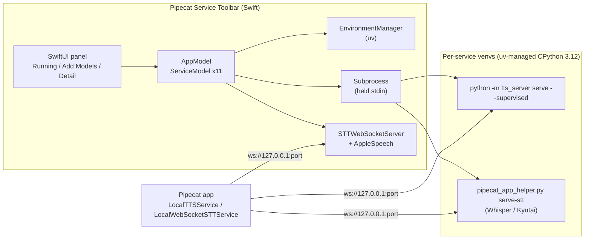
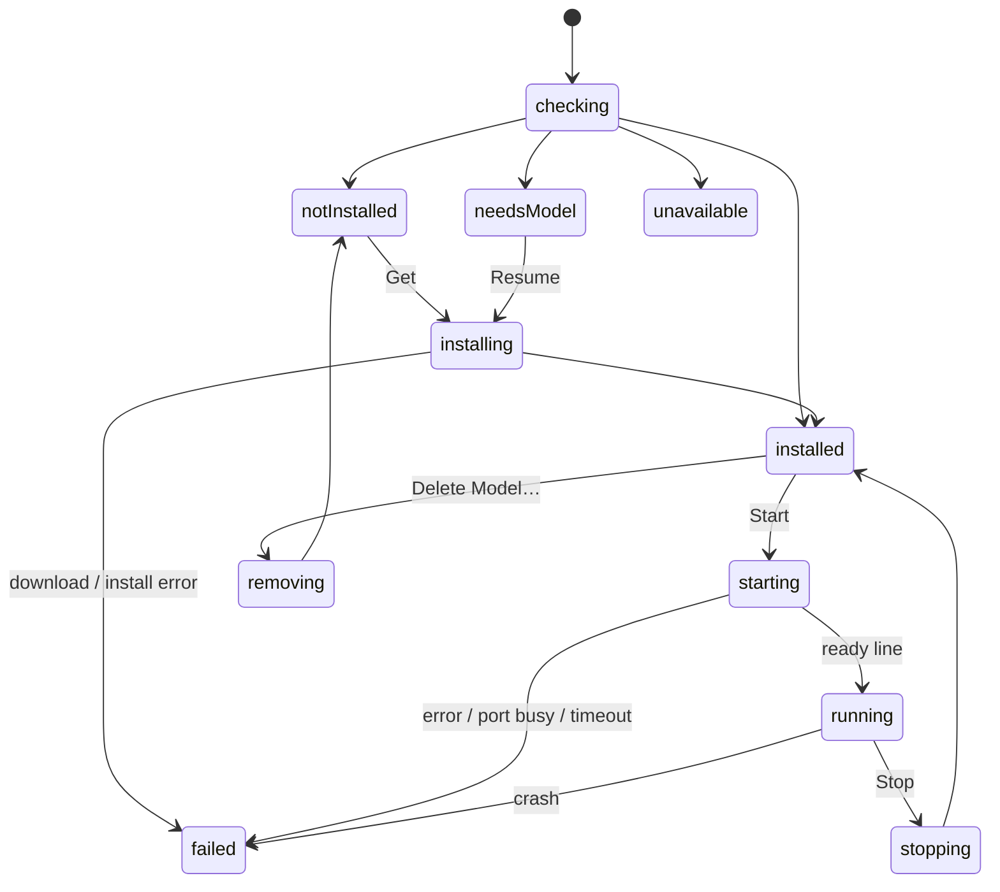

# Architecture

Pipecat Service Toolbar is a SwiftUI menu bar app. It installs local speech
services, runs each on a fixed loopback port, and supervises them. This page
covers how it fits together. For usage, see the [README](../README.md).

## Components

| Layer | Where | Responsibility |
|---|---|---|
| Catalog | `PipecatToolbarCore/Service.swift` | Each service's kind, runtime, port, model, licence and copy strings. |
| Tools | `ToolLocator.swift` | Finds `uv`, the TTS wheel, the `uv.lock` constraints and the STT helper: bundle first, then `PIPECAT_TOOLBAR_*` overrides, then the repo checkout. |
| Environments | `EnvironmentManager.swift` (actor) | Python, venvs, packages and model prefetch. Runs the offline cache checks and removal. Builds every command line by runtime. |
| Processes | `Subprocess.swift` | `Process` wrapper safe under Swift 6: line streams for stdout and stderr, a held stdin pipe, SIGTERM then SIGKILL. |
| Protocols | `TTSClient.swift`, `STTClient.swift`, `STTWebSocketServer.swift` | WebSocket clients for both wire protocols, plus a native stt-protocol server. |
| State | `AppModel`, `ServiceModel` (`@MainActor @Observable`) | Per-service phase machine, page navigation, delete confirmation. |
| Audio | `AudioPlayer`, `TryItSession`, `STTTryItSession`, `AppleSpeech` | TTS playback, microphone and sample capture, SpeechAnalyzer. |
| Views | `PanelView`, `ServiceDetailView`, `Components`, `Brand` | Running list, catalog, detail page, right-click menu, catmark artwork. |

`PipecatToolbarCore` has no UI. Unit tests and the opt-in end-to-end tests
target it.

## Runtimes

Each service has one of three `ServiceRuntime` values:

| Runtime | Install | Serve | Services |
|---|---|---|---|
| `ttsServer(extra:)` | `uv pip install "pipecat-local-tts-server[extra] @ <bundled wheel>"` with `uv.lock` constraints, then `python -m tts_server prefetch --json` | `python -m tts_server serve --supervised` | 8 TTS backends |
| `sttHelper(engine:requirements:)` | `uv pip install <pinned PyPI requirements>`, then `helper prefetch --repo R --json` | `helper serve-stt --engine whisper\|kyutai` | Whisper, Kyutai |
| `appleSpeech` | `AssetInventory` model download | `STTWebSocketServer` in-process | Apple Speech |

On first use, all Python services share one uv-managed CPython 3.12, stored under
`~/Library/Application Support/Pipecat Service Toolbar/python`. Each model
family gets its own venv. Kyutai's pins (`mlx<0.27`, `huggingface-hub<0.29`) clash with
the other engines' stacks, which separate venvs make harmless. An environment
marker records what the venv was built from: the wheel name for TTS, the
requirement list for STT. A mismatch triggers a package-only refresh before the
next start.

### Variants

A family can list several weights variants (Phonon full precision, 8-bit and
4-bit; Whisper Turbo to Tiny; Kyutai 1B and 2.6B). Each is a `Service` case with
its own port (the family's port + 1, 2, ...), log and state, so siblings run side
by side. They share the family's venv (`envs/<family>`) and server backend; a
variant only adds `--model` (`phonon-q8`, a Whisper repo) to `prefetch` and
`serve`. `envs/<family>/.variants/` holds one empty file per installed variant;
a venv from before variants counts the service its marker names. Installing a
second variant downloads only its weights. Installs and removals on one family
are serialized. Deleting a variant keeps the files an installed sibling still
uses (Phonon's variants share one Hugging Face repo; the 8-bit and 4-bit
conversions are their own), and the venv goes with the last variant. In Add
Models, a family's uninstalled variants share one row that expands to list them;
once installed, each is an ordinary row.

## Supervision contract

Every Python server, and the native server, follows one contract.

1. **Ready line.** The server prints one JSON line to stdout once it is
   listening and warm:
   `{"event":"ready","backend","model","host","port","rate","pid"}`.
   Everything else goes to stderr. That output is copied to the service's log
   file and the in-app log tail.
2. **Startup errors.** A fatal startup error prints
   `{"event":"error","code",...}` and exits 1. The codes are `EADDRINUSE`,
   `ModuleNotFoundError`, `ModelDownloadError`, `ConfigError` and
   `BackendStartError`. A busy port is reported before any model loads.
3. **Stdin EOF.** The app holds the server's stdin. EOF means the app quit or
   crashed, and the server shuts down as if sent SIGTERM. So servers never
   outlive the app.
4. **Stop.** Stop sends SIGTERM and closes stdin, then sends SIGKILL after
   10 s. Quitting the app stops all servers in parallel before it exits.

`tts_server` implements this natively (`serve --supervised`,
`tts_server/supervise.py`). The STT engines get it from the helper, which wraps
`stt_server.server.serve()` without modifying that package.

## Protocols

- **TTS.** This repo's `docs/protocol.md`. Clients send JSON text, then commit.
  Audio streams back as base64 pcm16 deltas at the model's rate. The app's
  `TTSClient` plays it through `AVAudioEngine`, coalescing 20 ms frames into
  100 ms buffers.
- **STT.** The protocol of
  [pipecat-local-stt-server](https://github.com/vr000m/pipecat-local-stt-server).
  Clients send binary pcm16 at 16 kHz mono, then `input_audio_buffer.commit`.
  The reply is `…transcription.delta` followed by `…completed`.
  `STTWebSocketServer` covers the full event set:
  - `session.update` (with `turn_detection: null`);
  - base64 append;
  - `clear` and `status`;
  - `session.close` and `session.cancel`;
  - errors.

  It rejects requests with an `Origin` header, as the Python servers do.

## Service state

State is rebuilt from disk on every launch, never persisted:

- **Environment:** the venv plus its marker.
- **Weights:** an offline `prefetch --check`.
- **Apple Speech:** `AssetInventory.status`.

Running state is never restored, because servers always die with the app.

The **main menu** lists services that are *active*: starting, running, stopping,
or failed at runtime. **Add Models** lists the rest by kind, split into
Installed and Available.

## Packaging

`macos/scripts/build_app.sh` assembles `Pipecat Service Toolbar.app` in six steps:

1. Builds the TTS wheel (`uv build`) and exports `constraints.txt` from
   `uv.lock`.
2. Fetches the pinned `uv` release and verifies its SHA-256.
3. Compiles a release build.
4. Renders the icon from the vector catmark (`--render-icon`).
5. Copies `uv`, the wheel, the constraints and the helper into
   `Contents/Resources`.
6. Codesigns inside-out with the hardened runtime. The only entitlement is
   microphone input, for STT Try it.

Python itself is not bundled, and the bundle is about 43 MB, mostly `uv`.

uv 0.12.5 splits a `--constraint` path at spaces, and the bundle path has
them. So the install step runs from the constraints file's folder and passes
the bare file name.

## Testing

| Suite | What it covers |
|---|---|
| Swift unit (`swift test`) | Line splitting, event decoding, PCM conversion, catalog ports and copy strings, variant commands, shared environments and deletion sets, logo parsing, `Subprocess` stdin and kill handling, `STTWebSocketServer` round trip, busy port, Origin rejection. |
| Live tone (needs `.venv`) | A supervised tone server, `TTSClient` speak (no `Origin` header, so no 403). |
| End-to-end (`PIPECAT_TOOLBAR_E2E=1`) | Real installs of tone, phonon, Phonon 8-bit beside phonon, Whisper Tiny and Kyutai against the built bundle, then serve and use each. |
| Python (`uv run pytest`) | `serve --supervised`, `prefetch`, and a drift test that ties the app's TTS ports to the README and `justfile`. |
| Visual (`--snapshot <dir>`) | Renders every page in light and dark from sample states. |

## Security notes

- **Loopback only.** Every listener binds `127.0.0.1`, and requests that carry
  a browser `Origin` are refused. No auth tokens are configured because the
  app serves loopback only.
- **No sandbox.** The app has no App Sandbox, so it can start `uv` and the
  per-service interpreters. The hardened runtime is on.
- **Pinned downloads.**
  - `uv` is pinned to a version and SHA-256.
  - TTS packages follow `uv.lock`, and STT packages use exact pins.
  - Phonon's weights are pinned to a revision. Other repos follow `main`, as
    `serve` does.
- **Logs.** The app never writes audio or transcripts to disk itself. Each
  service's log file holds what that server prints at INFO level, plus the
  app's start and stop markers.
