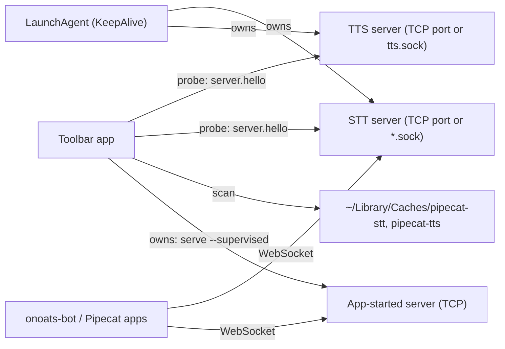
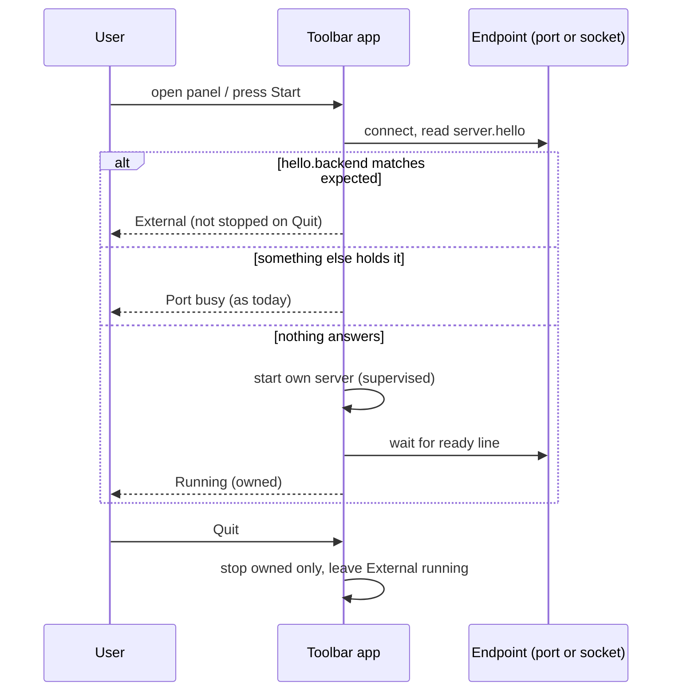

# Task: Adopt servers that are already running, and start one only when none is

**Status**: Not Started
**Component**: macos
**Assigned to**: Varun / Claude
**Priority**: High
**Branch**: `feature/macos-adopt-external-servers`
**Created**: 2026-10-25
**Review Gates**: full
**Follows**: [phase 2](20261023-feature-stt-service-toolbar.md) (PR #20, merged as d568f69)

## Objective

The Pipecat Service Toolbar reuses a TTS or STT server that is already running
and gives light control over it: show it, copy its URL, test it. It starts its own
server only when none answers. A server it did not start is never stopped, and its
LaunchAgent is never touched. Several apps (onoats-bot, a Pipecat bot, this app)
can then share one server.

## Context

- Today the app and the `just tts-*` / STT LaunchAgents use the same fixed
  loopback ports (drift-tested against the justfile `_resolve` map). A server that
  already holds the port is reported as a failure ("Port N is busy… stop it before
  starting here", `ServiceLifecycle.swift:51`). A healthy server on the right port
  is exactly what the app is for.
- The STT LaunchAgents do not use TCP. They bind Unix sockets:
  `~/Library/Caches/pipecat-stt/{stt,parakeet,nemotron}.sock` (label
  `pipecat.stt-server[.parakeet|.nemotron]`, KeepAlive, 10 s throttle). TTS has a
  quick-start `~/Library/Caches/pipecat-tts/tts.sock`. A port-only probe never
  sees them.
- Both servers speak the same wire protocol v0.1 over a Unix socket or TCP, and
  can listen on a LAN address (a token is then required). A process binds exactly
  one listener.
- `server.hello` is the first frame on every connection and carries
  `backend.name` and `backend.model` (STT 0.4.0, verified against a running
  nemotron agent; TTS parsed in `TTSClient.swift:40-52`). Whisper reports `mlx`.
- Both clients use `URLSessionWebSocketTask` over TCP only (`STTClient.swift:25-35`,
  `TTSClient.swift:106-115`). `NWConnection` + `NWProtocolWebSocket` is already used
  server-side in `STTWebSocketServer.swift`.
- The app pins `pipecat-local-stt-server==0.3.3` and launches STT through its own
  helper (`EnvironmentManager.swift:181`), not the upstream CLI. STT 0.4.0 ships
  `python -m stt_server` with `serve --supervised` (JSON `ready`, stdin-EOF stop),
  `--socket-path`, `status --json`, and Parakeet and Nemotron backends.

## Requirements

- **Support floor:** STT >= 0.4.0, TTS >= 0.7.0. `hello.backend` is required; a
  server without it is unsupported. No code path for older servers.
- **Protocol v0.1 compatibility is non-negotiable.** Client-side probing only; no
  wire change on either server.
- **Ownership invariant:** the app only ever signals, stops or deletes processes it
  started. It never loads, unloads or restarts a LaunchAgent. Quit leaves External
  services running.
- **Adopt only after `server.hello`:** `backend.name` must equal the catalog entry's
  expected name; `backend.model` must equal the pinned model when the entry pins
  one. A mismatch or a non-speaking process keeps today's "port busy" failure.
- **Endpoints:** `unix:<path>` or `host:port`, plus an optional bearer token. Local
  discovery only (loopback ports and the socket directories). No LAN scan.
- **External controls:** status, Copy URL / Pipecat service / env vars, Test Voice,
  Test Transcription. No Stop, no Delete.
- **Unix-socket safety:** scan only a directory owned by the current user and mode
  0700; accept only a socket owned by the current user; never follow a symlink; a
  stale socket (nothing accepts) is skipped, not an error.
- The app starts its own server exactly as today when nothing answers.

## Review Focus

- Protocol v0.1: no frame, field or ordering change on either server.
- Ownership invariant: no code path can signal, stop or delete a process the app did
  not start, including after pid reuse (cf. the reaped-child test in `CoreTests`).
- `ServiceLifecycle` reducer stays total: every (state, event) cell, with the new
  External phase and with quit under way.
- Unix-socket probing: symlinks, foreign-owned directories or sockets, stale socket
  files, a socket that accepts but never sends `server.hello` (bounded timeout).
- Adoption trusts `server.hello`; a local process on a fixed port can claim any
  backend. Test Voice / Test Transcription send only the fixed test line and the
  bundled clip, never user data.
- Supervised contract drift: `docs/supervised-contract.json` and the Swift
  `SupervisedErrorCode` stay one definition (add `ModelInvalidError`).
- Hash-pinned constraints regenerate cleanly after the 0.4.0 bump.

## Implementation Checklist

Phases 0 to 3 deliver adoption; phase 4 moves STT to the upstream CLI and adds two
engines; phase 5 is conditional. Phase 0 is a go/no-go gate for the Unix-socket
work.

### Phase 0: Spike a Unix-socket WebSocket client

**Impl files:** `macos/Sources/PipecatToolbarCore/UnixWebSocket.swift`
**Test files:** `macos/Tests/PipecatServiceToolbarTests/UnixWebSocketTests.swift`
**Test command:** `swift test --package-path macos --filter UnixWebSocket`
**Goal:** Prove or refute that the app can read `server.hello` and run one request over a Unix socket before anything else depends on it.

- Connect with `NWConnection` to a `.unix(path:)` endpoint, with `NWProtocolWebSocket` framing and a `ws://` Host header. Read `server.hello`, send `server.status`, read the reply.
- Test against a real `python -m tts_server serve --backend tone --socket-path <tmp>` started by the test (the lean env used by the live tone test).
- Record the result in `## Findings` (works / does not). If it does not work, the fallback is probe-only through `status --json --socket-path` (both CLIs have it), Test Voice and Test Transcription stay TCP-only, and the plan is re-scoped before phase 2.

### Phase 1: Endpoint, transport and the adopt decision

**Impl files:** `macos/Sources/PipecatToolbarCore/Endpoint.swift, macos/Sources/PipecatToolbarCore/ExternalProbe.swift, macos/Sources/PipecatToolbarCore/STTClient.swift, macos/Sources/PipecatToolbarCore/TTSClient.swift`
**Test files:** `macos/Tests/PipecatServiceToolbarTests/ExternalProbeTests.swift, macos/Tests/PipecatServiceToolbarTests/CoreTests.swift`
**Test command:** `swift test --package-path macos`
**Goal:** One `Endpoint` type and one pure adopt/reject function, so every transport and every caller decides the same way.

- `Endpoint` (`tcp(host, port)` | `unix(path)`) with an optional token; both clients connect through it (TCP stays `URLSessionWebSocketTask`; Unix uses the phase 0 transport).
- `ExternalProbe`: connect, read `server.hello` under a short timeout, return `adopt(info)`, `mismatch(found)`, `needsToken`, `silent` or `unreachable`. The decision is a pure function of (hello, catalog entry).
- Catalog gains the expected `backend.name` per entry (`mlx` for Whisper) and the pinned model where there is one.

### Phase 2: Discovery and the External lifecycle

**Impl files:** `macos/Sources/PipecatToolbarCore/ServiceLifecycle.swift, macos/Sources/PipecatToolbarCore/ServiceDriver.swift, macos/Sources/PipecatToolbarCore/PortProbe.swift, macos/Sources/PipecatToolbarCore/SocketScan.swift, macos/Sources/PipecatServiceToolbar/State/ServiceModel.swift, macos/Sources/PipecatServiceToolbar/State/AppModel.swift`
**Test files:** `macos/Tests/PipecatServiceToolbarTests/ServiceLifecycleTests.swift, macos/Tests/PipecatServiceToolbarTests/ServiceDriverTests.swift, macos/Tests/PipecatServiceToolbarTests/ExternalDiscoveryTests.swift`
**Test command:** `swift test --package-path macos`
**Goal:** The reducer stays total and an External service can never be signalled, stopped or deleted.

- New `external(Endpoint, info)` phase and `externalFound` / `externalLost` events in the pure reducer; every existing phase handles both.
- Before starting a service the driver probes its canonical port and the matching socket paths. `adopt` enters External; `mismatch` / `silent` keep today's port-busy failure (with the hello it found in the message); `unreachable` starts our own server as now.
- `SocketScan` lists `~/Library/Caches/pipecat-stt` and `~/Library/Caches/pipecat-tts` under the safety rules in Requirements.
- Re-probe: on panel open and Start, plus every 15 s while the panel is visible; a failed re-probe moves External to Stopped.
- Tests build sockets and directories in a temp dir: owner/mode, symlink, stale file, silent listener, hello mismatch, token required.

### Phase 3: External services in the menu

**Impl files:** `macos/Sources/PipecatServiceToolbar/Views/PanelView.swift, macos/Sources/PipecatServiceToolbar/Views/ServiceDetailView.swift, macos/Sources/PipecatServiceToolbar/State/ServiceModel.swift, macos/Sources/PipecatServiceToolbar/App/Snapshots.swift, macos/Sources/PipecatToolbarCore/AppLifecycle.swift`
**Test files:** `macos/Tests/PipecatServiceToolbarTests/AppLifecycleTests.swift, macos/Tests/PipecatServiceToolbarTests/CoreTests.swift`
**Test command:** `swift test --package-path macos`
**Validation cmd:** `just app-smoke`
**Goal:** A person can tell at a glance which servers the app owns, and Quit never touches the ones it does not.

- "External" badge and source line ("launchd: `pipecat.stt-server.nemotron`" when the label is loaded, otherwise the socket path or port). Stop and Delete hidden; Copy URL, Pipecat service, env vars, Test Voice, Test Transcription present.
- Copy actions for a `unix:` endpoint follow whatever `LocalWebSocketSTTService` / `LocalTTSService` accept (check the adapter signatures first; if they take only host and port, show the socket path and say so).
- Quit and `AppLifecycle` stop owned services only; a test adds an External service next to an owned one and asserts only the owned one is stopped.
- Debug snapshots render an External row.

### Phase 4: STT through the upstream CLI, plus Parakeet and Nemotron

**Impl files:** `macos/Sources/PipecatToolbarCore/Service.swift, macos/Sources/PipecatToolbarCore/EnvironmentManager.swift, macos/Sources/PipecatToolbarCore/ServiceDriver.swift, macos/Helper/pipecat_app_helper.py, macos/constraints/stt-whisper.txt, macos/constraints/stt-kyutai.txt, macos/constraints/stt-parakeet.txt, macos/constraints/stt-nemotron.txt, macos/scripts/compile_stt_constraints.py, docs/supervised-contract.json`
**Test files:** `tests/test_macos_catalog_drift.py, tests/test_supervised_contract.py, tests/test_app_helper_cancel.py, macos/Tests/PipecatServiceToolbarTests/CoreTests.swift`
**Test command:** `uv run pytest tests/test_macos_catalog_drift.py tests/test_supervised_contract.py tests/test_app_helper_cancel.py -q && swift test --package-path macos`
**Validation cmd:** `just smoke-supervised-all`
**Goal:** The app launches STT exactly the way a LaunchAgent does, so adoption and ownership run the same server.

- Bump `sttServerRequirement` to `>=0.4.0` (pin the exact release) and regenerate the hash-pinned constraints.
- Launch `python -m stt_server serve --supervised --backend <b> --model <m> --host 127.0.0.1 --port 
`; read the JSON `ready` line; stdin EOF stops it.
- Check whether upstream 0.4.0 covers what our helper adds (Kyutai backend and its leading/trailing silence, mlx-whisper, `prefetch`). Remove the helper only for what upstream covers; keep the rest and say why in `## Findings`.
- Catalog: Parakeet on 9765 and Nemotron on 9865 (the +100 pattern the other families use), each with its own environment and constraints file.
- Add `ModelInvalidError` to `docs/supervised-contract.json` and the Swift `SupervisedErrorCode`.

### Phase 5: Discovery file (conditional on onoats-bot)

**Impl files:** `macos/Sources/PipecatToolbarCore/ServicesFile.swift, macos/Sources/PipecatServiceToolbar/State/AppModel.swift`
**Test files:** `macos/Tests/PipecatServiceToolbarTests/ServicesFileTests.swift`
**Test command:** `swift test --package-path macos --filter ServicesFile`
**Goal:** Publish what the app owns for other apps without becoming a dependency of them.

- Only if onoats-bot asks for it: the app writes `~/Library/Application Support/Pipecat Service Toolbar/services.json` (engine, endpoint, pid, started_at; owned services only), atomically, mode 0600, removed on Quit. It is advisory; consumers must still verify `server.hello`.
- Skip this phase if onoats keeps using fixed ports and its own LaunchAgent fallback.

### Phase 6: Docs and an out-of-process smoke

**Impl files:** `macos/README.md, macos/docs/architecture.md, AGENTS.md, CHANGELOG.md, macos/scripts/ui_smoke.sh`
**Test files:** `tests/test_justfile_recipes.py`
**Test command:** `uv run pytest tests/test_justfile_recipes.py -q`
**Validation cmd:** `just app-smoke`

- `ui_smoke.sh` starts a server out of process (TCP and a socket), launches the bundle and checks the service shows as External and survives Quit.
- README and architecture: the adopt-first rule, the ownership invariant, the support floor, how to run beside `just tts-install`.
- CHANGELOG entry; update the two earlier macOS plans' "Known follow-ups".

## Technical Specifications

### Files to Modify
- `macos/Sources/PipecatToolbarCore/{STTClient,TTSClient}.swift` - connect through `Endpoint`.
- `macos/Sources/PipecatToolbarCore/{ServiceLifecycle,ServiceDriver,PortProbe}.swift` - External phase, probe before start, port-busy only for a non-matching holder.
- `macos/Sources/PipecatToolbarCore/{Service,EnvironmentManager}.swift` - expected backend names, STT launch command, Parakeet and Nemotron.
- `macos/Sources/PipecatServiceToolbar/{State/ServiceModel,State/AppModel,Views/PanelView,Views/ServiceDetailView}.swift` - External rows and menu items.
- `macos/Helper/pipecat_app_helper.py`, `macos/constraints/*`, `macos/scripts/compile_stt_constraints.py`, `docs/supervised-contract.json`.
- `tests/test_macos_catalog_drift.py`, `tests/test_supervised_contract.py`, `.github/workflows/test.yml` only if a new lean test file is added (extend its allow-list).

### New Files to Create
- `macos/Sources/PipecatToolbarCore/{Endpoint,ExternalProbe,SocketScan,UnixWebSocket}.swift`.
- `macos/Sources/PipecatToolbarCore/ServicesFile.swift` (phase 5, conditional).
- `macos/constraints/stt-parakeet.txt`, `stt-nemotron.txt`.
- Matching test files under `macos/Tests/PipecatServiceToolbarTests/`.

### Architecture Decisions
- **Adopt first, own second.** Probe, then start. Rationale: the port is the discovery contract and several apps can share one server.
- **The app never touches a LaunchAgent.** KeepAlive restarts anything the app stops within 10 s, and a second owner for one process invites races. It only reads the label to show where the server came from.
- **Support floor, not version sniffing.** Neither hello carries a package version; `hello.backend` is the gate.
- **External controls are observe, copy and test.** "Lightweight control" does not include Stop (a stopped agent comes straight back).
- **Local discovery only.** LAN endpoints would need token storage (Keychain) and a manual "add server" flow; deferred.
- **Protocol untouched.** The Unix transport is a client concern.

### Dependencies
- `pipecat-local-stt-server` 0.3.3 to 0.4.0 (hash-pinned constraints regenerate).
- No new Swift packages (`Network.framework` is a system framework).

### Integration Seams

| Seam | Writer (task) | Caller (task) | Contract |
|------|---------------|---------------|----------|
| `Endpoint` | Phase 1 | Phases 0, 2, 3 | One type for TCP and Unix; clients never branch on transport themselves |
| `ExternalProbe` result | Phase 1 | Phase 2 driver | Pure decision of (hello, catalog entry); the driver never re-implements it |
| External phase | Phase 2 reducer | Phase 3 views, `AppLifecycle` | A service in External is never signalled, stopped or deleted |
| Expected backend names | Phase 1 catalog | Phase 4 catalog entries | Every STT entry carries `backend.name` (`mlx` for Whisper) |
| Supervised contract | Phase 4 | `docs/supervised-contract.json` drift test | Swift and JSON stay one definition |

## Architecture & Call Flow

Component graph (which component triggers which):

Trigger order:

Context lifecycle:

| Step | Trigger | Enters context | Cleared/persisted | Turn boundary |
|------|---------|----------------|-------------------|---------------|
| 1 | Panel opens or Start pressed | catalog entry, expected `backend.name` and model | persists in the service model | after the probe returns |
| 2 | `server.hello` read | `backend.name`, `backend.model`, rate | persists as External info | probe connection closed |
| 3 | Adopted | endpoint (host:port or socket path) | persists until a re-probe fails | none |
| 4 | Re-probe fails | the connection error | External becomes Stopped | next probe |
| 5 | App starts its own server | `ready` line (pid, port, model) | persists until Stop or Quit | after the `ready` line |
| 6 | Quit | owned set only | owned stopped, External untouched | after the drain |

## Testing Notes

### Test Approach
- [ ] Reducer table tests cover every (state, event) cell with the External phase, including quit under way.
- [ ] Probe tests against fake servers: matching hello, wrong backend, wrong model, silent listener, token required, closed port.
- [ ] Socket scan tests in a temp dir: owner/mode, symlink, stale file.
- [ ] Live tests: tone server over a Unix socket (phase 0) and over TCP (adopt, then Quit leaves it running).
- [ ] Out-of-process smoke in `ui_smoke.sh` (phase 6).
- [ ] Manual: run beside `just tts-install tone` and an STT LaunchAgent; the app shows both as External and Quit leaves them.

### Test Results
- [ ] All existing tests pass
- [ ] New tests added and passing
- [ ] Manual verification complete

### Edge Cases Tested
- [ ] A LaunchAgent restarts the server while the app shows it External (re-probe recovers).
- [ ] A server on the port answers with the wrong backend.
- [ ] Two servers for one engine on different sockets.
- [ ] Socket file left behind by a crashed server.

## Acceptance Criteria

- With `just tts-install tone` running, the app shows Tone as External, never reports "port busy", and Quit leaves it running.
- With an STT LaunchAgent on `~/Library/Caches/pipecat-stt/nemotron.sock`, the app shows Nemotron as External and Test Transcription passes over the socket.
- With nothing running, Start launches an owned server exactly as today.
- No path signals, stops or deletes a process the app did not start; a test asserts it.
- STT starts through `python -m stt_server`; Parakeet and Nemotron install and run.
- No change to wire protocol v0.1 on either server.
- Code reviewed and approved; tests passing; docs updated.

<!-- /review-plan writes the review marker above this line. Everything below is the workspace: edits here do NOT invalidate the marker. -->

## Progress

- [ ] Phase 0: Spike a Unix-socket WebSocket client
- [ ] Phase 1: Endpoint, transport and the adopt decision
- [ ] Phase 2: Discovery and the External lifecycle
- [ ] Phase 3: External services in the menu
- [ ] Phase 4: STT through the upstream CLI, plus Parakeet and Nemotron
- [ ] Phase 5: Discovery file (conditional on onoats-bot)
- [ ] Phase 6: Docs and an out-of-process smoke

## Findings

- 2026-10-25, STT peer (`pipecat-local-stt-server-78`, v0.4.0, main 4484373), facts from its code:
  - `server.hello` and `server.status` carry `backend: {name, model}`. `name` is one of echo, mlx, parakeet, nemotron, kyutai (`mlx` is Whisper). Hello is the first frame on every connection.
  - `--socket-path PATH` replaces the TCP flags (no TCP listener is bound); one listener per process. Socket 0600 under umask 077, directory owned by the user and 0700, `<sock>.lock` (flock) left on disk. Peer uid must equal the server's euid (else 403); a bearer token is optional on top, and is the only auth on TCP.
  - The LaunchAgent passes `~/Library/Caches/pipecat-stt/{stt,parakeet,nemotron}.sock`, label `pipecat.stt-server[.parakeet|.nemotron]`, no `--supervised`, KeepAlive with a 10 s throttle. `serve` on an agent's socket exits `EADDRINUSE` before loading a model.
  - `python -m stt_server status [--socket-path|--host/--port|--uri] [--json]` is the health probe; `serve --supervised` prints one JSON `ready` line or one `error` line (codes: EADDRINUSE, EACCES, ModuleNotFoundError, ModelDownloadError, ModelInvalidError, ConfigError, BackendStartError); stdin EOF stops it.
- 2026-10-25, codebase facts: both Swift clients are TCP only; `NWProtocolWebSocket` is used server-side in `STTWebSocketServer.swift`; the app pins 0.3.3 and launches STT through its own helper, which also defines Kyutai; sockets present on the dev machine: `pipecat-stt/{stt,nemotron}.sock`, `pipecat-tts/tts.sock`.
- 2026-10-25, decision (user): LAN endpoints are out of scope for this plan; local discovery only. Revisit as a follow-up.
- 2026-10-25, onoats-bot (relayed by the user): STT is a WebSocket. It runs over the Unix socket by default (`stt.sock`); `STT_WS_HOST`/`STT_WS_PORT` or `STT_WS_URI` select TCP instead. A raw (non-WebSocket) connect fails the handshake ("did not receive a valid HTTP request"), so every probe must speak WebSocket. Consequence: onoats finds the LaunchAgent's socket by default and will not find an app-started TCP server unless `STT_WS_URI` is set.
- Still unanswered by onoats: LaunchAgent self-heal behaviour if the app holds a port, whether it wants a `services.json`, and whether it needs TTS. Phase 5 depends on it.
- To grill: (1) transport of an app-started STT server, TCP (today, matches the Pipecat adapter's host and port) or the canonical socket path (what onoats finds by default; one listener per process, so not both); (2) `services.json` yes or no; (3) re-probe cadence; (4) UDS in this branch or after TCP adoption (phase 0 decides); (5) split phase 4 into its own PR.
- Not yet verified: whether the Pipecat adapters (`LocalWebSocketSTTService`, `LocalTTSService`) accept a Unix socket path (affects the Copy actions in phase 3).

## Issues & Solutions

(none yet)

## Final Results

(fill when the work is complete)
