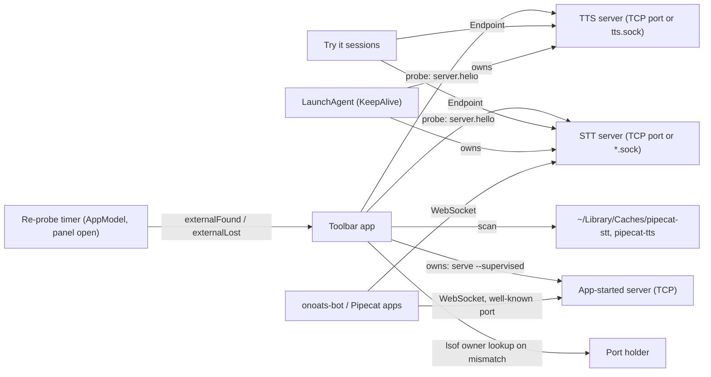
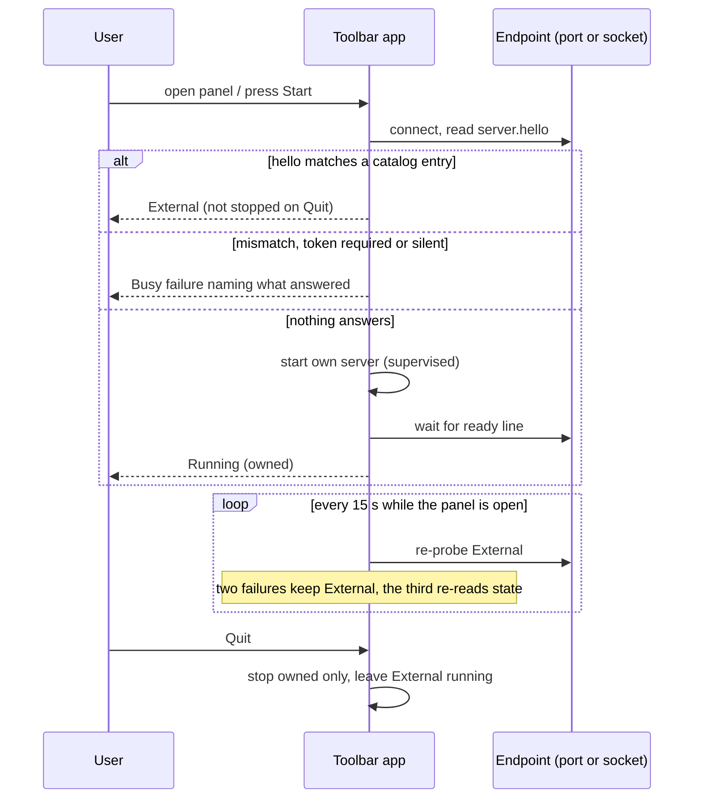

# Task: Adopt servers that are already running, and start one only when none is

**Status**: Not Started
**Component**: macos
**Assigned to**: Varun / Claude
**Priority**: High
**Branch**: `feature/macos-adopt-external-servers`
**Created**: 2026-10-25
**Review Gates**: full
**Follows**: [phase 2](20261023-feature-stt-service-toolbar.md) (PR #20, merged as d568f69)

## Objective

The Pipecat Service Toolbar reuses a TTS or STT server that is already running
and gives light control over it: show it, copy its URL, test it. It starts its own
server when none answers, and it can own every TTS and STT server. A server it did
not start is never stopped, and its LaunchAgent is never touched. Several apps
(onoats-bot, a Pipecat bot, this app) can then share one server. Other apps find
the app's servers on the well-known catalog ports, or with the `just` recipes that
ship with each server. The releases of this app, the TTS server, the STT server and
onoats-bot stay aligned.

## Context

- Today the app and the `just tts-*` / STT LaunchAgents use the same fixed
  loopback ports (drift-tested against the justfile `_resolve` map). A server that
  already holds the port is reported as a failure ("Port N is busy… stop it before
  starting here", `ServiceLifecycle.swift:51`). A healthy server on the right port
  is exactly what the app is for.
- The STT LaunchAgents do not use TCP. They bind Unix sockets:
  `~/Library/Caches/pipecat-stt/{stt,parakeet,nemotron}.sock` (label
  `pipecat.stt-server[.parakeet|.nemotron]`, KeepAlive, 10 s throttle). TTS has a
  quick-start `~/Library/Caches/pipecat-tts/tts.sock`; its LaunchAgents use
  `--host/--port` and carry labels `pipecat.tts-server.<backend>`, so a TTS socket
  never belongs to a label. A port-only probe never sees the STT agents.
- Both servers speak the same wire protocol v0.1 over a Unix socket or TCP, and
  can listen on a LAN address (a token is then required). A process binds exactly
  one listener. onoats-bot reaches STT over the Unix socket by default and uses TCP
  only when `STT_WS_URI` (or `STT_WS_HOST`/`STT_WS_PORT`) is set.
- `server.hello` is the first frame on every connection and carries
  `backend.name`, `backend.model` and `protocol_version` (STT 0.4.0, verified against
  a running nemotron agent; TTS parsed in `TTSClient.swift:40-52`, which drops
  `protocol_version` today). Whisper reports `mlx`; Phonon reports the raw `--model`
  argument (`phonon-q8`), not the repo (`phonon.py:455`).
- Both clients use `URLSessionWebSocketTask` over TCP only (`STTClient.swift:25-35`,
  `TTSClient.swift:106-115`). `NWConnection` + `NWProtocolWebSocket` is already used
  server-side in `STTWebSocketServer.swift`.
- The app pins `pipecat-local-stt-server==0.3.3` and launches STT through its own
  helper (`EnvironmentManager.swift:180-182`), not the upstream CLI. STT 0.4.0 ships
  `python -m stt_server` with `serve --supervised` (JSON `ready`, stdin-EOF stop),
  `--socket-path`, `status --json`, and Parakeet and Nemotron backends.
- `examples/pipecat_tts_service.py:54,61-62` already accepts `socket_path`
  (precedence uri > socket_path > host+port). Socket support in the upstream
  `LocalWebSocketSTTService` is not verified.

## Requirements

- **Support floor:** STT >= 0.4.0 (first release with the upstream supervised CLI
  and Parakeet/Nemotron), TTS >= 0.7.0 (first release with `serve --supervised`,
  `prefetch` and the supervised contract this app relies on). `hello.backend` has
  existed since TTS v0.1.0, so the wire is not what sets the floor. A server whose
  hello lacks `backend.name` is unsupported. No code path for older servers.
- **Protocol v0.1 compatibility is non-negotiable.** Client-side probing only; no
  wire change on either server.
- **Ownership invariant:** the app only ever signals, stops or deletes processes it
  started. It never loads, unloads or restarts a LaunchAgent. Quit leaves External
  services running. For a service in `.external` the reducer issues no
  `.stopServer`, `.launch`, `.launchNative` or `.startReadyTimer` effect under any
  event, and `s.server` stays nil.
- **One decision function.** `entry(for: hello, endpoint) -> Service?` matches
  `backend.name`, then `backend.model` against the entry's `modelArgument ?? modelRepo`
  (a missing model matches only an entry that pins none, such as tone). An unknown
  model for a known backend is a mismatch. A hello whose `protocol_version` is not
  `0.1` is a mismatch. When both a port and a socket answer for one entry, the port
  wins; a second server for the same entry is ignored.
- **Probe outcomes:** `adopt`, `mismatch`, `needsToken` (HTTP 401/403 on the
  handshake), `silent` (accepts but sends no hello), `unreachable`. `mismatch`,
  `needsToken` and `silent` keep a port-busy style failure with a message naming
  what was found; `unreachable` starts the app's own server.
- **Endpoints:** `unix:<path>` or `host:port`. No token in this plan (LAN and token
  storage are out of scope); `needsToken` is a reject outcome. Local discovery only:
  loopback ports and the socket directories. No LAN scan.
- **Hello timeout** is sized for a busy server (several seconds), because a TTS
  event loop can stall during Metal compute. A timeout on a re-probe means "retry
  later", never "gone". A refused connection or a missing socket means gone.
- **Re-probe rule:** on panel open and Start, plus every 15 s while the panel is
  visible. The first two failed re-probes keep the service External (shown as "not
  responding"); the third moves it to the checking phase and re-reads its state. The
  timer lives in `AppModel` and its result is an epoch-tagged reducer event.
- **External controls:** status, Copy URL / Pipecat service / env vars, Test Voice,
  Test Transcription. No Stop, no Delete. The source line shows the LaunchAgent
  label only where the catalog maps a socket to one (STT); a TTS socket shows its
  path.
- **Apple Speech** is an in-process server on 9465 and skips probing and discovery.
- **Unix-socket safety:** scan only a directory owned by the current user and mode
  0700; accept only a socket owned by the current user; skip a non-socket entry (the
  `<sock>.lock` file STT leaves beside a socket); skip a socket that refuses a
  connection; refuse a symlinked directory and a symlinked socket.
- With nothing answering, the app starts its own server. TTS and Apple Speech start
  exactly as today; STT starts through the upstream CLI after Phase 4. App-started
  STT servers bind TCP on the catalog port.

## Review Focus

- Protocol v0.1: no frame, field or ordering change on either server.
- Ownership invariant: no code path can signal, stop or delete a process the app did
  not start, including after pid reuse (cf. the reaped-child test in `CoreTests`),
  asserted at the effect level for every event, not only at Quit.
- `ServiceLifecycle` reducer stays total: every (state, event) cell with the new
  External phase, with epoch-tagged probe events, and with quit under way.
- Hello-to-entry matching: Whisper variants all report `mlx`; Phonon quantized
  variants report their alias; `protocol_version` is checked.
- Unix-socket probing: symlinks, foreign-owned directories or sockets, the `.lock`
  file, refused sockets, a socket that accepts but never sends `server.hello`.
- A busy TTS server can answer hello slowly; a late hello must not demote a healthy
  External service.
- Adoption trusts `server.hello`; a local process on a fixed port can claim any
  backend. Test Voice / Test Transcription send only the fixed test line and the
  bundled clip, never user data.
- Supervised contract drift: `docs/supervised-contract.json`,
  `tts_server/supervise.py` and the Swift `SupervisedErrorCode` stay one definition.
- Hash-pinned constraints regenerate cleanly after the 0.4.0 bump, in one commit
  with the catalog change.

## Implementation Checklist

Phases 0 to 3 deliver adoption; phase 4 moves STT to the upstream CLI and adds two
engines (last in this branch, so adoption does not wait on it); phase 5 is
conditional. Phase 0 is a go/no-go gate for Unix-socket work: if it fails, `Endpoint`
keeps only the `tcp` case and Unix sockets are probe-only (see Phase 0).

### Phase 0: Spike a Unix-socket WebSocket client

**Impl files:** `macos/Sources/PipecatToolbarCore/UnixWebSocket.swift`
**Test files:** `macos/Tests/PipecatServiceToolbarTests/UnixWebSocketTests.swift`
**Test command:** `swift test --package-path macos --filter UnixWebSocket`
**Goal:** Prove or refute that the app can read `server.hello` and run one request over a Unix socket before anything else depends on it.

- Connect with `NWConnection` to a `.unix(path:)` endpoint, with `NWProtocolWebSocket` framing and a `ws://` Host header. Read `server.hello`, send `server.status`, read the reply.
- Test against a real `python -m tts_server serve --backend tone --socket-path <tmp>` started by the test (the lean env used by the live tone test). The fixture creates the socket's parent directory mode 0700 under a `mktemp` root, or the server refuses to bind; Phase 2 reuses it for the socket-scan tests.
- Record the result in `## Findings`. **Go:** Phase 1 wires both clients to this transport. **No-go:** `Endpoint` keeps only the `tcp` case; Unix sockets are probe-only through `python -m <server> status --json --socket-path` (both CLIs have it), run from an environment that has `stt_server` 0.4.0 (so the STT fallback needs Phase 4's environment first); Test Voice and Test Transcription stay TCP-only; the plan is re-scoped before Phase 1.

### Phase 1: Endpoint, transport, probe and the one decision function

**Impl files:** `macos/Sources/PipecatToolbarCore/Endpoint.swift, macos/Sources/PipecatToolbarCore/ExternalProbe.swift, macos/Sources/PipecatToolbarCore/Service.swift, macos/Sources/PipecatToolbarCore/STTClient.swift, macos/Sources/PipecatToolbarCore/TTSClient.swift, tests/_macos_catalog.py`
**Test files:** `macos/Tests/PipecatServiceToolbarTests/ExternalProbeTests.swift, macos/Tests/PipecatServiceToolbarTests/CoreTests.swift, tests/test_macos_catalog_drift.py`
**Test command:** `uv run pytest tests/test_macos_catalog_drift.py tests/test_supervised_contract.py -q && swift test --package-path macos`
**Goal:** One `Endpoint` type and one pure hello-to-entry function, so every transport and every caller decides the same way.

- `Endpoint` (`tcp(host, port)` | `unix(path)`, no token); both clients connect through it. TCP stays `URLSessionWebSocketTask`; Unix uses the Phase 0 transport. The clients keep `protocol_version` from the hello.
- `ExternalProbe`: connect, read `server.hello` under the busy-server timeout, return one of the five outcomes in Requirements.
- Catalog (`Service.swift`) gains the expected `backend.name` per entry (`mlx` for Whisper), the socket file name and LaunchAgent label for each STT entry (TTS entries have none), and the pure `entry(for:endpoint:)`.
- `tests/_macos_catalog.py` (the regex parser of `ServiceInfo(` blocks) learns the new fields. A drift test compares each TTS backend's real hello (`backend.name`, `backend.model`) with its catalog entry, in the pattern of `test_macos_catalog_drift.py:209`.
- Tests: fake servers for every probe outcome; Phonon q8/q4 and Whisper variant matching; wrong `protocol_version`; tone's null model.

### Phase 2: Discovery and the External lifecycle

**Impl files:** `macos/Sources/PipecatToolbarCore/ServiceLifecycle.swift, macos/Sources/PipecatToolbarCore/ServiceDriver.swift, macos/Sources/PipecatToolbarCore/PortProbe.swift, macos/Sources/PipecatToolbarCore/SocketScan.swift, macos/Sources/PipecatServiceToolbar/State/ServiceModel.swift, macos/Sources/PipecatServiceToolbar/State/AppModel.swift, macos/Sources/PipecatServiceToolbar/Views/PanelView.swift, macos/Sources/PipecatServiceToolbar/Views/ServiceDetailView.swift`
**Test files:** `macos/Tests/PipecatServiceToolbarTests/ServiceLifecycleTests.swift, macos/Tests/PipecatServiceToolbarTests/ServiceDriverTests.swift, macos/Tests/PipecatServiceToolbarTests/ExternalDiscoveryTests.swift`
**Test command:** `swift test --package-path macos`
**Goal:** The reducer stays total and an External service can never be signalled, stopped or deleted; the package builds and passes at this phase boundary.

- New `external(Endpoint, info)` phase in the pure reducer. `startRequested` issues a `.probeExternal(endpoints)` effect; its result arrives as probe-tagged `externalFound(probe:)` / `externalLost(probe:)` events, classified in `Kind.owner`, `isNonOwning` and `isCurrent` (`everyKindIsClassified` enforces this) and covered by the probe-slot rule so a stale result is ignored (a late `externalFound` after Delete, Stop or quit must not resurrect a service).
- Derived predicates in `ServiceLifecycle.swift:348-375`: `hasLiveWork` true, `blocksReset` false, `isActive` true, `isBusy` false, `isInstalled` follows the app's environment. `refreshed` does not overwrite `.external`. `AppModel`'s `active`, `startable` and `canReset` (`AppModel.swift:77-94`, `232-234`) take a position.
- The two views that switch on the phase get their minimal `.external` cases here (`PanelView.swift`, `ServiceDetailView.swift`), so the package builds. Phase 3 finishes the UI.
- `PortProbe.owner` stays TCP; the busy failure generalises to `.endpointBusy(Endpoint, owner?, found)`. `SocketScan` has its own owner lookup (socket uid) or none.
- `SocketScan` lists `~/Library/Caches/pipecat-stt` and `~/Library/Caches/pipecat-tts` under the safety rules in Requirements.
- Re-probe: `AppModel` owns the timer (starts on panel open, stops on close) and calls the driver; apply the bounded rule in Requirements. Apple Speech skips the probe.
- Tests: add `.external` to the hand-maintained `phases` array in `ServiceLifecycleTests`, add `externalFound` / `externalLost` rows, add a `LifecycleEvent.Kind.allCases` exhaustiveness guard (cf. `AppLifecycleTests.swift:100`), stale-tag x every phase and `shuttingDown` rows, the effect-level ownership invariant, and quit with an External service next to an owned one (only the owned one is stopped). Socket fixtures: non-socket entry (`.lock`), refused socket, symlinked directory, symlinked socket, foreign owner, silent listener, hello mismatch, needs-token, a tone server mid-commit (slow hello), `externalLost` then `externalFound` after a LaunchAgent restart.

### Phase 3: External services in the menu

**Impl files:** `macos/Sources/PipecatServiceToolbar/Views/PanelView.swift, macos/Sources/PipecatServiceToolbar/Views/ServiceDetailView.swift, macos/Sources/PipecatServiceToolbar/State/ServiceModel.swift, macos/Sources/PipecatServiceToolbar/App/Snapshots.swift, macos/Sources/PipecatServiceToolbar/Audio/TryItSession.swift, macos/Sources/PipecatServiceToolbar/Audio/STTTryItSession.swift, macos/Sources/PipecatToolbarCore/TTSRequestDriver.swift, macos/Sources/PipecatToolbarCore/ServiceLifecycle.swift, macos/Sources/PipecatToolbarCore/ServiceDriver.swift`
**Test files:** `macos/Tests/PipecatServiceToolbarTests/ServiceLifecycleTests.swift, macos/Tests/PipecatServiceToolbarTests/CoreTests.swift`
**Test command:** `swift test --package-path macos`
**Validation cmd:** `just app-smoke`
**Goal:** A person can tell at a glance which servers the app owns, and Quit never touches the ones it does not.

- "External" badge and source line (LaunchAgent label only for a mapped STT socket; otherwise the socket path or port; "not responding" during the re-probe window). Stop and Delete hidden; Copy URL, Pipecat service, env vars, Test Voice, Test Transcription present.
- The Try it chain is port-typed today (`LifecycleEffect.openTryIt(port:)`, `ServiceHost.openTryIt(port:)`, `TryItSession(backend:port:)`, `STTTryItSession(port:)`, `TTSRequestDriver(port:)`, `STTClient(port:)`, `ServiceRunningInfo.port`); each takes an `Endpoint`.
- Copy actions for a `unix:` endpoint: TTS uses `LocalTTSService(socket_path=...)` (`examples/pipecat_tts_service.py:54`); STT shows the socket path and says the adapter must accept it, until `LocalWebSocketSTTService` socket support is checked against the 0.4.0 checkout.
- `AppLifecycle` stays unchanged: it has no service knowledge, and `shutdownServers` already stops only `s.server` / `s.native`. The quit invariant is tested at the service level (Phase 2 tests).
- Before Test Transcription is a criterion for Nemotron, run the app's STT try-it flow once against the running nemotron agent over TCP to confirm its transcript semantics.
- Debug snapshots render an External row.

### Phase 4: STT through the upstream CLI, plus Parakeet and Nemotron

**Impl files:** `macos/Sources/PipecatToolbarCore/Service.swift, macos/Sources/PipecatToolbarCore/EnvironmentManager.swift, macos/Sources/PipecatToolbarCore/ServiceDriver.swift, macos/Sources/PipecatToolbarCore/PrefetchEvent.swift, macos/Helper/pipecat_app_helper.py, macos/constraints/stt-whisper.txt, macos/constraints/stt-kyutai.txt, macos/constraints/stt-parakeet.txt, macos/constraints/stt-nemotron.txt, macos/scripts/compile_stt_constraints.py, docs/supervised-contract.json, tts_server/supervise.py, tests/_macos_catalog.py`
**Test files:** `tests/test_macos_catalog_drift.py, tests/test_supervised_contract.py, tests/test_app_helper_cancel.py, macos/Tests/PipecatServiceToolbarTests/CoreTests.swift, macos/Tests/PipecatServiceToolbarTests/EndToEndTests.swift`
**Test command:** `uv run pytest tests/test_macos_catalog_drift.py tests/test_supervised_contract.py tests/test_app_helper_cancel.py -q && swift test --package-path macos`
**Validation cmd:** `PIPECAT_TOOLBAR_E2E=1 swift test --package-path macos --filter EndToEnd`
**Goal:** The app launches STT through the same upstream CLI a LaunchAgent runs, so adoption and ownership use one entry point.

- Order inside the phase: (a) decide which helper behaviour upstream 0.4.0 already covers (Kyutai backend and its leading/trailing silence, mlx-whisper, `prefetch`); remove the helper only for what upstream covers and record why in `## Findings`. (b) Update `tests/_macos_catalog.py` and the helper-coupled drift tests (`test_supervised_contract.py` `serve_events` and the constraints/engine-set checks; `test_macos_catalog_drift.py` helper `MODEL_REVISIONS` equality), and say how the upstream ready line is contract-tested in the lean job, where `stt_server` is absent. (c) One commit: bump `sttServerRequirement` to the exact 0.4.0 release, regenerate all four hash-pinned constraints files with `compile_stt_constraints.py`, add the two engines, and add `ModelInvalidError` to the contract JSON, `SupervisedErrorCode` and a new `CODE_MODEL_INVALID` in `tts_server/supervise.py` (TTS never emits it; the three-way drift test requires the equality). The drift tests assert the `stt-*.txt` set equals the engine set and each `# requirement:` line matches, so a partial commit fails CI.
- Launch `python -m stt_server serve --supervised --backend <b> --model <m> --host 127.0.0.1 --port 
` (TCP; app-started STT servers never take the canonical socket); read the JSON `ready` line; stdin EOF stops it.
- Catalog: Parakeet on 9765 and Nemotron on 9865 (the +100 pattern; verified free), each with its own environment and constraints file, and the hello `backend.name` (`parakeet`, `nemotron`).
- E2E (opt-in, not CI): Parakeet and Nemotron install and serve; an installed STT environment served with `--socket-path` is probed and transcribes over the socket (covers the peer-uid check on a real server).

### Phase 5: Discovery file (conditional on onoats-bot)

**Impl files:** `macos/Sources/PipecatToolbarCore/ServicesFile.swift, macos/Sources/PipecatServiceToolbar/State/AppModel.swift`
**Test files:** `macos/Tests/PipecatServiceToolbarTests/ServicesFileTests.swift`
**Test command:** `swift test --package-path macos --filter ServicesFile`
**Goal:** Publish what the app owns for other apps without becoming a dependency of them.

- Default: not built. onoats-bot probes the well-known catalog ports or uses the servers' `just` recipes. Build it only if onoats-bot asks for a file.
- If built: the app writes `~/Library/Application Support/Pipecat Service Toolbar/services.json` (engine, endpoint, pid, started_at; owned services only), atomically, mode 0600, removed on Quit. It is advisory; consumers must still verify `server.hello`.

### Phase 6: Docs and an out-of-process smoke

**Impl files:** `macos/README.md, macos/docs/architecture.md, AGENTS.md, CHANGELOG.md, macos/scripts/ui_smoke.sh`
**Test files:** `tests/test_justfile_recipes.py`
**Test command:** `uv run pytest tests/test_justfile_recipes.py -q`
**Validation cmd:** `just app-smoke`

- `ui_smoke.sh` starts a server out of process (TCP and a socket) on a catalog port that is free, launches the bundle, asserts External from the bootstrap log line (the script cannot read panel text), and asserts the out-of-process pid is alive after Quit. It skips with a clear message when the canonical port is already held by a real agent.
- README and architecture: the adopt-first rule, the ownership invariant, the support floor, running beside `just tts-install`, and that the app can own every server while other apps probe the well-known ports.
- CHANGELOG entry; update the two earlier macOS plans' "Known follow-ups".

## Technical Specifications

### Files to Modify
- `macos/Sources/PipecatToolbarCore/{STTClient,TTSClient}.swift` - connect through `Endpoint`; keep `protocol_version`.
- `macos/Sources/PipecatToolbarCore/{ServiceLifecycle,ServiceDriver,PortProbe}.swift` - External phase, probe effect and events, predicates, endpoint-generic busy failure.
- `macos/Sources/PipecatToolbarCore/{Service,EnvironmentManager,PrefetchEvent}.swift` - expected backend names, socket and label map, hello-to-entry function, STT launch command, `SupervisedErrorCode`, Parakeet and Nemotron.
- `macos/Sources/PipecatToolbarCore/TTSRequestDriver.swift`, `macos/Sources/PipecatServiceToolbar/Audio/{TryItSession,STTTryItSession}.swift` - take an `Endpoint`.
- `macos/Sources/PipecatServiceToolbar/{State/ServiceModel,State/AppModel,Views/PanelView,Views/ServiceDetailView,App/Snapshots}.swift` - External rows, menu items, re-probe timer.
- `macos/Helper/pipecat_app_helper.py`, `macos/constraints/*`, `macos/scripts/compile_stt_constraints.py`, `docs/supervised-contract.json`, `tts_server/supervise.py`.
- `tests/_macos_catalog.py`, `tests/test_macos_catalog_drift.py`, `tests/test_supervised_contract.py`; `.github/workflows/test.yml` only if a new lean test file is added (extend its allow-list).

### New Files to Create
- `macos/Sources/PipecatToolbarCore/{Endpoint,ExternalProbe,SocketScan,UnixWebSocket}.swift`.
- `macos/Sources/PipecatToolbarCore/ServicesFile.swift` (phase 5, conditional).
- `macos/constraints/stt-parakeet.txt`, `stt-nemotron.txt`.
- Matching test files under `macos/Tests/PipecatServiceToolbarTests/`.

### Architecture Decisions
- **Adopt first, own second.** Probe, then start. The canonical port or socket path is the discovery contract, and several apps can share one server.
- **The app can own every server.** App-started servers bind the catalog TCP ports, which are well known; other apps probe them or use the `just` recipes. A shared release cadence with onoats-bot and the servers keeps this stable.
- **The app never touches a LaunchAgent.** KeepAlive restarts anything the app stops within 10 s, and a second owner for one process invites races. It only reads the label to show where a server came from.
- **Support floor, not version sniffing.** Neither hello carries a package version.
- **Strict hello matching** (name, model alias, protocol 0.1), one pure function; port beats socket.
- **External controls are observe, copy and test.** Stop would be undone by KeepAlive.
- **Local discovery only; no token in this plan.** LAN endpoints and token storage are a follow-up.
- **Protocol untouched.** The Unix transport is a client concern.
- **Reducer owns the decision.** The probe is an effect and its results are epoch-tagged events; the driver only runs the effect.

### Dependencies
- `pipecat-local-stt-server` 0.3.3 to 0.4.0 (hash-pinned constraints regenerate in the same commit as the catalog).
- No new Swift packages (`Network.framework` is a system framework).

### Integration Seams

| Seam | Writer (task) | Caller (task) | Contract |
|------|---------------|---------------|----------|
| Unix transport | Phase 0 (raw `.unix` spike) | Phase 1 `Endpoint` | Go/no-go decides whether `Endpoint` has a `unix` case |
| `Endpoint` | Phase 1 | Phases 2, 3 | One type for TCP and Unix; clients never branch on transport themselves |
| `entry(for:endpoint:)` | Phase 1 | Phase 2 reducer effect | Pure; strict name + model alias + protocol 0.1; nobody re-implements it |
| External phase and probe events | Phase 2 reducer | Phase 3 views, `AppModel` | A service in External is never signalled, stopped or deleted; stale probe results are ignored |
| Try it chain | Phase 3 | `TryItSession`, `STTTryItSession`, `TTSRequestDriver` | Takes an `Endpoint`; same fixed test line and clip |
| Expected backend names and socket map | Phase 1 catalog | Phase 4 catalog entries | Every STT entry carries `backend.name`, socket file and label |
| Supervised contract | Phase 4 | JSON, `supervise.py`, `SupervisedErrorCode`, drift tests | Three definitions, one commit |

## Architecture & Call Flow

Component graph (which component triggers which):

Trigger order:

Context lifecycle:

| Step | Trigger | Enters context | Cleared/persisted | Turn boundary |
|------|---------|----------------|-------------------|---------------|
| 1 | Panel opens or Start pressed | catalog entry, expected `backend.name` and model | persists in the service model | after the probe returns |
| 2 | `server.hello` read | `backend.name`, `backend.model`, `protocol_version`, rate | persists as External info | probe connection closed |
| 3 | Adopted | endpoint (host:port or socket path) | persists until the re-probe window closes | none |
| 4 | Re-probe fails | the connection error or timeout | counted; third failure moves to checking and re-reads | next probe |
| 5 | App starts its own server | `ready` line (pid, port, model) | persists until Stop or Quit | after the `ready` line |
| 6 | Quit | owned set only | owned stopped, External untouched | after the drain |

## Testing Notes

### Test Approach
- [ ] Reducer table tests cover every (state, event) cell with the External phase: `.external` in the `phases` array, probe events, an `allCases` guard, stale tags, quit under way.
- [ ] Effect-level ownership invariant: for `.external`, no `.stopServer`, `.launch`, `.launchNative` or `.startReadyTimer` under any event.
- [ ] Probe tests against fake servers: matching hello, wrong backend, wrong model, wrong `protocol_version`, silent listener, token required, closed port.
- [ ] Hello-to-entry tests: Whisper variants, Phonon q8/q4, tone's null model; a drift test of each TTS backend's real hello against the catalog.
- [ ] Socket scan tests in a temp dir (parent mode 0700): owner/mode, `.lock` file, refused socket, symlinked directory, symlinked socket.
- [ ] Live tests: tone server over a Unix socket (Phase 0) and over TCP (adopt, then Quit leaves it running); a tone server mid-commit still answers a re-probe.
- [ ] Opt-in E2E (`PIPECAT_TOOLBAR_E2E=1`): Parakeet and Nemotron install and serve; STT over `--socket-path`.
- [ ] Out-of-process smoke in `ui_smoke.sh` (Phase 6).
- [ ] Manual: run beside `just tts-install tone` and an STT LaunchAgent; the app shows both as External and Quit leaves them.

### Test Results
- [ ] All existing tests pass
- [ ] New tests added and passing
- [ ] Manual verification complete

### Edge Cases Tested
- [ ] A LaunchAgent restarts the server while the app shows it External (re-probe recovers).
- [ ] A server on the port answers with the wrong backend or model.
- [ ] Two servers for one engine on different sockets (port wins).
- [ ] A socket file left behind by a crashed server; the `.lock` file beside a live one.
- [ ] A busy server misses one hello window and stays External.

## Acceptance Criteria

- With `just tts-install tone` running, the app shows Tone as External, never reports "port busy", and Quit leaves it running.
- With nothing running, Start launches an owned server (TTS and Apple Speech exactly as today; STT through the upstream CLI after Phase 4).
- With an STT LaunchAgent on `~/Library/Caches/pipecat-stt/nemotron.sock`, the app shows Nemotron as External with its source. If Phase 0 passed, Test Transcription also works over the socket; if it failed, the row is shown through the probe-only fallback and Test Transcription is TCP-only.
- No path signals, stops or deletes a process the app did not start; an effect-level test asserts it.
- STT starts through `python -m stt_server`; Parakeet and Nemotron install and run (verified by the opt-in E2E tests, which are not in CI).
- `swift build` and `swift test` pass at every phase boundary.
- No change to wire protocol v0.1 on either server.
- Code reviewed and approved; tests passing; docs updated.

<!-- reviewed: 2026-10-26 @ 57ab7cb9209682a06690ab3006f0a15c31bb34cc -->

<!-- /review-plan writes the review marker above this line. Everything below is the workspace: edits here do NOT invalidate the marker. -->

## Progress

- [ ] Phase 0: Spike a Unix-socket WebSocket client
- [ ] Phase 1: Endpoint, transport, probe and the one decision function
- [ ] Phase 2: Discovery and the External lifecycle
- [ ] Phase 3: External services in the menu
- [ ] Phase 4: STT through the upstream CLI, plus Parakeet and Nemotron
- [ ] Phase 5: Discovery file (conditional on onoats-bot)
- [ ] Phase 6: Docs and an out-of-process smoke

## Findings

- 2026-10-25, STT peer (`pipecat-local-stt-server-78`, v0.4.0, main 4484373), facts from its code:
  - `server.hello` and `server.status` carry `backend: {name, model}`. `name` is one of echo, mlx, parakeet, nemotron, kyutai (`mlx` is Whisper). Hello is the first frame on every connection.
  - `--socket-path PATH` replaces the TCP flags (no TCP listener is bound); one listener per process. Socket 0600 under umask 077, directory owned by the user and 0700, `<sock>.lock` (flock) left on disk. Peer uid must equal the server's euid (else 403); a bearer token is optional on top, and is the only auth on TCP.
  - The LaunchAgent passes `~/Library/Caches/pipecat-stt/{stt,parakeet,nemotron}.sock`, label `pipecat.stt-server[.parakeet|.nemotron]`, no `--supervised`, KeepAlive with a 10 s throttle. `serve` on an agent's socket exits `EADDRINUSE` before loading a model.
  - `python -m stt_server status [--socket-path|--host/--port|--uri] [--json]` is the health probe; `serve --supervised` prints one JSON `ready` line or one `error` line (codes: EADDRINUSE, EACCES, ModuleNotFoundError, ModelDownloadError, ModelInvalidError, ConfigError, BackendStartError); stdin EOF stops it.
- 2026-10-25, codebase facts: both Swift clients are TCP only; `NWProtocolWebSocket` is used server-side in `STTWebSocketServer.swift`; the app pins 0.3.3 and launches STT through its own helper, which also defines Kyutai; sockets present on the dev machine: `pipecat-stt/{stt,nemotron}.sock`, `pipecat-tts/tts.sock`.
- 2026-10-25, onoats-bot (relayed by the user): STT is a WebSocket. It runs over the Unix socket by default (`stt.sock`); `STT_WS_HOST`/`STT_WS_PORT` or `STT_WS_URI` select TCP instead. A raw (non-WebSocket) connect fails the handshake ("did not receive a valid HTTP request"), so every probe must speak WebSocket. Consequence: onoats finds the LaunchAgent's socket by default and will not find an app-started TCP server unless `STT_WS_URI` is set.
- 2026-10-25, decision (user): LAN endpoints are out of scope for this plan; local discovery only. Revisit as a follow-up.
- 2026-10-25, decisions from the `/review-plan` grill (user):
  1. App-started STT binds TCP on the catalog port (accepted). Phase 4's goal now says "same upstream CLI".
  2. Re-probe: two failures keep External, the third moves to checking plus re-read; a timeout means retry later (accepted).
  3. No token in `Endpoint`; `needsToken` is a reject outcome (accepted).
  4. Strict hello-to-entry match: name, `modelArgument ?? modelRepo`, protocol 0.1; port beats socket (accepted).
  5. Phase 4 stays in this branch as the last phase, with conditional socket criteria (accepted). The user added: the menu bar app can own all STT and TTS servers; onoats-bot can probe them with the servers' `just` recipes or a well-known port; releases are aligned across onoats-bot and this repo. Phase 5 (`services.json`) therefore defaults to not built.
- Pending: onoats-bot-39 has not answered about LaunchAgent self-heal when the app holds a port, or whether it needs TTS.
- Not yet verified: whether the upstream `LocalWebSocketSTTService` accepts a Unix socket path (TTS side verified: `examples/pipecat_tts_service.py:54`); whether the app's STT try-it flow fits the nemotron backend's transcript semantics.

## Issues & Solutions

(none yet)

## Final Results

(fill when the work is complete)
