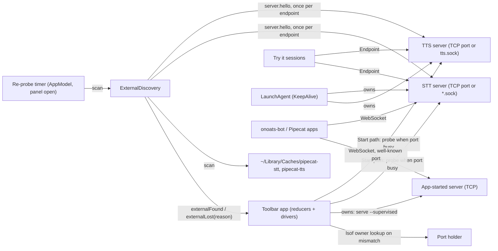
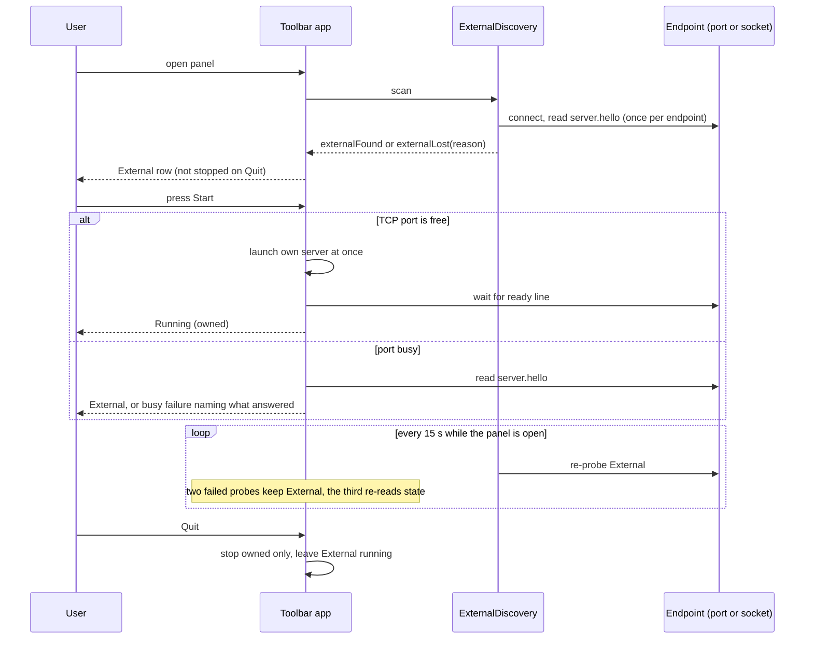

# Task: Adopt servers that are already running, and start one only when none is

**Status**: Not Started
**Component**: macos
**Assigned to**: Varun / Claude
**Priority**: High
**Branch**: `feature/macos-adopt-external-servers`
**Created**: 2026-10-25
**Review Gates**: full
**Follows**: [phase 2](20261023-feature-stt-service-toolbar.md) (PR #20, merged as d568f69)

## Objective

The Pipecat Service Toolbar reuses a TTS or STT server that is already running
and gives light control over it: show it, copy its URL, test it. It starts its own
server when none answers, and it can own every TTS and STT server. A server it did
not start is never stopped, and its LaunchAgent is never touched. Several apps
(onoats-bot, a Pipecat bot, this app) can then share one server. Other apps find
the app's servers on the well-known catalog ports, or with the `just` recipes that
ship with each server (the STT recipes resolve sockets, the TTS recipes ports). The
intent is that the releases of this app, the TTS server, the STT server and
onoats-bot stay aligned; that is a commitment to make with those repos, not a fact
verified here.

## Context

- Today the app and the `just tts-*` / STT LaunchAgents use the same fixed
  loopback ports (drift-tested against the justfile `_resolve` map). A server that
  already holds the port is reported as a failure ("Port N is busy… stop it before
  starting here", `ServiceLifecycle.swift:51-56`). A healthy server on the right port
  is exactly what the app is for.
- The STT LaunchAgents do not use TCP. They bind Unix sockets:
  `~/Library/Caches/pipecat-stt/{stt,parakeet,nemotron}.sock` (label
  `pipecat.stt-server[.parakeet|.nemotron]`, KeepAlive, 10 s throttle; Kyutai has no
  agent). TTS has a quick-start `~/Library/Caches/pipecat-tts/tts.sock`; its
  LaunchAgents use `--host/--port` and carry labels `pipecat.tts-server.<backend>`
  (already known to `PortProbe` through `ServiceInfo.launchdLabel`), so a TTS socket
  never belongs to a label. A port-only probe never sees the STT agents.
- Both servers speak the same wire protocol v0.1 over a Unix socket or TCP, and
  can listen on a LAN address (a token is then required). A process binds exactly
  one listener. onoats-bot reaches STT over the Unix socket by default and uses TCP
  only when `STT_WS_URI` (or `STT_WS_HOST`/`STT_WS_PORT`) is set; it has no TTS
  client today.
- `server.hello` is the first frame on every connection and carries
  `backend.name`, `backend.model` and `protocol_version` (STT 0.4.0, verified against
  a running nemotron agent; TTS parsed in `TTSClient.swift:40-52`, which drops
  `protocol_version` today). Whisper reports `mlx`; Phonon reports the raw `--model`
  argument (`phonon-q8`), not the repo (`phonon.py:455`). The TTS server answers HTTP
  403 to any handshake that carries an `Origin` header and 401 without a required
  bearer (`tts_server/server.py:616,623`).
- Both clients use `URLSessionWebSocketTask` over TCP only (`STTClient.swift:25-35`,
  `TTSClient.swift:106-115`). `NWConnection` + `NWProtocolWebSocket` is already used
  server-side in `STTWebSocketServer.swift`.
- The app pins `pipecat-local-stt-server==0.3.3` and launches STT through its own
  helper (`EnvironmentManager.swift:180-182`), not the upstream CLI. 0.3.3 already
  sends `backend` in its hello and accepts the `parakeet` and `nemotron` backends;
  0.4.0 adds `python -m stt_server serve --supervised` (JSON `ready`, stdin-EOF
  stop), the backend registry, Kyutai, `--socket-path` handling and `status --json`.
- Both Pipecat adapters take a socket path: `examples/pipecat_tts_service.py:54,61-62`
  (`LocalTTSService(socket_path=...)`, precedence uri > socket_path > host+port) and
  the sibling `stt_server/examples/pipecat_stt_service.py:57,66` at 0.4.0.

## Requirements

- **Support floor:** STT >= 0.4.0 (the first release with the upstream supervised
  CLI the app launches), TTS >= 0.7.0 (the first release with `serve --supervised`,
  `prefetch` and the supervised contract; `CHANGELOG.md` lists it as Unreleased, so
  it must be released before this ships). The hello check does not enforce the floor
  (a 0.3.3 STT server's hello passes it, and is adopted); the floor states what the
  app launches and tests. A hello without `backend.name` is unsupported.
- **Protocol v0.1 compatibility is non-negotiable.** Client-side probing only; no
  wire change on either server.
- **Ownership invariant:** the app only ever signals, stops or deletes processes it
  started. It never loads, unloads or restarts a LaunchAgent. Quit leaves External
  services running. For a service in `.external`, `s.server` and `s.native` stay nil
  and the reducer issues only allow-listed effects (`.cancelProbe`, `.openTryIt`,
  `.tearDown` for a Try it session, and the state re-read) under any event; it never
  issues `.stopServer`, `.stopNative`, `.discardNative`, `.launch`, `.launchNative`,
  `.startReadyTimer`, `.runInstall`, `.resumeRemoval` or `.removeEnvironment`.
  `removeRequested` on an External service is refused by the reducer, not only hidden
  in the UI.
- **One decision function.** `entry(for: hello, endpoint) -> Service?` matches
  `backend.name`, then `backend.model` against the entry's `modelArgument ?? modelRepo`
  (a missing model matches only an entry that pins none, such as tone). An unknown
  model for a known backend is a mismatch. A hello whose `protocol_version` is absent
  or not `0.1` is a mismatch. When both a port and a socket answer for one entry, the
  port wins; a second server for the same entry is ignored.
- **Probe outcomes:** `adopt`, `mismatch`, `needsToken` (HTTP 401/403 on the
  handshake), `silent` (closed without a hello), `timeout` (accepted, no hello before
  the deadline), `unreachable` (refused or no socket). On Start, `mismatch`,
  `needsToken`, `silent` and `timeout` keep a busy failure with a message naming what
  was found; `unreachable` starts the app's own server. On a re-probe, `timeout` and
  `unreachable` are failed probes.
- **Endpoints:** `unix:<path>` or `host:port`. No token in this plan (LAN and token
  storage are out of scope); `needsToken` is a reject outcome. Local discovery only:
  loopback ports and the socket directories. No LAN scan.
- **Hello timeout:** measured, not guessed. Phase 1 measures hello latency on a real
  backend mid-commit and records it; the default is that figure with margin. A TTS
  event loop can stall during Metal compute (AGENTS.md sizes the pong timeout at 120 s
  for the same reason).
- **Re-probe rule:** `ExternalDiscovery` (app target) runs on panel open and Start,
  plus every 15 s while the panel is visible. It probes each endpoint once and sends
  each service an epoch-tagged `externalFound` or `externalLost(reason:)` (`refused`,
  `timeout`, `mismatch`). Refused, missing socket and timeout each count as one failed
  probe: two keep the service External (shown as "not responding"); the third moves it
  to the checking phase and re-reads its state, which outlasts a KeepAlive restart
  (about 45 s against a 10 s throttle). A successful probe resets the count, which
  lives in `LifecycleState`.
- **External controls:** status, Copy URL / Pipecat service / env vars, Test Voice,
  Test Transcription. No Stop, no Delete. The source line shows the LaunchAgent
  label only where the catalog maps a socket to one (STT); a TTS socket shows its
  path.
- **Apple Speech** is an in-process server on 9465 and skips probing and discovery.
- **Unix-socket safety:** scan only a directory owned by the current user with no
  group or other write bit (the rule the servers apply to their own parent
  directory); accept only a socket owned by the current user; skip a non-socket entry
  (the `<sock>.lock` file STT leaves beside a socket); skip a socket that refuses a
  connection; refuse a symlinked directory and a symlinked socket. The servers
  enforce socket mode 0600 and the peer uid on connect.
- With nothing answering, the app starts its own server. TTS and Apple Speech start
  as today; STT starts through the upstream CLI after Phase 4. App-started STT servers
  bind TCP on the catalog port. A free TCP port launches at once, without a hello
  probe (the existing fast path); the probe runs only when the port is busy or a
  socket exists.

## Review Focus

- Protocol v0.1: no frame, field or ordering change on either server.
- Ownership invariant: no code path can signal, stop or delete a process the app did
  not start, including after pid reuse (cf. the reaped-child test in `CoreTests`),
  asserted at the effect level (allow-list) for every event, not only at Quit.
- `ServiceLifecycle` reducer stays total: every (state, event) cell with the new
  External phase, with epoch-tagged discovery events, and with quit under way; the
  external owner slot survives the phase instead of being cleared with the Start-time
  probe slot.
- Hello-to-entry matching: Whisper variants all report `mlx`; Phonon quantized
  variants report their alias; `protocol_version` is checked.
- Unix-socket probing: symlinks, foreign-owned directories or sockets, the `.lock`
  file, refused sockets, a socket that accepts but never sends `server.hello`, and
  whether the transport sends an `Origin` header (the TTS server rejects it with 403).
- A busy TTS server can answer hello slowly; a late hello must not demote a healthy
  External service.
- Adoption trusts `server.hello`; a local process on a fixed port can claim any
  backend. Test Voice / Test Transcription send only the fixed test line and the
  bundled clip, never user data.
- Supervised contract drift: `docs/supervised-contract.json`,
  `tts_server/supervise.py` and the Swift `SupervisedErrorCode` stay one definition.
- Hash-pinned constraints regenerate cleanly after the 0.4.0 bump, in one commit
  with the catalog change and the helper removal.

## Implementation Checklist

Phases 0 to 3 deliver adoption of today's catalog entries; phase 4 moves STT to the
upstream CLI and adds Parakeet and Nemotron (last in this branch, so adoption does
not wait on it); phase 5 is conditional. Phase 0 is a go/no-go gate for Unix-socket
work: if it fails, Unix sockets are out of scope for this branch and `Endpoint` has
only the `tcp` case (see Phase 0). Every phase boundary builds and passes
`swift build` and `swift test`.

### Phase 0: Spike a Unix-socket WebSocket client

**Impl files:** `macos/Sources/PipecatToolbarCore/UnixWebSocket.swift`
**Test files:** `macos/Tests/PipecatServiceToolbarTests/UnixWebSocketTests.swift`
**Test command:** `swift test --package-path macos --filter UnixWebSocket`
**Goal:** Prove or refute that the app can read `server.hello` and run one request over a Unix socket before anything else depends on it.

- Connect with `NWConnection` to a `.unix(path:)` endpoint, with `NWProtocolWebSocket` framing and a `ws://` Host header. Read `server.hello`, send `server.status`, read the reply. Record whether the transport sends an `Origin` header (the TTS server answers 403 to any `Origin`, which would turn every probe into `needsToken`).
- Test against a real `python -m tts_server serve --backend tone --socket-path <tmp>` started by the test (the lean env used by the live tone test). The fixture creates the socket's parent directory with no group or other write bit under a `mktemp` root, or the server refuses to bind; Phase 2 reuses it. Add a live probe with and without `PIPECAT_TTS_AUTH_TOKEN` on both transports.
- Record the result in `## Findings`. **Go:** Phase 1 wires both clients to this transport. **No-go:** Unix sockets are out of scope for this branch. `Endpoint` keeps only `tcp`; discovery adopts TCP endpoints only; STT LaunchAgents on sockets are not shown; the socket acceptance criterion is dropped; socket support becomes a follow-up. There is no probe-only fallback through `status --json` (that CLI cannot tell refused, timeout and bad token apart, and for STT it needs a 0.4.0 environment that Phase 4 delivers last).

### Phase 1: Endpoint, transport, probe and the one decision function

**Impl files:** `macos/Sources/PipecatToolbarCore/Endpoint.swift, macos/Sources/PipecatToolbarCore/WebSocketTransport.swift, macos/Sources/PipecatToolbarCore/ExternalProbe.swift, macos/Sources/PipecatToolbarCore/Service.swift, macos/Sources/PipecatToolbarCore/STTClient.swift, macos/Sources/PipecatToolbarCore/TTSClient.swift, tests/_macos_catalog.py`
**Test files:** `macos/Tests/PipecatServiceToolbarTests/ExternalProbeTests.swift, macos/Tests/PipecatServiceToolbarTests/CoreTests.swift, tests/test_macos_catalog_drift.py`
**Test command:** `uv run pytest tests/test_macos_catalog_drift.py tests/test_supervised_contract.py tests/test_backend_registry.py -q && swift test --package-path macos`
**Goal:** One `Endpoint` type, one transport protocol and one pure hello-to-entry function, so every transport and every caller decides the same way.

- `Endpoint` (`tcp(host, port)` | `unix(path)`, no token) builds a `WebSocketTransport` (protocol with two conformers: the existing `URLSessionWebSocketTask` for TCP, the Phase 0 transport for Unix). Both clients depend on the protocol, so neither branches on transport. The clients keep `init(host:port:)` as a forwarding convenience so every existing caller still builds; Phase 3 removes it. The clients keep `protocol_version` from the hello.
- `ExternalProbe`: connect, read `server.hello` under the measured timeout, return one of the six outcomes in Requirements. Measure hello latency on a real backend mid-commit and record it in `## Findings`.
- Catalog (`Service.swift`) gains the expected `backend.name` per entry (`mlx` for Whisper), an optional socket file name and LaunchAgent label for STT entries that have an agent (Kyutai has none; TTS entries have none), and the pure `entry(for:endpoint:)`.
- `tests/_macos_catalog.py` (the regex parser of `ServiceInfo(` blocks) learns the new fields. The drift test compares each TTS backend's static `backend_name` and default model with its catalog entry (read from source, which runs in the lean job); a live hello is asserted for tone only.
- Tests: fake servers for every probe outcome with an injectable hello delay (under and over the timeout); Phonon q8/q4, Whisper variants, tone with a model, kokoro with no model, a hello without `protocol_version`, a wrong `protocol_version`.

### Phase 2: Discovery and the External lifecycle

**Impl files:** `macos/Sources/PipecatToolbarCore/ServiceLifecycle.swift, macos/Sources/PipecatToolbarCore/ServiceDriver.swift, macos/Sources/PipecatToolbarCore/PortProbe.swift, macos/Sources/PipecatToolbarCore/SocketScan.swift, macos/Sources/PipecatServiceToolbar/State/ExternalDiscovery.swift, macos/Sources/PipecatServiceToolbar/State/ServiceModel.swift, macos/Sources/PipecatServiceToolbar/State/AppModel.swift, macos/Sources/PipecatServiceToolbar/Views/PanelView.swift, macos/Sources/PipecatServiceToolbar/Views/ServiceDetailView.swift, macos/Sources/PipecatServiceToolbar/App/Snapshots.swift`
**Test files:** `macos/Tests/PipecatServiceToolbarTests/ServiceLifecycleTests.swift, macos/Tests/PipecatServiceToolbarTests/ServiceDriverTests.swift, macos/Tests/PipecatServiceToolbarTests/ExternalDiscoveryTests.swift`
**Test command:** `swift test --package-path macos`
**Goal:** The reducer stays total and an External service can never be signalled, stopped or deleted; the package builds and passes at this phase boundary.

- New `external(Endpoint, info)` phase in the pure reducer, with its own `Owner.external` slot (the existing probe slot is cleared whenever the phase is not `.starting` and `.cancelProbe` fires on every slot change, so a re-probe tag would otherwise be dropped as stale). `externalFound(probe:)` and `externalLost(probe:reason:)` are classified in `Kind.owner`, `isNonOwning` and `isCurrent` (`everyKindIsClassified` enforces this); a late result after Delete, Stop or quit must not resurrect a service. The failure count lives in `LifecycleState`.
- `ExternalDiscovery` (app target) is the only owner of re-probing and scanning: it probes each endpoint once (a shared `tts.sock` is opened once, not once per TTS entry), runs `entry(for:endpoint:)`, applies "port wins" and "second server ignored", and sends the events above. `AppModel` owns the 15 s timer (starts on panel open, stops on close) and asks `ExternalDiscovery` to scan. The per-service `.probeExternal` effect exists for the Start path only; on a `mismatch` it chains `.probePortOwner` before `.endpointBusy`. Apple Speech skips both.
- Start path: a free TCP port launches at once (no probe); the hello probe runs only when the port is busy or a socket exists, and the service stays in `.starting` while it runs.
- Derived predicates in `ServiceLifecycle.swift:348-375`: `hasLiveWork` true, `blocksReset` false, `isActive` true, `isBusy` false, `isInstalled` follows the app's environment. `refreshed` does not overwrite `.external`. `AppModel`'s `active`, `startable`, `canReset`, `isRunning`, `summary` and `menuBarBadge` (`AppModel.swift:77-120`, `232-234`) count External as running; `quitTitle` ("Stop All & Quit") counts owned services only; the Try it views' `isRunning` gates (`ServiceDetailView.swift:29,32`) allow External. `removeRequested` is refused for `.external`.
- Try it sessions open on demand from an External row (not at adoption); the third failed probe tears the session down (`.tearDown`).
- `.portBusy` becomes `.endpointBusy(Endpoint, owner?, found)`, so `Snapshots.swift:142` and the views change in this phase. The two views that switch on the phase get their minimal `.external` cases here; Phase 3 finishes the UI. `PortProbe.owner` stays TCP; `SocketScan` has its own owner lookup (socket uid) or none.
- `SocketScan` lists `~/Library/Caches/pipecat-stt` and `~/Library/Caches/pipecat-tts` under the safety rules in Requirements, reading file attributes (uid, mode, type, symlink) through an injectable reader so owner and mode cases need no privilege.
- Tests: add `.external` to the hand-maintained `phases` array in `ServiceLifecycleTests`, add `externalFound` / `externalLost` rows (gone, timeout x1, x2 stays External, x3 moves to checking, found resets the count), a `LifecycleEvent.Kind.allCases` exhaustiveness guard (cf. `AppLifecycleTests.swift:100`), stale-tag x every phase and `shuttingDown` rows, an allow-list effect assertion plus `s.server == nil && s.native == nil` for every event x stale x `shuttingDown`, and quit with an External service next to an owned one. `FakeHost` in `ServiceDriverTests` compiles against the changed host protocol. Discovery fixtures: non-socket entry (`.lock`), refused socket, symlinked directory, symlinked socket, foreign owner (injected), a 0755 directory (accepted) and a 0775 directory (refused), silent listener, hello mismatch, needs-token, port beats socket, second server ignored, a fake server whose hello arrives slowly, and `externalLost` then `externalFound` after a LaunchAgent restart.

### Phase 3: External services in the menu

**Impl files:** `macos/Sources/PipecatServiceToolbar/Views/PanelView.swift, macos/Sources/PipecatServiceToolbar/Views/ServiceDetailView.swift, macos/Sources/PipecatServiceToolbar/State/ServiceModel.swift, macos/Sources/PipecatServiceToolbar/App/Snapshots.swift, macos/Sources/PipecatServiceToolbar/Audio/TryItSession.swift, macos/Sources/PipecatServiceToolbar/Audio/STTTryItSession.swift, macos/Sources/PipecatToolbarCore/TTSRequestDriver.swift, macos/Sources/PipecatToolbarCore/ServiceLifecycle.swift, macos/Sources/PipecatToolbarCore/ServiceDriver.swift, macos/Sources/PipecatToolbarCore/STTClient.swift, macos/Sources/PipecatToolbarCore/TTSClient.swift`
**Test files:** `macos/Tests/PipecatServiceToolbarTests/ServiceLifecycleTests.swift, macos/Tests/PipecatServiceToolbarTests/ServiceDriverTests.swift, macos/Tests/PipecatServiceToolbarTests/CoreTests.swift, macos/Tests/PipecatServiceToolbarTests/TTSRequestMachineTests.swift, macos/Tests/PipecatServiceToolbarTests/EndToEndTests.swift, macos/Tests/PipecatServiceToolbarTests/AppleSpeechEndToEndTests.swift`
**Test command:** `swift test --package-path macos`
**Validation cmd:** `just app-smoke`
**Goal:** A person can tell at a glance which servers the app owns, and Quit never touches the ones it does not.

- "External" badge and source line (LaunchAgent label only for a mapped STT socket; otherwise the socket path or port; "not responding" during the re-probe window). Stop and Delete hidden; Copy URL, Pipecat service, env vars, Test Voice, Test Transcription present.
- The Try it chain is port-typed today (`LifecycleEffect.openTryIt(port:)`, `ServiceHost.openTryIt(port:)`, `TryItSession(backend:port:)`, `STTTryItSession(port:)`, `TTSRequestDriver(port:)`, `STTClient(port:)`, `ServiceRunningInfo.port`); each takes an `Endpoint`, and the forwarding `init(host:port:)` convenience from Phase 1 is removed along with the call sites in the test files above (`CoreTests`, `EndToEndTests`, `TTSRequestMachineTests`, `AppleSpeechEndToEndTests`).
- Copy actions for a `unix:` endpoint: TTS uses `LocalTTSService(socket_path=...)` (`examples/pipecat_tts_service.py:54`) and STT uses `LocalWebSocketSTTService(socket_path=...)` (`stt_server/examples/pipecat_stt_service.py:57,66` at 0.4.0); a TCP endpoint copies host and port as today.
- `AppLifecycle` stays unchanged: it has no service knowledge, and `shutdownServers` already stops only `s.server` / `s.native`. The quit invariant is tested at the service level (Phase 2 tests).
- Debug snapshots render an External row.

### Phase 4: STT through the upstream CLI, plus Parakeet and Nemotron

**Impl files:** `macos/Sources/PipecatToolbarCore/Service.swift, macos/Sources/PipecatToolbarCore/EnvironmentManager.swift, macos/Sources/PipecatToolbarCore/ServiceDriver.swift, macos/Sources/PipecatToolbarCore/PrefetchEvent.swift, macos/Helper/pipecat_app_helper.py, macos/constraints/stt-whisper.txt, macos/constraints/stt-kyutai.txt, macos/constraints/stt-parakeet.txt, macos/constraints/stt-nemotron.txt, macos/scripts/compile_stt_constraints.py, docs/supervised-contract.json, tts_server/supervise.py, tests/_macos_catalog.py`
**Test files:** `tests/test_macos_catalog_drift.py, tests/test_supervised_contract.py, tests/test_app_helper_cancel.py, tests/fixtures/stt_supervised_lines.jsonl, macos/Tests/PipecatServiceToolbarTests/CoreTests.swift, macos/Tests/PipecatServiceToolbarTests/EndToEndTests.swift`
**Test command:** `uv run pytest tests/test_macos_catalog_drift.py tests/test_supervised_contract.py tests/test_app_helper_cancel.py -q && swift test --package-path macos`
**Validation cmd:** `PIPECAT_TOOLBAR_E2E=1 swift test --package-path macos --filter EndToEnd`
**Goal:** The app launches STT through the same upstream CLI a LaunchAgent runs, so adoption and ownership use one entry point.

- Order inside the phase: (a) decide which helper behaviour upstream 0.4.0 already covers (Kyutai backend and its leading/trailing silence, mlx-whisper, `prefetch`); record why in `## Findings`. (b) Generalise `tests/_macos_catalog.py` and the helper-coupled tests only in ways that stay green on 0.3.3 (nothing removed yet). (c) One commit: remove the helper pieces upstream covers, switch the launch in `EnvironmentManager` / `ServiceDriver`, bump `sttServerRequirement` to the exact 0.4.0 release, regenerate all four hash-pinned constraints files with `compile_stt_constraints.py`, add the two engines, add `ModelInvalidError` (contract JSON, `SupervisedErrorCode`, and `CODE_MODEL_INVALID` in `tts_server/supervise.py`, which TTS never emits; the contract is the union of both emitters' codes), and rewrite the helper-coupled drift tests (`serve_events`, the engine-set and `# requirement:` checks, `MODEL_REVISIONS`). A partial commit fails CI.
- The upstream ready/error lines are contract-tested in the lean job from a recorded fixture (`tests/fixtures/stt_supervised_lines.jsonl`: a real 0.4.0 `ready` and `error` line, checked against `docs/supervised-contract.json`); the opt-in E2E asserts the live line matches it.
- Launch `python -m stt_server serve --supervised --backend <b> --model <m> --host 127.0.0.1 --port 
` (TCP; app-started STT servers never take the canonical socket); read the JSON `ready` line; stdin EOF stops it.
- Catalog: Parakeet on 9765 and Nemotron on 9865 (the +100 pattern; verified free), each with its own environment and constraints file, the hello `backend.name` (`parakeet`, `nemotron`), and, for adoption, the socket file and label (`parakeet.sock` / `nemotron.sock`, `pipecat.stt-server.parakeet` / `.nemotron`). Adopting a Parakeet or Nemotron agent therefore arrives in this phase.
- E2E (opt-in, not CI): Parakeet and Nemotron install and serve (the Nemotron try-it flow is checked against a hand-started TCP server, because the LaunchAgent is socket-only). If Phase 0 went, an installed STT environment served with `--socket-path` is probed and transcribes over the socket (covers the peer-uid check on a real server).

### Phase 5: Discovery file (conditional on onoats-bot)

**Impl files:** `macos/Sources/PipecatToolbarCore/ServicesFile.swift, macos/Sources/PipecatServiceToolbar/State/AppModel.swift`
**Test files:** `macos/Tests/PipecatServiceToolbarTests/ServicesFileTests.swift`
**Test command:** `swift test --package-path macos --filter ServicesFile`
**Goal:** Publish what the app owns for other apps without becoming a dependency of them.

- Default: not built. onoats-bot probes the well-known catalog ports (it has no probing of its own today) or uses the servers' `just` recipes. Build it only if onoats-bot asks for a file.
- If built: the app writes `~/Library/Application Support/Pipecat Service Toolbar/services.json` (engine, endpoint, pid, started_at; owned services only), atomically, mode 0600, removed on Quit. It is advisory; consumers must still verify `server.hello`.

### Phase 6: Docs and an out-of-process smoke

**Impl files:** `macos/README.md, macos/docs/architecture.md, AGENTS.md, CHANGELOG.md, macos/scripts/ui_smoke.sh`
**Test files:** `tests/test_justfile_recipes.py`
**Test command:** `uv run pytest tests/test_justfile_recipes.py -q`
**Validation cmd:** `just app-smoke`

- `ui_smoke.sh` starts a server out of process (TCP, and a socket if Phase 0 went) on a catalog port that is free, launches the bundle, asserts External from the bootstrap log line (the script cannot read panel text; its phase-line regex at `ui_smoke.sh:137` gains `external`), and asserts the out-of-process pid is alive after Quit. It skips with a clear message when the canonical port is already held by a real agent. It runs through `just app-smoke`, which is manual (the pytest above checks recipe and README drift only).
- README and architecture: the adopt-first rule, the ownership invariant, the support floor, running beside `just tts-install`, and that the app can own every server while other apps probe the well-known ports.
- CHANGELOG entry; extend the "Known follow-ups" list in `macos/docs/architecture.md` (that is where the heading lives; the earlier plans point there).

## Technical Specifications

### Files to Modify
- `macos/Sources/PipecatToolbarCore/{STTClient,TTSClient}.swift` - depend on `WebSocketTransport`; keep `protocol_version`; forwarding `init(host:port:)` until Phase 3.
- `macos/Sources/PipecatToolbarCore/{ServiceLifecycle,ServiceDriver,PortProbe}.swift` - External phase and owner slot, discovery events, Start-path probe, predicates, endpoint-generic busy failure.
- `macos/Sources/PipecatToolbarCore/{Service,EnvironmentManager,PrefetchEvent}.swift` - expected backend names, socket and label map, hello-to-entry function, STT launch command, `SupervisedErrorCode`, Parakeet and Nemotron.
- `macos/Sources/PipecatToolbarCore/TTSRequestDriver.swift`, `macos/Sources/PipecatServiceToolbar/Audio/{TryItSession,STTTryItSession}.swift` - take an `Endpoint`.
- `macos/Sources/PipecatServiceToolbar/{State/ServiceModel,State/AppModel,Views/PanelView,Views/ServiceDetailView,App/Snapshots}.swift` - External rows, menu items, derived properties, timer.
- `macos/Helper/pipecat_app_helper.py`, `macos/constraints/*`, `macos/scripts/compile_stt_constraints.py`, `docs/supervised-contract.json`, `tts_server/supervise.py`.
- `tests/_macos_catalog.py`, `tests/test_macos_catalog_drift.py`, `tests/test_supervised_contract.py`; `.github/workflows/test.yml` only if a new lean test file is added (extend its allow-list).

### New Files to Create
- `macos/Sources/PipecatToolbarCore/{Endpoint,WebSocketTransport,ExternalProbe,SocketScan,UnixWebSocket}.swift`.
- `macos/Sources/PipecatServiceToolbar/State/ExternalDiscovery.swift`.
- `macos/Sources/PipecatToolbarCore/ServicesFile.swift` (phase 5, conditional).
- `macos/constraints/stt-parakeet.txt`, `stt-nemotron.txt`; `tests/fixtures/stt_supervised_lines.jsonl`.
- Matching test files under `macos/Tests/PipecatServiceToolbarTests/`.

### Architecture Decisions
- **Adopt first, own second.** Probe, then start. The canonical port or socket path is the discovery contract, and several apps can share one server.
- **The app can own every server.** App-started servers bind the catalog TCP ports, which are well known; other apps probe them or use the `just` recipes.
- **The app never touches a LaunchAgent.** KeepAlive restarts anything the app stops within 10 s, and a second owner for one process invites races. It only reads the label to show where a server came from.
- **Support floor, not version sniffing.** Neither hello carries a package version.
- **Strict hello matching** (name, model alias, protocol 0.1), one pure function; port beats socket.
- **External controls are observe, copy and test.** Stop would be undone by KeepAlive.
- **Local discovery only; no token in this plan.** LAN endpoints and token storage are a follow-up.
- **Protocol untouched.** The Unix transport is a client concern behind one `WebSocketTransport` protocol.
- **One app-level discovery owner.** `ExternalDiscovery` scans and probes each endpoint once and feeds the per-service reducers events; reducers never probe on their own while External. The reducer owns every state change; the driver and discovery only run effects and report results.
- **No-go means TCP-only.** A failed Phase 0 defers sockets; there is no second, coarser probe implementation.

### Dependencies
- `pipecat-local-stt-server` 0.3.3 to 0.4.0 (hash-pinned constraints regenerate in the same commit as the catalog and the helper removal).
- No new Swift packages (`Network.framework` is a system framework).

### Integration Seams

| Seam | Writer (task) | Caller (task) | Contract |
|------|---------------|---------------|----------|
| Unix transport | Phase 0 (raw `.unix` spike) | Phase 1 `WebSocketTransport` | Go/no-go decides whether `Endpoint` has a `unix` case |
| `Endpoint` and `WebSocketTransport` | Phase 1 | Phases 2, 3 | One type and one protocol; clients never branch on transport |
| `entry(for:endpoint:)` | Phase 1 | `ExternalDiscovery`, Start-path probe | Pure; strict name + model alias + protocol 0.1; nobody re-implements it |
| Discovery events and External phase | `ExternalDiscovery`, Phase 2 reducer | Phase 3 views, `AppModel` | A service in External is never signalled, stopped or deleted; stale results are ignored |
| Try it chain | Phase 3 | `TryItSession`, `STTTryItSession`, `TTSRequestDriver` | Takes an `Endpoint`; same fixed test line and clip |
| Expected backend names and socket map | Phase 1 catalog (TTS and existing STT) / Phase 4 (Parakeet, Nemotron) | `ExternalDiscovery`, drift tests | Every STT entry carries `backend.name`; entries with a LaunchAgent also carry socket and label (Kyutai has none) |
| Supervised contract | Phase 4 | JSON, `supervise.py`, `SupervisedErrorCode`, drift tests, STT fixture | Three definitions plus one recorded upstream fixture, one commit |

## Architecture & Call Flow

Component graph (which component triggers which):

Trigger order:

Context lifecycle:

| Step | Trigger | Enters context | Cleared/persisted | Turn boundary |
|------|---------|----------------|-------------------|---------------|
| 1 | Panel opens | catalog entries, expected `backend.name` and model | persists in the service model | after the scan returns |
| 2 | `server.hello` read | `backend.name`, `backend.model`, `protocol_version`, rate | persists as External info | probe connection closed |
| 3 | Adopted | endpoint (host:port or socket path) | persists until the third failed probe | none |
| 4 | Probe fails (refused, missing socket or timeout) | reason | counted in `LifecycleState`; reset by a success; third failure re-reads state | next probe |
| 5 | App starts its own server | `ready` line (pid, port, model) | persists until Stop or Quit | after the `ready` line |
| 6 | Quit | owned set only | owned stopped, External untouched | after the drain |

## Testing Notes

### Test Approach
- [ ] Reducer table tests cover every (state, event) cell with the External phase: `.external` in the `phases` array, discovery events with reasons, an `allCases` guard, stale tags, quit under way, `removeRequested` refused.
- [ ] Effect-level ownership invariant: an allow-list of effects for `.external`, and `s.server == nil && s.native == nil`, for every event x stale x `shuttingDown`.
- [ ] Probe tests against fake servers with an injectable hello delay: matching hello, wrong backend, wrong model, no or wrong `protocol_version`, silent, timeout, token required, closed port.
- [ ] Hello-to-entry tests: Whisper variants, Phonon q8/q4, tone with and without a model, kokoro with none; drift of each TTS backend's static `backend_name` against the catalog (lean), live hello for tone only.
- [ ] Socket scan tests with an injectable attribute reader: owner/mode (0755 accepted, 0775 refused), `.lock` file, refused socket, symlinked directory, symlinked socket.
- [ ] Live tests: tone server over a Unix socket (Phase 0, with and without a token) and over TCP (adopt, then Quit leaves it running); hello latency measured on a real backend mid-commit.
- [ ] Recorded upstream `ready`/`error` fixture checked in the lean job; opt-in E2E (`PIPECAT_TOOLBAR_E2E=1`): Parakeet and Nemotron install and serve; STT over `--socket-path` if Phase 0 went.
- [ ] Out-of-process smoke in `ui_smoke.sh` (Phase 6).
- [ ] Manual: run beside `just tts-install tone` and an STT LaunchAgent; the app shows both as External and Quit leaves them.

### Test Results
- [ ] All existing tests pass
- [ ] New tests added and passing
- [ ] Manual verification complete

### Edge Cases Tested
- [ ] A LaunchAgent restarts the server while the app shows it External (the count absorbs the refused connections and the row recovers).
- [ ] A server on the port answers with the wrong backend or model.
- [ ] Two servers for one engine on different endpoints (port wins; the second is ignored).
- [ ] A socket file left behind by a crashed server; the `.lock` file beside a live one.
- [ ] A busy server misses one hello window and stays External.
- [ ] Apple Speech never probes.

## Acceptance Criteria

- With `just tts-install tone` running, the app shows Tone as External, never reports "port busy", and Quit leaves it running.
- With nothing running, Start launches an owned server (TTS and Apple Speech as today; STT through the upstream CLI after Phase 4).
- After Phase 4, with Phase 0 a go and an STT LaunchAgent on `~/Library/Caches/pipecat-stt/nemotron.sock`, the app shows Nemotron as External with its source and Test Transcription works over the socket. If Phase 0 is a no-go, this criterion is dropped (sockets are deferred) and Nemotron is adoptable only on a TCP endpoint.
- No path signals, stops or deletes a process the app did not start; an effect-level allow-list test asserts it.
- STT starts through `python -m stt_server`; Parakeet and Nemotron install and run (verified by the opt-in E2E tests, which are not in CI).
- `swift build` and `swift test` pass at every phase boundary.
- No change to wire protocol v0.1 on either server.
- Code reviewed and approved; tests passing; docs updated.

<!-- reviewed: 2026-10-26 @ 03a8839f1da81a1962d8e4c6e1ef7a3c78369dc3 -->

<!-- /review-plan writes the review marker above this line. Everything below is the workspace: edits here do NOT invalidate the marker. -->

## Progress

- [ ] Phase 0: Spike a Unix-socket WebSocket client
- [ ] Phase 1: Endpoint, transport, probe and the one decision function
- [ ] Phase 2: Discovery and the External lifecycle
- [ ] Phase 3: External services in the menu
- [ ] Phase 4: STT through the upstream CLI, plus Parakeet and Nemotron
- [ ] Phase 5: Discovery file (conditional on onoats-bot)
- [ ] Phase 6: Docs and an out-of-process smoke

## Findings

- 2026-10-25, STT peer (`pipecat-local-stt-server-78`, v0.4.0, main 4484373), facts from its code:
  - `server.hello` and `server.status` carry `backend: {name, model}`. `name` is one of echo, mlx, parakeet, nemotron, kyutai (`mlx` is Whisper). Hello is the first frame on every connection.
  - `--socket-path PATH` replaces the TCP flags (no TCP listener is bound); one listener per process. Socket 0600 under umask 077, directory owned by the user and 0700, `<sock>.lock` (flock) left on disk. Peer uid must equal the server's euid (else 403); a bearer token is optional on top, and is the only auth on TCP.
  - The LaunchAgent passes `~/Library/Caches/pipecat-stt/{stt,parakeet,nemotron}.sock`, label `pipecat.stt-server[.parakeet|.nemotron]`, no `--supervised`, KeepAlive with a 10 s throttle. `serve` on an agent's socket exits `EADDRINUSE` before loading a model.
  - `python -m stt_server status [--socket-path|--host/--port|--uri] [--json]` is the health probe; `serve --supervised` prints one JSON `ready` line or one `error` line (codes: EADDRINUSE, EACCES, ModuleNotFoundError, ModelDownloadError, ModelInvalidError, ConfigError, BackendStartError); stdin EOF stops it.
- 2026-10-25, codebase facts: both Swift clients are TCP only; `NWProtocolWebSocket` is used server-side in `STTWebSocketServer.swift`; the app pins 0.3.3 and launches STT through its own helper, which also defines Kyutai; sockets present on the dev machine: `pipecat-stt/{stt,nemotron}.sock`, `pipecat-tts/tts.sock`.
- 2026-10-25, onoats-bot (relayed by the user): STT is a WebSocket. It runs over the Unix socket by default (`stt.sock`); `STT_WS_HOST`/`STT_WS_PORT` or `STT_WS_URI` select TCP instead. A raw (non-WebSocket) connect fails the handshake ("did not receive a valid HTTP request"), so every probe must speak WebSocket. Consequence: onoats finds the LaunchAgent's socket by default and will not find an app-started TCP server unless `STT_WS_URI` is set.
- 2026-10-25, decision (user): LAN endpoints are out of scope for this plan; local discovery only. Revisit as a follow-up.
- 2026-10-25, decisions from the first `/review-plan` grill (user):
  1. App-started STT binds TCP on the catalog port (accepted). Phase 4's goal says "same upstream CLI".
  2. Re-probe: two failures keep External, the third moves to checking plus re-read; a timeout means retry later (accepted; refined below).
  3. No token in `Endpoint`; `needsToken` is a reject outcome (accepted).
  4. Strict hello-to-entry match: name, `modelArgument ?? modelRepo`, protocol 0.1; port beats socket (accepted).
  5. Phase 4 stays in this branch as the last phase, with conditional socket criteria (accepted). The user added: the menu bar app can own all STT and TTS servers; onoats-bot can probe them with the servers' `just` recipes or a well-known port; releases are aligned across onoats-bot and this repo. Phase 5 (`services.json`) therefore defaults to not built.
- 2026-10-26, decisions from the second `/review-plan` grill (user, all accepted as recommended):
  1. A refused connection or missing socket counts as one failed probe, the same as a timeout (so a KeepAlive restart recovers without the row disappearing).
  2. `ExternalDiscovery` (app target) owns scanning and re-probing; reducers only consume found/lost events; `.probeExternal` is Start-path only.
  3. No Phase 0 no-go fallback through `status --json`: a failed spike defers Unix sockets and the branch stays TCP-only.
  4. SocketScan accepts a directory owned by the user with no group or other write bit (0755 accepted, 0775 refused), mirroring the servers.
- 2026-10-26, applied without a grill (obvious from the second review): added a `timeout` probe outcome distinct from `silent`; moved `Snapshots.swift` into Phase 2 and `ServiceDriverTests.swift` and the other `init(host:port:)` callers into Phase 3 so every boundary builds; Phase 1 keeps a forwarding `init(host:port:)`; Phase 4 steps (b)/(c) split so only (c) removes the helper; the real-hello drift test compares static backend names (live hello for tone only); a recorded upstream `ready`/`error` fixture for the lean job; Kyutai has no socket or label; adoption of Parakeet and Nemotron arrives in Phase 4; STT adapter socket support verified (`stt_server/examples/pipecat_stt_service.py:57,66`); the Known follow-ups heading lives in `macos/docs/architecture.md`; the hello timeout is measured in Phase 1; the Nemotron try-it check uses a hand-started TCP server.
- 2026-10-26, user: onoats-bot needs STT only, no TTS. TTS adoption is for other Pipecat apps and the `just tts-*` agents; onoats-bot's only touchpoint is STT (Unix socket by default, TCP via `STT_WS_URI`).
- Pending: onoats-bot-39 has not answered about LaunchAgent self-heal when the app holds a port (it does no port probing today).
- Not yet verified: whether the app's STT try-it flow fits the nemotron backend's transcript semantics (Phase 4 E2E checks it); whether the Unix transport sends an `Origin` header (Phase 0 records it).

## Issues & Solutions

(none yet)

## Final Results

(fill when the work is complete)
