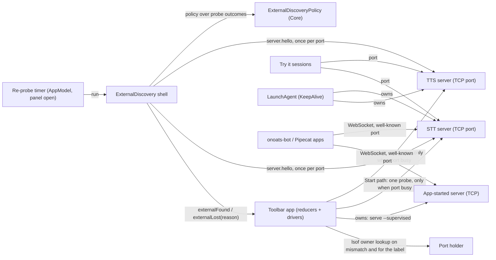
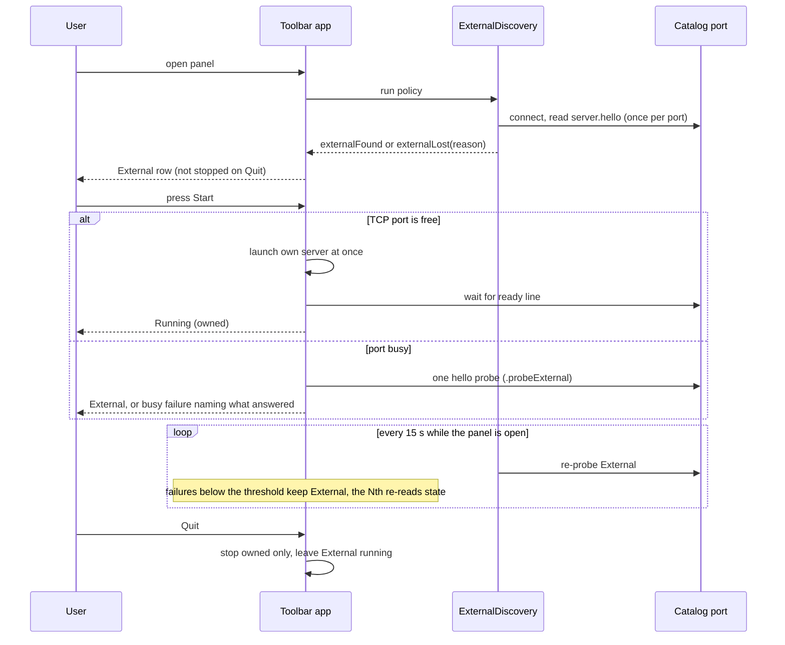

# Task: Adopt servers that are already running, and start one only when none is

**Status**: Not Started
**Component**: macos
**Assigned to**: Varun / Claude
**Priority**: High
**Branch**: `feature/macos-adopt-external-servers`
**Created**: 2026-10-25
**Review Gates**: full
**Follows**: [phase 2](20261023-feature-stt-service-toolbar.md) (PR #20, merged as d568f69)

## Objective

The Pipecat Service Toolbar reuses a TTS or STT server that is already running
and gives light control over it: show it, copy its URL, test it. It starts its own
server when none answers, and it can own every TTS and STT server. A server it did
not start is never stopped, and its LaunchAgent is never touched. Several apps
(onoats-bot, a Pipecat bot, this app) can then share one server. Other apps find
the app's servers on the well-known catalog ports, or with the `just` recipes that
ship with each server (both the TTS and the STT recipes resolve those same loopback
ports). The intent is that the releases of this app, the TTS server, the STT server
and onoats-bot stay aligned; that is a commitment to make with those repos, not a
fact verified here.

## Context

- Today the app and the `just tts-*` / `just stt-*` LaunchAgents use the same fixed
  loopback ports (drift-tested against the justfile `_resolve` map). A server that
  already holds the port is reported as a failure ("Port N is busy… stop it before
  starting here", `ServiceLifecycle.swift:51-56`). A healthy server on the right port
  is exactly what the app is for.
- Every installed LaunchAgent is on loopback TCP. TTS agents use `--host/--port`
  (label `pipecat.tts-server.<backend>`, already known to `PortProbe` through
  `ServiceInfo.launchdLabel`). The STT agents moved from Unix sockets to TCP in
  pipecat-local-stt-server PR #16 (open, unreleased as 0.5.0): whisper 9565
  (`pipecat.stt-server`), kyutai 9665 (`pipecat.stt-server.kyutai`), parakeet 9765
  (`pipecat.stt-server.parakeet`), nemotron 9865 (`pipecat.stt-server.nemotron`);
  KeepAlive, 10 s throttle. Verified 2026-10-26 from the LaunchAgent plists and
  `just stt-list` on the dev machine; the wire protocol and client are unchanged.
- **Unix sockets are out of scope.** Both servers still support `--socket-path`, but
  no installed agent uses one (a stale `~/Library/Caches/pipecat-tts/tts.sock`
  remains from earlier runs and is ignored). The app discovers and adopts loopback
  TCP endpoints only.
- Both servers speak the same wire protocol v0.1 and can listen on a LAN address (a
  token is then required). A process binds exactly one listener. onoats-bot has no
  TTS client today.
- `server.hello` is the first frame on every connection and carries
  `backend.name`, `backend.model` and `protocol_version` (STT 0.4.0, verified against
  a running nemotron agent; TTS parsed in `TTSClient.swift:40-52`, which drops
  `protocol_version` today). Whisper reports `mlx`; Phonon reports the raw `--model`
  argument (`phonon-q8`), not the repo (`phonon.py:455`). The TTS server answers HTTP
  403 to any handshake that carries an `Origin` header and 401 without a required
  bearer (`tts_server/server.py:616,623`).
- Both clients use `URLSessionWebSocketTask` over TCP (`STTClient.swift:25-35`,
  `TTSClient.swift:106-115`), and so will the probe.
- The app pins `pipecat-local-stt-server==0.3.3` and launches STT through its own
  helper (`EnvironmentManager.swift:180-182`), not the upstream CLI. 0.3.3 already
  sends `backend` in its hello and accepts the `parakeet` and `nemotron` backends;
  0.4.0 adds `python -m stt_server serve --supervised` (JSON `ready`, stdin-EOF
  stop), the backend registry, Kyutai and `status --json`.
- Both servers listen only after the model has loaded (`tts_server/server.py:480-499`),
  so a restarted agent is unreachable for the whole cold start, not only for the
  KeepAlive throttle.

## Requirements

- **Support floor:** STT >= 0.4.0 (the first release with the upstream supervised
  CLI the app launches), TTS >= 0.7.0 (the first release with `serve --supervised`,
  `prefetch` and the supervised contract; released as v0.7.0). The hello check does not enforce the floor
  (a 0.3.3 STT server's hello passes it, and is adopted, as are the 0.5.0 TCP agents);
  the floor states what the app launches and tests. A hello without `backend.name`
  is unsupported.
- **Protocol v0.1 compatibility is non-negotiable.** Client-side probing only; no
  wire change on either server.
- **Ownership invariant:** the app only ever signals, stops or deletes processes it
  started. It never loads, unloads or restarts a LaunchAgent. Quit leaves External
  services running. For a service in `.external`, `s.server` and `s.native` stay nil
  and the reducer issues only allow-listed effects (`.cancelProbe`, `.openTryIt`,
  `.tearDown` for a Try it session, and the state re-read) under any event; it never
  issues `.stopServer`, `.stopNative`, `.discardNative`, `.launch`, `.launchNative`,
  `.startReadyTimer`, `.runInstall`, `.resumeRemoval` or `.removeEnvironment`.
  `removeRequested` and the Get / Install / Reset requests on an External service are
  refused by the reducer, not only hidden in the UI. A discovery event for a service
  that is not idle, failed, checking or External (any owned phase) changes nothing,
  so an `externalFound` can never drop `s.server` and leak the owned process.
- **One decision function.** `entry(for: hello, port) -> Service?` matches
  `backend.name`, then `backend.model` against the entry's `modelArgument ?? modelRepo`
  (a missing model matches only an entry that pins none, such as tone). An unknown
  model for a known backend is a mismatch. A hello whose `protocol_version` is absent
  or not `0.1` is a mismatch. A second server for the same entry on another port is
  ignored.
- **Probe outcomes:** `adopt`, `mismatch`, `needsToken` (HTTP 401/403 on the
  handshake), `silent` (closed without a hello), `timeout` (accepted, no hello before
  the deadline), `unreachable` (refused). On Start, `mismatch` and `needsToken` keep a
  busy failure whose message names what answered; `silent` and `timeout` keep a busy
  failure that says nothing identified itself (or did not answer in time);
  `unreachable` starts the app's own server. On a re-probe, `timeout` and
  `unreachable` are failed probes.
- **Endpoints:** loopback `host:port` only, from the catalog. No token in this plan
  (LAN and token storage are out of scope); `needsToken` is a reject outcome. Local
  discovery only: the catalog's loopback ports. No LAN scan, no socket scan.
- **Hello timeout:** a named constant, `ExternalProbe.helloTimeout`, that tests and
  fakes use too. Phase 1 measures hello latency on a named backend (kokoro or phonon)
  while a long commit is generating, records it in `## Findings`, and sets the
  default to that figure with margin. A TTS event loop can stall during Metal compute
  (AGENTS.md sizes the pong timeout at 120 s for the same reason); tone has no Metal
  stall, so it cannot size the margin.
- **Re-probe rule:** `ExternalDiscovery` runs on panel open and every 15 s while the
  panel is visible (not on Start; Start has its own probe). It probes each catalog
  port once and sends each service an epoch-tagged `externalFound` or
  `externalLost(reason:)` (`refused`, `timeout`, `mismatch`). Refused and timeout each
  count as one failed probe: the first failures keep the service External (shown as
  "not responding"); the Nth moves it to the checking phase and re-reads its state. A
  successful probe resets the count, which lives in `LifecycleState`. **Assumption to
  verify in Phase 1:** a KeepAlive restart is outlasted when N x 15 s exceeds
  (cold start to first hello of the heaviest model) + the 10 s throttle. N defaults
  to 3 and is raised if the measured cold start needs it.
- **External controls:** status, Copy URL / Pipecat service / env vars, Test Voice,
  Test Transcription. No Stop, no Delete, no Get / Install / Reset. The source line
  shows the LaunchAgent label when `PortProbe.owner` resolves the port holder to the
  catalog entry's `launchdLabel` (every TTS and STT entry carries one); otherwise it
  shows `127.0.0.1:<port>`.
- **Apple Speech** is an in-process server on 9465 and skips probing and discovery.
- **Start path:** with nothing answering, the app starts its own server. TTS and
  Apple Speech start as today; STT starts through the upstream CLI after Phase 4.
  App-started STT servers bind TCP on the catalog port. A free TCP port launches at
  once, without a hello probe (the existing fast path); a busy port runs one hello
  probe (`.probeExternal`, the only prober on Start), and the service stays in
  `.starting` while it runs. If the launched server then loses the bind race
  (`EADDRINUSE`, `ServiceLifecycle.swift:648-650`), the reducer chains the same single
  `.probeExternal` before it settles on a busy failure, so a KeepAlive restart that
  wins the port is adopted, not reported busy.

## Review Focus

- Protocol v0.1: no frame, field or ordering change on either server.
- Ownership invariant: no code path can signal, stop or delete a process the app did
  not start, including after pid reuse (cf. the reaped-child test in `CoreTests`),
  asserted at the effect level (allow-list) for every event, not only at Quit.
- `ServiceLifecycle` reducer stays total: every (state, event) cell with the new
  External phase, with epoch-tagged discovery events, and with quit under way; the
  external owner slot survives the phase instead of being cleared with the Start-time
  probe slot.
- Hello-to-entry matching: Whisper variants all report `mlx`; Phonon quantized
  variants report their alias; `protocol_version` is checked.
- TCP probing: refused versus accepted-but-silent versus HTTP 401/403, a listener
  that accepts but never sends `server.hello`, and that the probe sends no `Origin`
  header (the TTS server rejects it with 403; verify against a live tone server).
- A busy TTS server can answer hello slowly; a late hello must not demote a healthy
  External service.
- Adoption trusts `server.hello`; loopback TCP has no peer-uid check, so a local
  process that binds the port first can claim any backend. Test Voice / Test
  Transcription send only the fixed test line and the bundled clip, never user data.
- Supervised contract drift: `docs/supervised-contract.json`,
  `tts_server/supervise.py` and the Swift `SupervisedErrorCode` stay one definition.
- Hash-pinned constraints regenerate cleanly after the 0.4.0 bump, in one commit
  with the catalog change and the helper removal.

## Implementation Checklist

Phases 1 to 3 deliver adoption of today's catalog entries; phase 4 moves STT to the
upstream CLI and adds Parakeet and Nemotron (last in this branch, so adoption does
not wait on it); phase 5 is conditional. There is no Phase 0: the Unix-socket spike
was removed on 2026-10-26 when the STT agents moved to TCP (see `## Findings`). Every
phase boundary builds and passes `swift build` and `swift test`. The package's test
target depends on `PipecatToolbarCore` only (`Package.swift:29-35`), so every piece of
logic that needs a test lives in Core; the app target holds only thin shells (timer,
panel-visibility hook, view code).

### Phase 1: Probe, hello timing and the one decision function

**Impl files:** `macos/Sources/PipecatToolbarCore/ExternalProbe.swift, macos/Sources/PipecatToolbarCore/Service.swift, macos/Sources/PipecatToolbarCore/STTClient.swift, macos/Sources/PipecatToolbarCore/TTSClient.swift, tests/_macos_catalog.py`
**Test files:** `macos/Tests/PipecatServiceToolbarTests/ExternalProbeTests.swift, macos/Tests/PipecatServiceToolbarTests/CoreTests.swift, tests/test_macos_catalog_drift.py`
**Test command:** `uv run pytest tests/test_macos_catalog_drift.py tests/test_supervised_contract.py tests/test_backend_registry.py -q && swift test --package-path macos`
**Goal:** One probe and one pure hello-to-entry function, so every caller decides the same way.

- `ExternalProbe`: connect to a loopback port over `URLSessionWebSocketTask`, read `server.hello` under `ExternalProbe.helloTimeout`, return one of the six outcomes in Requirements (HTTP 401/403 from the task's response; refused from the connect error). Both clients keep `protocol_version` from the hello.
- Measure and record in `## Findings`: (a) hello latency on kokoro or phonon mid-commit, which sets `helloTimeout`; (b) cold start to first hello for the heaviest model, against a real KeepAlive restart of an agent, which sets the failure count N; (c) that the probe carries no `Origin` header against a live tone server.
- Catalog (`Service.swift`) gains the expected `backend.name` per entry (`mlx` for Whisper), the LaunchAgent label for every TTS and STT entry that has one (all four STT entries and every TTS backend; tone and Apple Speech have none), and the pure `entry(for:port:)`.
- `tests/_macos_catalog.py` (the regex parser of `ServiceInfo(` blocks) learns the new fields. The drift test compares each TTS backend's static `backend_name` and default model with its catalog entry (read from source, which runs in the lean job); a live hello is asserted for tone only.
- Tests: fake servers for every probe outcome with an injectable hello delay (under and over `helloTimeout`); Phonon q8/q4, Whisper variants, tone with a model, kokoro with no model, a hello without `protocol_version`, a wrong `protocol_version`.

### Phase 2: Discovery and the External lifecycle

**Impl files:** `macos/Sources/PipecatToolbarCore/ServiceLifecycle.swift, macos/Sources/PipecatToolbarCore/ServiceDriver.swift, macos/Sources/PipecatToolbarCore/PortProbe.swift, macos/Sources/PipecatToolbarCore/ExternalDiscoveryPolicy.swift, macos/Sources/PipecatToolbarCore/ServiceCounts.swift, macos/Sources/PipecatServiceToolbar/State/ExternalDiscovery.swift, macos/Sources/PipecatServiceToolbar/State/ServiceModel.swift, macos/Sources/PipecatServiceToolbar/State/AppModel.swift, macos/Sources/PipecatServiceToolbar/Views/PanelView.swift, macos/Sources/PipecatServiceToolbar/Views/ServiceDetailView.swift, macos/Sources/PipecatServiceToolbar/App/Snapshots.swift`
**Test files:** `macos/Tests/PipecatServiceToolbarTests/ServiceLifecycleTests.swift, macos/Tests/PipecatServiceToolbarTests/ServiceDriverTests.swift, macos/Tests/PipecatServiceToolbarTests/ExternalDiscoveryPolicyTests.swift, macos/Tests/PipecatServiceToolbarTests/ServiceCountsTests.swift`
**Test command:** `swift test --package-path macos`
**Goal:** The reducer stays total and an External service can never be signalled, stopped or deleted; the package builds and passes at this phase boundary.

- New `external(port, ExternalInfo)` phase in the pure reducer. `ExternalInfo` is its own struct (backend name, model, rate, protocol version; no pid), so `ServiceRunningInfo.pid` stays non-optional. The reducer claims a new `Owner.external` slot on entering the phase and releases it on leaving (the existing probe slot is cleared whenever the phase is not `.starting`, so a re-probe tag would otherwise be dropped as stale).
- Event tags: discovery events carry an `externalEpoch`, a counter in `LifecycleState` that the reducer bumps on every transition into or out of `.external`, and on Delete, Stop and shutdown. `ExternalDiscovery` reads the epoch from the service snapshot when it starts a probe; `isCurrent` drops an event whose epoch is behind, so a late result after Delete, Stop or quit cannot resurrect a service. `externalFound(epoch:info:)` and `externalLost(epoch:reason:)` are classified in `Kind.owner`, `isNonOwning` and `isCurrent` (`everyKindIsClassified` enforces this). The Start-path probe result is a separate event, `startProbeResult(tag:outcome:)`, owned by the `.probe` slot. The failure count lives in `LifecycleState`.
- Discovery policy lives in Core: `ExternalDiscoveryPolicy` is a pure function of (catalog, per-port probe outcomes, each service's phase and epoch) returning the events to send; it skips any service in an owned phase (the ownership guard in Requirements) and applies "second server ignored". A thin `HelloProber` protocol (default: `ExternalProbe`) lets tests inject outcomes. `ExternalDiscovery` (app target) is only the shell: it runs the policy on a timer, calls the `ServiceDriver` entry points below, and asks `AppModel` for panel visibility. It does not probe on Start.
- `ServiceDriver` gains `externalFound`, `externalLost` and `startProbeResult` entry points that call `send(_:)` and execute the returned effects, refusing when `quitting`, like the existing intents.
- Start path (reducer): a free TCP port launches at once (no probe); a busy port emits one `.probeExternal`, and the service stays in `.starting`. One row per outcome, in `.starting` and with a stale tag: `adopt` goes External; `mismatch` chains `.probePortOwner` before the busy failure; `needsToken`, `silent` and `timeout` fail busy with their message; `unreachable` launches. `EADDRINUSE` after a launch (`ServiceLifecycle.swift:648-650`) chains the same single `.probeExternal`: `adopt` goes External, anything else stays the busy failure.
- Derived predicates in `ServiceLifecycle.swift:326-375` (`hasLiveWork` at :326, `blocksReset` at :338): `hasLiveWork` true, `blocksReset` false, `isActive` true, `isBusy` false, `isInstalled` follows the app's environment. `refreshed` does not overwrite `.external`. The counting that decides `AppModel`'s `active`, `startable`, `canReset`, `summary` and `menuBarBadge` (`AppModel.swift:77-120`, `232-234`), `ServiceModel.isRunning` (`ServiceModel.swift:66`) and `quitTitle` (`PanelView.swift:694`, "Stop All & Quit") moves into a pure `ServiceCounts` in Core: External counts as running, and `quitTitle` counts owned services only. The Try it views' `isRunning` gates (`ServiceDetailView.swift:29,32`) allow External. The reducer refuses `removeRequested` and the install/reset requests for `.external`.
- Try it sessions open on demand from an External row (not at adoption); the failed-probe threshold tears the session down (`.tearDown`).
- `.portBusy(port, owner?)` gains `found` (what answered), so `Snapshots.swift:142` and the views change in this phase. The two views that switch on the phase get their minimal `.external` cases here; Phase 3 finishes the UI. `PortProbe.owner` stays as is.
- Panel visibility: `MenuBarExtra(.window)` has no open/close signal (`ToolbarApp.swift:33-39`). The panel view's `.onAppear` / `.onDisappear` start and stop the 15 s timer; verify in the Phase 3 validation that both fire on every open and close, or fall back to an `NSWindow` visibility observer.
- Tests: add `.external` to the hand-maintained `phases` array in `ServiceLifecycleTests`, add `externalFound` / `externalLost` rows (gone, timeout x1, intermediate failures stay External, the Nth moves to checking, found resets the count), rows for `externalFound` / `externalLost` in every owned phase (changes nothing), the Start-path outcome rows above, a `LifecycleEvent.Kind.allCases` exhaustiveness guard (cf. `AppLifecycleTests.swift:100`), stale-tag x every phase and `shuttingDown` rows, an allow-list effect assertion plus `s.server == nil && s.native == nil` for every event x stale x `shuttingDown`, and quit with an External service next to an owned one. `FakeHost` in `ServiceDriverTests` compiles against the changed host protocol. Policy fixtures: silent listener, hello mismatch, needs-token, second server ignored, owned service skipped, a slow hello that stays External, and `externalLost` then `externalFound` after a LaunchAgent restart. `ServiceCountsTests` covers the predicates and `quitTitle`.

### Phase 3: External services in the menu

**Impl files:** `macos/Sources/PipecatServiceToolbar/Views/PanelView.swift, macos/Sources/PipecatServiceToolbar/Views/ServiceDetailView.swift, macos/Sources/PipecatServiceToolbar/State/ServiceModel.swift, macos/Sources/PipecatServiceToolbar/App/Snapshots.swift, macos/Sources/PipecatServiceToolbar/App/ToolbarApp.swift, macos/Sources/PipecatToolbarCore/ServiceLifecycle.swift, macos/Sources/PipecatToolbarCore/ServiceDriver.swift`
**Test files:** `macos/Tests/PipecatServiceToolbarTests/ServiceLifecycleTests.swift, macos/Tests/PipecatServiceToolbarTests/ServiceDriverTests.swift, macos/Tests/PipecatServiceToolbarTests/CoreTests.swift`
**Test command:** `swift test --package-path macos`
**Validation cmd:** `just app-smoke`
**Goal:** A person can tell at a glance which servers the app owns, and Quit never touches the ones it does not.

- "External" badge and source line (the LaunchAgent label when `PortProbe.owner` resolves the holder to the entry's `launchdLabel`, otherwise `127.0.0.1:<port>`; "not responding" during the re-probe window). Stop, Delete, Get, Install and Reset hidden; Copy URL, Pipecat service, env vars, Test Voice, Test Transcription present. Copy actions use the existing host/port forms; a TCP endpoint is all there is.
- The Try it chain stays port-typed (the host is always 127.0.0.1), so `TryItSession`, `STTTryItSession`, `TTSRequestDriver`, `STTClient(port:)` (including its `#if DEBUG` caller in `DebugTools.swift:81`) and the `init(host:port:)` convenience are unchanged.
- Verify the panel `.onAppear` / `.onDisappear` timer hook from Phase 2 fires on every open and close (manual, in the validation step).
- `AppLifecycle` stays unchanged: it has no service knowledge, and `shutdownServers` already stops only `s.server` / `s.native`. The quit invariant is tested at the service level (Phase 2 tests).
- Debug snapshots render an External row.

### Phase 4: STT through the upstream CLI, plus Parakeet and Nemotron

**Impl files:** `macos/Sources/PipecatToolbarCore/Service.swift, macos/Sources/PipecatToolbarCore/EnvironmentManager.swift, macos/Sources/PipecatToolbarCore/ServiceDriver.swift, macos/Sources/PipecatToolbarCore/PrefetchEvent.swift, macos/Helper/pipecat_app_helper.py, macos/constraints/stt-whisper.txt, macos/constraints/stt-kyutai.txt, macos/constraints/stt-parakeet.txt, macos/constraints/stt-nemotron.txt, macos/scripts/compile_stt_constraints.py, docs/supervised-contract.json, tts_server/supervise.py, tests/_macos_catalog.py, .github/workflows/test.yml`
**Test files:** `tests/test_macos_catalog_drift.py, tests/test_supervised_contract.py, tests/test_app_helper_cancel.py, tests/fixtures/stt_supervised_lines.jsonl, macos/Tests/PipecatServiceToolbarTests/CoreTests.swift, macos/Tests/PipecatServiceToolbarTests/EndToEndTests.swift`
**Test command:** `uv run pytest tests/test_macos_catalog_drift.py tests/test_supervised_contract.py tests/test_app_helper_cancel.py -q && swift test --package-path macos`
**Validation cmd:** `PIPECAT_TOOLBAR_E2E=1 swift test --package-path macos --filter EndToEnd`
**Goal:** The app launches STT through the same upstream CLI a LaunchAgent runs, so adoption and ownership use one entry point.

- Order inside the phase: (a) decide which helper behaviour upstream 0.4.0 already covers (Kyutai backend and its leading/trailing silence, mlx-whisper, `prefetch`); record why in `## Findings`. (b) Generalise `tests/_macos_catalog.py` and the helper-coupled tests only in ways that stay green on 0.3.3 (nothing removed yet). (c) One commit: remove the helper pieces upstream covers, switch the launch in `EnvironmentManager` / `ServiceDriver`, bump `sttServerRequirement` to the exact 0.4.0 release, regenerate all four hash-pinned constraints files with `compile_stt_constraints.py`, add the two engines, add `ModelInvalidError` (contract JSON, `SupervisedErrorCode`, and `CODE_MODEL_INVALID` in `tts_server/supervise.py`, which TTS never emits; the contract is the union of both emitters' codes), rewrite the helper-coupled drift tests (`serve_events`, the engine-set and `# requirement:` checks, `MODEL_REVISIONS`), and, if step (a) removes the cancel path, delete `tests/test_app_helper_cancel.py`, drop it from the lean allow-list at `.github/workflows/test.yml:76` and from this phase's test command. A partial commit fails CI.
- The upstream ready/error lines are contract-tested in the lean job from a recorded fixture (`tests/fixtures/stt_supervised_lines.jsonl`: a real 0.4.0 `ready` and `error` line, checked against `docs/supervised-contract.json`); the opt-in E2E asserts the live line matches it.
- Launch `python -m stt_server serve --supervised --backend <b> --model <m> --host 127.0.0.1 --port 
` (TCP); read the JSON `ready` line; stdin EOF stops it.
- Catalog: Parakeet on 9765 and Nemotron on 9865, the ports the STT repo's LaunchAgents already use (PR #16; the +100 pattern continues the app's series). This is agreement with that repo, not a registry check, and it is confirmed live as of 2026-10-26. Each gets its own environment and constraints file, the hello `backend.name` (`parakeet`, `nemotron`) and its label (`pipecat.stt-server.parakeet` / `.nemotron`); Whisper and Kyutai carry `pipecat.stt-server` and `pipecat.stt-server.kyutai`.
- E2E (opt-in, not CI): Parakeet and Nemotron install and serve; the Nemotron try-it flow is also run against the TCP LaunchAgent on 9865.

### Phase 5: Discovery file (conditional on onoats-bot)

**Impl files:** `macos/Sources/PipecatToolbarCore/ServicesFile.swift, macos/Sources/PipecatServiceToolbar/State/AppModel.swift`
**Test files:** `macos/Tests/PipecatServiceToolbarTests/ServicesFileTests.swift`
**Test command:** `swift test --package-path macos --filter ServicesFile`
**Goal:** Publish what the app owns for other apps without becoming a dependency of them.

- Default: not built. onoats-bot probes the well-known catalog ports (the STT agents listen on them too; it has no probing of its own today) or uses the servers' `just` recipes. Build it only if onoats-bot asks for a file.
- If built: the app writes `~/Library/Application Support/Pipecat Service Toolbar/services.json` (engine, endpoint, pid, started_at; owned services only), atomically, mode 0600, removed on Quit. It is advisory; consumers must still verify `server.hello`.

### Phase 6: Docs and an out-of-process smoke

**Impl files:** `macos/README.md, macos/docs/architecture.md, AGENTS.md, CHANGELOG.md, macos/scripts/ui_smoke.sh`
**Test files:** `tests/test_justfile_recipes.py`
**Test command:** `uv run pytest tests/test_justfile_recipes.py -q`
**Validation cmd:** `just app-smoke`

- `ui_smoke.sh` starts a server out of process (TCP) on a catalog port that is free, launches the bundle, asserts External from the bootstrap log line (the script cannot read panel text; its phase-line regex at `ui_smoke.sh:137` gains `external`), and asserts the out-of-process pid is alive after Quit. It skips with a clear message when the canonical port is already held by a real agent. It runs through `just app-smoke`, which is manual (the pytest above checks recipe and README drift only).
- README and architecture: the adopt-first rule, the ownership invariant, the support floor, running beside `just tts-install` and `just stt-*`, that the app can own every server while other apps probe the well-known ports, and that Unix sockets are not discovered.
- CHANGELOG entry; extend the "Known follow-ups" list in `macos/docs/architecture.md` (that is where the heading lives; the earlier plans point there) with Unix-socket discovery, LAN endpoints and token storage.

## Technical Specifications

### Files to Modify
- `macos/Sources/PipecatToolbarCore/{STTClient,TTSClient}.swift` - keep `protocol_version` from the hello.
- `macos/Sources/PipecatToolbarCore/{ServiceLifecycle,ServiceDriver,PortProbe}.swift` - External phase and owner slot, discovery and Start-probe events, predicates, busy failure that names what answered.
- `macos/Sources/PipecatToolbarCore/{Service,EnvironmentManager,PrefetchEvent}.swift` - expected backend names, LaunchAgent labels, hello-to-entry function, STT launch command, `SupervisedErrorCode`, Parakeet and Nemotron.
- `macos/Sources/PipecatServiceToolbar/{State/ServiceModel,State/AppModel,Views/PanelView,Views/ServiceDetailView,App/Snapshots,App/ToolbarApp}.swift` - External rows, menu items, derived properties, timer hook.
- `macos/Helper/pipecat_app_helper.py`, `macos/constraints/*`, `macos/scripts/compile_stt_constraints.py`, `docs/supervised-contract.json`, `tts_server/supervise.py`.
- `tests/_macos_catalog.py`, `tests/test_macos_catalog_drift.py`, `tests/test_supervised_contract.py`; `.github/workflows/test.yml` (Phase 4, the lean allow-list).

### New Files to Create
- `macos/Sources/PipecatToolbarCore/{ExternalProbe,ExternalDiscoveryPolicy,ServiceCounts}.swift`.
- `macos/Sources/PipecatServiceToolbar/State/ExternalDiscovery.swift` (thin shell).
- `macos/Sources/PipecatToolbarCore/ServicesFile.swift` (phase 5, conditional).
- `macos/constraints/stt-parakeet.txt`, `stt-nemotron.txt`; `tests/fixtures/stt_supervised_lines.jsonl`.
- Matching test files under `macos/Tests/PipecatServiceToolbarTests/`.

### Architecture Decisions
- **Adopt first, own second.** Probe, then start. The canonical loopback port is the discovery contract, and several apps can share one server.
- **The app can own every server.** App-started servers bind the catalog TCP ports, which are well known; other apps probe them or use the `just` recipes.
- **The app never touches a LaunchAgent.** KeepAlive restarts anything the app stops within 10 s, and a second owner for one process invites races. It only reads the label (through `PortProbe.owner`) to show where a server came from.
- **Support floor, not version sniffing.** Neither hello carries a package version.
- **Strict hello matching** (name, model alias, protocol 0.1), one pure function.
- **External controls are observe, copy and test.** Stop would be undone by KeepAlive.
- **Local discovery only; no token in this plan.** LAN endpoints and token storage are a follow-up.
- **TCP only; Unix sockets deferred.** Every installed agent uses loopback TCP, so the app neither scans nor probes sockets. Protocol untouched.
- **One prober per path.** `ExternalDiscovery` (panel open and a 15 s timer) feeds the per-service reducers found/lost events; the reducer's `.probeExternal` is the Start path and the `EADDRINUSE` path only. The reducer owns every state change; the driver and discovery only run effects and report results. Testable policy lives in Core; the app target holds only shells.

### Dependencies
- `pipecat-local-stt-server` 0.3.3 to 0.4.0 (hash-pinned constraints regenerate in the same commit as the catalog and the helper removal). The 0.5.0 TCP agents (PR #16, unreleased) are adopted by hello alone and need no pin change.
- No new Swift packages.

### Integration Seams

| Seam | Writer (task) | Caller (task) | Contract |
|------|---------------|---------------|----------|
| `ExternalProbe` | Phase 1 | Phase 2 policy, Start path | Six outcomes; `helloTimeout` constant shared with fakes |
| `entry(for:port:)` | Phase 1 | `ExternalDiscoveryPolicy`, Start-path probe | Pure; strict name + model alias + protocol 0.1; nobody re-implements it |
| `ExternalDiscoveryPolicy` and driver entry points | Phase 2 | `ExternalDiscovery` shell, `AppModel` | Pure policy in Core; driver runs effects, refuses when `quitting` |
| Discovery events and External phase | Phase 2 reducer | Phase 3 views, `AppModel` | Epoch-tagged; a service in External is never signalled, stopped or deleted; stale results ignored; owned phases ignore them |
| `ServiceCounts` | Phase 2 | `AppModel`, `PanelView`, `ServiceModel` | Pure; External counts as running, `quitTitle` counts owned only |
| Expected backend names and labels | Phase 1 catalog (TTS and existing STT) / Phase 4 (Parakeet, Nemotron) | `ExternalDiscoveryPolicy`, drift tests | Every STT entry carries `backend.name` and its LaunchAgent label |
| Supervised contract | Phase 4 | JSON, `supervise.py`, `SupervisedErrorCode`, drift tests, STT fixture | Three definitions plus one recorded upstream fixture, one commit |

## Architecture & Call Flow

Component graph (which component triggers which):

Trigger order:

Context lifecycle:

| Step | Trigger | Enters context | Cleared/persisted | Turn boundary |
|------|---------|----------------|-------------------|---------------|
| 1 | Panel opens | catalog entries, expected `backend.name` and model | persists in the service model | after the policy returns |
| 2 | `server.hello` read | `backend.name`, `backend.model`, `protocol_version`, rate | persists as External info | probe connection closed |
| 3 | Adopted | port, epoch | persists until the Nth failed probe | none |
| 4 | Probe fails (refused or timeout) | reason | counted in `LifecycleState`; reset by a success; the Nth failure re-reads state | next probe |
| 5 | App starts its own server | `ready` line (pid, port, model) | persists until Stop or Quit | after the `ready` line |
| 6 | Quit | owned set only | owned stopped, External untouched | after the drain |

## Testing Notes

### Test Approach
- [ ] Reducer table tests cover every (state, event) cell with the External phase: `.external` in the `phases` array, discovery events with reasons, an `allCases` guard, stale tags, quit under way, `removeRequested` and install/reset refused, discovery events in owned phases change nothing, one row per Start-path probe outcome, and the `EADDRINUSE` chain.
- [ ] Effect-level ownership invariant: an allow-list of effects for `.external`, and `s.server == nil && s.native == nil`, for every event x stale x `shuttingDown`.
- [ ] Probe tests against fake servers with an injectable hello delay: matching hello, wrong backend, wrong model, no or wrong `protocol_version`, silent, timeout, token required, closed port.
- [ ] Hello-to-entry tests: Whisper variants, Phonon q8/q4, tone with and without a model, kokoro with none; drift of each TTS backend's static `backend_name` against the catalog (lean), live hello for tone only.
- [ ] `ExternalDiscoveryPolicy` and `ServiceCounts` tests in Core (policy fixtures and counting predicates, `quitTitle`).
- [ ] Live tests: tone server over TCP (adopt, then Quit leaves it running); hello latency on a real backend mid-commit; cold start to first hello and a real agent restart (sets N).
- [ ] Recorded upstream `ready`/`error` fixture checked in the lean job; opt-in E2E (`PIPECAT_TOOLBAR_E2E=1`): Parakeet and Nemotron install and serve.
- [ ] Out-of-process smoke in `ui_smoke.sh` (Phase 6).
- [ ] Manual: run beside `just tts-install tone` and an STT LaunchAgent; the app shows both as External and Quit leaves them; the panel `.onAppear` / `.onDisappear` hook fires on every open and close.

### Test Results
- [ ] All existing tests pass
- [ ] New tests added and passing
- [ ] Manual verification complete

### Edge Cases Tested
- [ ] A LaunchAgent restarts the server while the app shows it External (the count absorbs the refused connections and the row recovers; N measured in Phase 1).
- [ ] A KeepAlive restart wins the port right after the app launched (`EADDRINUSE`): adopted, not a busy failure.
- [ ] A server on the port answers with the wrong backend or model.
- [ ] Two servers for one engine on different ports (the second is ignored).
- [ ] A stale `tts.sock` on disk is ignored.
- [ ] A busy server misses one hello window and stays External.
- [ ] Discovery never changes a service the app owns.
- [ ] Apple Speech never probes.

## Acceptance Criteria

- With `just tts-install tone` running, the app shows Tone as External, never reports "port busy", and Quit leaves it running.
- With nothing running, Start launches an owned server (TTS and Apple Speech as today; STT through the upstream CLI after Phase 4).
- After Phase 4, with an STT LaunchAgent on `127.0.0.1:9865` (Nemotron), the app shows Nemotron as External with its LaunchAgent label and Test Transcription works.
- No path signals, stops or deletes a process the app did not start; an effect-level allow-list test asserts it.
- STT starts through `python -m stt_server`; Parakeet and Nemotron install and run (verified by the opt-in E2E tests, which are not in CI).
- `swift build` and `swift test` pass at every phase boundary.
- No change to wire protocol v0.1 on either server.
- Code reviewed and approved; tests passing; docs updated.

<!-- reviewed: 2026-10-26 @ c9d3bd3a7b189e47f28d8cda42bc6cd085377fc2 -->

<!-- /review-plan writes the review marker above this line. Everything below is the workspace: edits here do NOT invalidate the marker. -->

## Progress

- [ ] Phase 1: Probe, hello timing and the one decision function
- [ ] Phase 2: Discovery and the External lifecycle
- [ ] Phase 3: External services in the menu
- [ ] Phase 4: STT through the upstream CLI, plus Parakeet and Nemotron
- [ ] Phase 5: Discovery file (conditional on onoats-bot)
- [ ] Phase 6: Docs and an out-of-process smoke

## Findings

- **2026-10-26, supersedes the socket facts below (user decision after the third `/review-plan`):** the plan is TCP-only. Evidence: the four `pipecat.stt-server*` LaunchAgent plists on the dev machine pass `--host 127.0.0.1 --port 9565|9665|9765|9865` and no `--socket-path`; the one installed TTS agent (`pocket_tts`) is on `127.0.0.1:8965`; `~/Library/Caches/pipecat-stt` is empty and `pipecat-tts` holds only a stale `tts.sock`; `just stt-list` shows every agent on TCP. Source: pipecat-local-stt-server PR #16 (`feat/stt-recipes-tcp-endpoints`, open, unreleased as 0.5.0; peer `pipecat-local-stt-server-78`). Removed: Phase 0 (Unix spike), `Endpoint`, `WebSocketTransport`, `SocketScan`, the socket criteria, the `unix:` copy actions and the `.lock` handling.
- 2026-10-26, decisions from the third `/review-plan` (user): contradiction 24 resolved as "label when launchd holds the port" (`PortProbe.owner` resolves to the entry's `launchdLabel`, else `127.0.0.1:<port>`); contradictions 5 and 7 dissolved by TCP-only; contradiction 6 resolved to the second grill's decision (`.probeExternal` is the Start and `EADDRINUSE` path only; discovery runs on panel open and the timer). All other findings applied as recommended: discovery policy and counting moved into Core (the test target sees only `PipecatToolbarCore`), epoch-tagged discovery events plus a separate `startProbeResult`, `ExternalInfo` without a pid, owned-phase guard, driver entry points, `EADDRINUSE` chain, `hasLiveWork`/`blocksReset` citations corrected, `test.yml` and `test_app_helper_cancel.py` handled in Phase 4 step (c), hello timeout measured on a named backend, the restart-window assumption measured in Phase 1.
- Pending: pipecat-local-stt-server-78 asked this branch to confirm 9765/9865 (done, they match Phase 4) and when this branch ships (not stated by the user yet). Until it ships, an app-started server and an agent on one port contend and the app reports `failed(.portBusy)`.
- (superseded socket facts, kept for history) 2026-10-25, STT peer (`pipecat-local-stt-server-78`, v0.4.0, main 4484373), facts from its code:
  - `server.hello` and `server.status` carry `backend: {name, model}`. `name` is one of echo, mlx, parakeet, nemotron, kyutai (`mlx` is Whisper). Hello is the first frame on every connection.
  - `--socket-path PATH` replaces the TCP flags (no TCP listener is bound); one listener per process. Socket 0600 under umask 077, directory owned by the user and 0700, `<sock>.lock` (flock) left on disk. Peer uid must equal the server's euid (else 403); a bearer token is optional on top, and is the only auth on TCP.
  - `python -m stt_server status [--socket-path|--host/--port|--uri] [--json]` is the health probe; `serve --supervised` prints one JSON `ready` line or one `error` line (codes: EADDRINUSE, EACCES, ModuleNotFoundError, ModelDownloadError, ModelInvalidError, ConfigError, BackendStartError); stdin EOF stops it.
- 2026-10-25, codebase facts: both Swift clients are TCP only; `NWProtocolWebSocket` is used server-side in `STTWebSocketServer.swift`; the app pins 0.3.3 and launches STT through its own helper, which also defines Kyutai.
- 2026-10-25, onoats-bot (relayed by the user): STT is a WebSocket. A raw (non-WebSocket) connect fails the handshake ("did not receive a valid HTTP request"), so every probe must speak WebSocket. Its default was the Unix socket (`stt.sock`) with TCP via `STT_WS_URI` / `STT_WS_HOST` / `STT_WS_PORT`; with the STT agents on TCP it must use the port (not yet confirmed with onoats-bot).
- 2026-10-25, decision (user): LAN endpoints are out of scope for this plan; local discovery only. Revisit as a follow-up.
- 2026-10-25, decisions from the first `/review-plan` grill (user):
  1. App-started STT binds TCP on the catalog port (accepted). Phase 4's goal says "same upstream CLI".
  2. Re-probe: failures keep External until the threshold, then checking plus re-read; a timeout means retry later (accepted; refined below).
  3. No token in the endpoint; `needsToken` is a reject outcome (accepted).
  4. Strict hello-to-entry match: name, `modelArgument ?? modelRepo`, protocol 0.1 (accepted).
  5. Phase 4 stays in this branch as the last phase (accepted). The user added: the menu bar app can own all STT and TTS servers; onoats-bot can probe them with the servers' `just` recipes or a well-known port; releases are aligned across onoats-bot and this repo. Phase 5 (`services.json`) therefore defaults to not built.
- 2026-10-26, decisions from the second `/review-plan` grill (user, all accepted as recommended):
  1. A refused connection counts as one failed probe, the same as a timeout (so a KeepAlive restart recovers without the row disappearing).
  2. `ExternalDiscovery` owns re-probing; reducers only consume found/lost events; `.probeExternal` is Start-path only.
  3. (superseded: the Phase 0 no-go fallback) The branch is now TCP-only by decision, not by a failed spike.
- 2026-10-26, applied without a grill (obvious from the second review): added a `timeout` probe outcome distinct from `silent`; moved `Snapshots.swift` into Phase 2; Phase 4 steps (b)/(c) split so only (c) removes the helper; the real-hello drift test compares static backend names (live hello for tone only); a recorded upstream `ready`/`error` fixture for the lean job; adoption of Parakeet and Nemotron arrives in Phase 4; the Known follow-ups heading lives in `macos/docs/architecture.md`.
- 2026-10-26, user: onoats-bot needs STT only, no TTS. TTS adoption is for other Pipecat apps and the `just tts-*` agents; onoats-bot's only touchpoint is STT.
- Pending: onoats-bot-39 has not answered about LaunchAgent self-heal when the app holds a port (it does no port probing today), nor confirmed it follows the STT agents to TCP.
- Not yet verified: whether the app's STT try-it flow fits the nemotron backend's transcript semantics (Phase 4 E2E checks it); the restart window N and `helloTimeout` (Phase 1 measures them).

## Issues & Solutions

(none yet)

## Final Results
