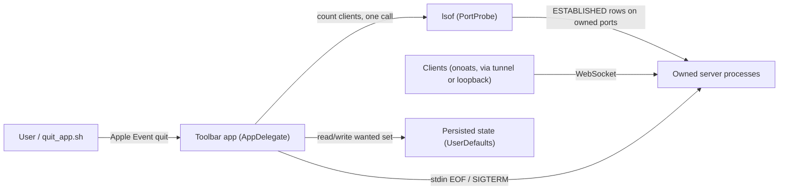
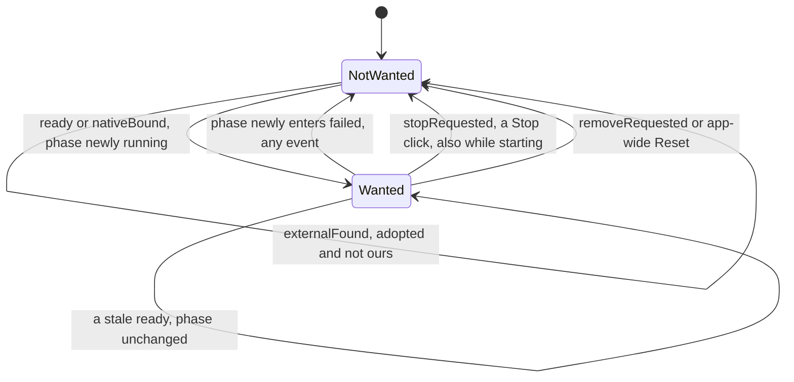
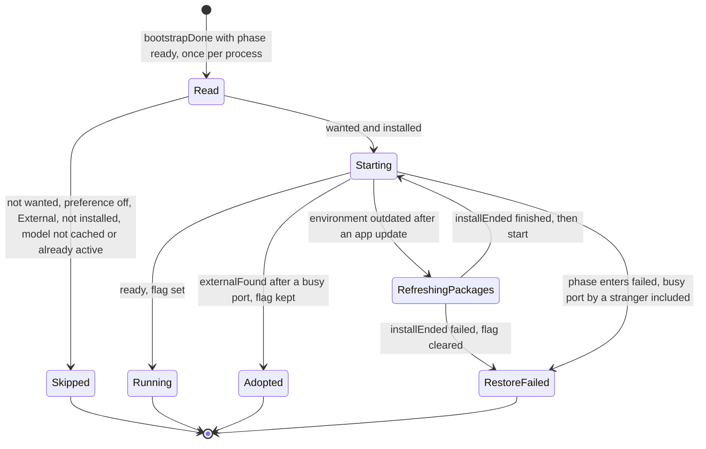
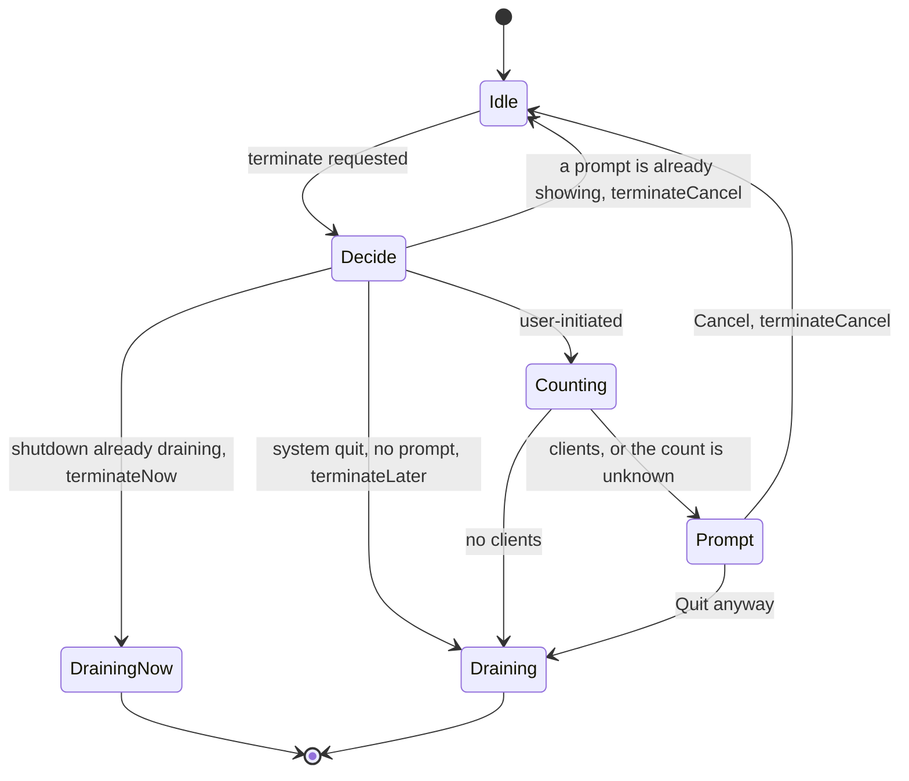

# Task: Menubar app — restore running services on launch, guard Quit when a client is connected

**Status**: Not Started
**Component**: macos
**Assigned to**: Varun Singh / Claude
**Priority**: Medium
**Branch**: `feature/menubar-restore-and-quit-guard` (off `main` @ `89ca2b5`)
**Created**: 2026-10-28
**Completed**: (fill when done)
**Review Gates**: full

## Objective

When Pipecat Service Toolbar quits (user quit, `just app-install`, crash), the servers it started stop with it, and nothing brings them back. Make the app (1) restart, on next launch, the services that were running, and (2) ask before quitting while a client is connected to one of the servers it owns.

## Context

- A supervised server exits on stdin EOF, so every app exit (Quit, update, crash) stops the servers the app started. The app persists no "was running" state: `UserDefaults` holds only `catalogKind`, `hubSize.service.<raw>`(+`.at`) and the try-it text/voice (`AppModel.swift:44-45,194-208`, `TryItSession.swift:34-35,80-82`).
- Operator pain (2026-10-28): updating the app stops the servers, and a client (onoats) connected to one loses its session with no warning.
- Option rejected: "Quit but leave servers running, re-adopt on launch". It needs servers that outlive the app (the stdin-EOF contract goes), an ownership notion that survives restarts, and orphan handling. Zero-drop updates are already available for the TTS servers as a LaunchAgent (`just tts-install`), which the app shows as External and never touches. The STT servers have no such route in this repo, and the in-process Apple Speech server can never outlive the app. This plan documents that scope instead of building a second route.
- Model weights are already global (`~/.cache/huggingface/hub`, `HF_HOME` honoured; `AppPaths.swift`), so a restore after an update re-loads weights from disk, not the network. Only the Python environments and the layout file are app-private. An update that changes an environment's fingerprint makes the next start refresh packages first (see state machine 2).
- Every server the app owns binds `127.0.0.1` (`ServiceCatalog.host`, `Service.swift:217`). A remote client reaches one through a tunnel or proxy on this machine, so its server-side socket still shows as an ESTABLISHED row on the service port.
- Decisions taken by the operator in conversation (2026-10-28): restore only services that were **running** (not failed ones); a **confirmation prompt** (not just a menu warning) guards Quit; the restore preference is on by default; a restore whose port was taken ends in `.failed` and is not retried; the prompt is **synchronous** inside `applicationShouldTerminate`; when the client count is unknown the app **asks anyway**; the Quit menu title is **unchanged**.

## Requirements

- **Restore.** The set of services the user wants running (the wanted set) is persisted when it changes, not only at Quit, so a crash restores too. Restore runs once per process, after `send(.bootstrapDone)` and the `.ready` guard (`AppModel.swift:186-188`): `ServiceModel.start()` refuses actions for Python services while the app phase has a job, and `.bootstrapping` is one (`AppLifecycle.swift:73,102-105`). A Retry after a failed bootstrap restores once it succeeds; a Reset clears the set first.
  - Set when: an owned server newly reaches `.running` (a Start click or a restore).
  - Cleared when: a user Stop click (`stopRequested`); the phase newly enters `.failed` from any event (crash, startup error, busy port, install failure, removal failure); `removeRequested`; an app-wide Reset.
  - Kept by everything else: the quit kinds (`shutdownRequested`, `shutdownServers`), an `exited` that follows a requested stop, `externalFound`/`externalLost`, a stale `ready`, install, refresh, probe and try-it events, app crash, power-off.
- Restore starts a wanted service through the same `start()` the Start button uses, when discovery has not found it External and it is installed with its model cached. It does **not** pre-filter on the port: a busy port reaches the reducer's own start path, which adopts an External match (flag kept) or ends in `.failed` (flag cleared, the reducer's own row text). A service whose model is not cached is skipped with a log line, never downloaded in the background.
- A restore never fights an External server: one that discovery finds at launch is adopted, not started, and its flag is kept.
- A preference "Restore running services on launch" (key `restoreOnLaunch`, default on) gates the launch restore. Off: the set is still maintained, nothing is started. The toggle sits in the panel's gear `Menu` beside "Open at Login" (`PanelView.swift:706-725`).
- **Quit guard.** On a user-initiated terminate (menu Quit, Apple Event from `quit_app.sh`), if any owned server has at least one connected client, or the count is unknown, show a confirmation naming the service(s) and the count; Cancel leaves every server running. No clients: today's behaviour, no prompt. The prompt is synchronous inside `applicationShouldTerminate`: Cancel returns `.terminateCancel`; Quit anyway starts the existing `.terminateLater` + `shutdownAll()` path. `terminateReplyPending` is set only after the answer, so a Cancel leaves no stale state and the next Quit prompts again.
- The guard is skipped (no prompt, shutdown proceeds as today) for a system-initiated quit (log out, restart, shut down) and for a second terminate while a shutdown is already draining (`.terminateNow`). A terminate that arrives while the prompt is showing answers `.terminateCancel`.
- Client count = established connections to an owned server's port, excluding the app's own connections (discovery probes, Try-it). It works for the TTS server, the pinned upstream STT server (no server-side counter exists: `server.status` reports `queue_depth`/`busy` only) and the in-process Apple Speech server. One bounded `lsof` call covers every owned port. A failure or a timeout is "unknown" and the guard asks anyway.
- `just app-install` / `just app-open` stop (exit 1, nothing replaced) rather than drop a connected client while the prompt is up; `quit_app.sh`'s failure message mentions a pending confirmation.
- Documented: zero-drop updates need a LaunchAgent (`just tts-install`) and apply to the TTS servers only; it shows as External. A half-open connection (a dead peer) stays ESTABLISHED until the keepalive reaps it (about 140 s at the defaults), so the prompt can name a client that is already gone; Cancel and Quit anyway are both one click.

## Review Focus

- **Client counting must not undercount, and the app's own sockets must not inflate it.** On loopback, both the server's and the client's socket appear in `lsof -iTCP`, so "exclude the server's pid" would drop a tunnelled remote client's row and "exclude the app's pid" would drop the Apple Speech server's own rows. The rule is "server-side row (local port == service port), minus rows whose peer is one of the app's own sockets". It assumes lsof lists the app's `URLSession` and `NWListener` sockets under the app pid; that is unverified (Phase 1 captures real output). Fixtures come from the real binary (`f` lines and bracketed IPv6 included), not hand-typed.
- **The flag rule is the whole feature.** It is a precedence rule over phase before/after plus the event kind (State machines, table). Re-check every path that ends a service (Stop click, `.failed` from any event, a server crash while the app lives, `shutdownAll`, Reset, Delete, power-off) against it. A `shutdownAll()` that clears the set silently defeats restore.
- **Stop and Quit share state.** `s.stopRequested` is one bool for a Stop click (`.stopRequested`) and Quit (`.shutdownServers`), and `.exited` treats them alike (`ServiceLifecycle.swift:900-915`). The user-Stop decision therefore keys off the event kind; the `.failed` decision keys off the phase change.
- **A new `LifecycleEvent.Kind` must force a decision.** `Kind` is `CaseIterable` (`ServiceLifecycle.swift:235`; `everyKindIsClassified` pins 32 kinds). The wanted-flag function switches exhaustively over it with no `default`, so a new event fails to compile until its effect is chosen.
- **Restore ordering and timing.** After `.bootstrapDone` and the `.ready` guard, once per process. Before that, Python-service starts are silently dropped.
- **Quit seam** (`ToolbarApp.swift:91-100`): the prompt runs before any reply. Unverified AppKit behaviour to check by hand: (a) whether a second terminate during `runModal` re-enters `applicationShouldTerminate` or is queued; (b) whether the alert comes to the front when the quit arrives by Apple Event and another app is frontmost (precedent alert: `ToolbarApp.swift:71-77`; macOS 14+ cooperative activation may refuse); (c) which quit-reason code a menu Quit, an `osascript` quit and a Log Out carry.
- **Test reach:** the test target depends only on `PipecatToolbarCore` (`Package.swift:29-32`). App-target code (`AppModel`, `ToolbarApp`) is gated by `swift build` and manual checks, so policy and parsing live in Core as pure functions.
- **Smoke isolation.** `ui_smoke.sh` runs the real binary against the operator's `UserDefaults`; it must not restore or write the operator's wanted set.

## Implementation Checklist

### Phase 1: Core policy and connection counting (pure, no UI)

**Impl files:** `macos/Sources/PipecatToolbarCore/RestorePolicy.swift, macos/Sources/PipecatToolbarCore/ConnectionCount.swift, macos/Sources/PipecatToolbarCore/QuitGuardPolicy.swift, macos/Sources/PipecatToolbarCore/QuitReason.swift, macos/Sources/PipecatToolbarCore/PortProbe.swift`
**Test files:** `macos/Tests/PipecatServiceToolbarTests/RestorePolicyTests.swift, macos/Tests/PipecatServiceToolbarTests/ConnectionCountTests.swift, macos/Tests/PipecatServiceToolbarTests/ConnectionCountLiveTests.swift, macos/Tests/PipecatServiceToolbarTests/QuitGuardPolicyTests.swift`
**Test command:** `swift test --package-path macos --filter "RestorePolicyTests|ConnectionCountTests|QuitGuardPolicyTests"`
**Validation cmd:** `PIPECAT_TOOLBAR_E2E=1 swift test --package-path macos --filter ConnectionCountLiveTests`
**Goal:** The decisions (which services to restore, how the wanted flag changes, how many clients a port has, whether to prompt) are pure functions of their inputs, written out per case in tables, so the UI layers only call them.

- `RestorePolicy.plan(wanted:states:preferenceOn:)`: per service, `start` or `skip(reason)` where reason is one of not wanted, preference off, External, not installed, model not cached, already active. Written as an explicit per-phase table (like `ServiceCountsTests.startableCountsExactlyTheStatesIsStartableAccepts`). An installed service with an outdated environment is `start`: the reducer turns it into a packages refresh.
- `WantedTransition.next(wanted:kind:before:after:) -> Bool`: precedence (1) `before != .failed && after == .failed` clears; (2) `stopRequested` clears; (3) `removeRequested` clears; (4) `ready`/`nativeBound` with `before != .running && after == .running` sets; (5) everything else keeps. The kind switch is exhaustive with no `default`. Tests: one row per `Kind` (iterate `Kind.allCases`, as `everyKindIsClassified` does); sequence tests: Start then Quit keeps; Start then Stop click clears; restore then `portOwnerFound` (busy port) clears; a stale `ready` after Stop leaves it unchanged; `installEnded(.failed)` during a packages refresh clears; `exited` after a requested stop keeps.
- `ConnectionCount.parse(output:ports:appPid:) -> [Int: Int]`: parse one `lsof -nP -iTCP -sTCP:ESTABLISHED -Fpn` output into a count of server-side sockets per owned port (local port == service port), minus those whose peer ephemeral port is the local port of a row owned by `appPid`. Fixtures, recorded from real lsof output and embedded as Swift string literals (no `Package.swift` change): loopback client process, a client connecting through the machine's own LAN address, IPv6 loopback (bracketed), the app's own probe, an Apple Speech shape (server rows owned by the app pid, client rows another pid), two connections from one client process (counts 2), malformed lines.
- `PortProbe.clientCounts(ports:appPid:timeout:)`: one blocking `Process` run of the same lsof command, bounded by a 2 s deadline (terminate at expiry), returning per-port `known(n)` or `unknown`. It is blocking because `applicationShouldTerminate` must answer synchronously; a full ESTABLISHED scan measured 0.07 s. This is a separate path from `owner(of:backend:)`, whose `collect` only cancels on task cancellation (`PortProbe.swift:94-100`).
- `QuitReason.isSystemInitiated(code:)`: a pure mapping from the Apple Event quit-reason code to a bool. The code table is filled from the Phase 3 spike, not from memory.
- `QuitGuardPolicy.decide(counts:systemQuit:drainInProgress:promptShowing:)` → `proceedNow` (`.terminateNow`) | `proceedAfterShutdown` (`.terminateLater` + `shutdownAll()`) | `confirm(message)` | `cancel` (`.terminateCancel`, a terminate while the prompt shows). One test row per state-machine arm, including: unknown count → `confirm`; system quit with clients → `proceedAfterShutdown`; drain in progress → `proceedNow`; and a sequence confirm → Cancel → terminate again → `confirm` again.
- `ConnectionCountLiveTests` (gated on `PIPECAT_TOOLBAR_E2E`, like `EndToEndTests`): an in-process `STTWebSocketServer` listener (the Apple Speech shape) with an out-of-process client (`nc`) counts 1; an in-process client counts 0; a tone TTS server over loopback with one client counts 1.

### Phase 2: Persist the wanted set and restore on launch

**Impl files:** `macos/Sources/PipecatToolbarCore/WantedServiceStore.swift, macos/Sources/PipecatToolbarCore/ServiceDriver.swift, macos/Sources/PipecatToolbarCore/AppLifecycle.swift, macos/Sources/PipecatServiceToolbar/State/AppModel.swift, macos/Sources/PipecatServiceToolbar/Views/PanelView.swift, macos/scripts/ui_smoke.sh`
**Test files:** `macos/Tests/PipecatServiceToolbarTests/ServiceDriverTests.swift, macos/Tests/PipecatServiceToolbarTests/WantedServiceStoreTests.swift, macos/Tests/PipecatServiceToolbarTests/AppLifecycleTests.swift, tests/test_justfile_recipes.py`
**Test command:** `swift build --package-path macos && swift test --package-path macos --filter "ServiceDriverTests|WantedServiceStoreTests|AppLifecycleTests" && uv run pytest tests/test_justfile_recipes.py -k ui_smoke -q`
**Goal:** The wanted set changes only by the precedence rule in Phase 1, and a restore starts exactly what `RestorePolicy` says, never before `.bootstrapDone` and never twice in one process.

- `WantedServiceStore`: a protocol over `UserDefaults` (key `restore.wanted`, an array of service raw values), injected in tests. `read` drops any raw value that no longer maps to a `Service` (a removed or renamed case) and a test pins that. `removeAll()` for Reset.
- `ServiceDriver`: one private reduce wrapper used by both `dispatch` (`ServiceDriver.swift:140`) and `dispatchAwaiting` (`:146`) computes `WantedTransition.next` from the kind and the before/after phase and writes through the store. The store arrives via `ServiceDependencies` (`:65-86`) with a no-op default so existing call sites compile; `start()`/`stop()`/`quit()` are unchanged. Driver tests inject a store and assert the sequences in Phase 1; `.shutdownServers` keeps the flag (the reachable form of "Quit keeps").
- Reset: `AppLifecycle.reduce` emits an effect for `.reset`; `AppModel` runs it as `wanted.removeAll()` before `send(.resetDone)`. A row in `AppLifecycleTests` pins the effect. If `AppEffect` cannot carry it, `AppModel.runReset` clears the set directly and `WantedServiceStoreTests` covers `removeAll()`; decide on reading `AppLifecycle.swift` at the start of this phase.
- Delete: `.removeRequested` clears via the same rule.
- `AppModel`: after `send(.bootstrapDone)` and the `phase == .ready` guard (`AppModel.swift:186-188`), once per process (a `restoredThisProcess` flag set when a restore pass has run; a Retry after a failed bootstrap restores once it succeeds), call `RestorePolicy`, start the services it names through `ServiceModel.start()`, and log one line per skip. No separate row text for a failed restore: the reducer's `.failed(ServiceFailure)` already renders it.
- The `restoreOnLaunch` toggle in the gear `Menu` beside "Open at Login" (`PanelView.swift:706-725`).
- `ui_smoke.sh`: launch the bundle binary with `-restoreOnLaunch NO` (argument domain, so the operator's defaults are neither read nor written). One extra step launches with `-restore.wanted "(<the catalog service whose port the existing External step holds>)"` and `-restoreOnLaunch YES`, and asserts that service shows External and no owned server was started; the existing no-children and clean-exit assertions still hold. Tests in `tests/test_justfile_recipes.py` (`-k ui_smoke`) assert the arguments are passed. Verify first that a plist-array argument reaches `UserDefaults.standard.array(forKey:)`.

### Phase 3: Quit guard

**Impl files:** `macos/Sources/PipecatServiceToolbar/App/ToolbarApp.swift, macos/Sources/PipecatServiceToolbar/State/AppModel.swift`
**Test files:** `macos/Tests/PipecatServiceToolbarTests/QuitGuardPolicyTests.swift, macos/Tests/PipecatServiceToolbarTests/QuitReasonTests.swift`
**Test command:** `swift build --package-path macos && swift test --package-path macos --filter "QuitGuardPolicyTests|QuitReasonTests"`
**Validation cmd:** `just app-smoke --build`
**Goal:** A connected client is never dropped by a user-initiated quit without an explicit answer, and a system log out, restart or shut down is never blocked.

- Spike first (record the results under Findings): temporarily log the quit reason from `NSAppleEventManager.shared().currentAppleEvent` (the `kAEQuitReason` attribute) for a menu Quit, an `osascript` quit and a real Log Out; fill `QuitReason`'s table and `QuitReasonTests` from what is observed.
- `applicationShouldTerminate` (`ToolbarApp.swift:91-100`): (1) drain in progress (`terminateReplyPending`) → `.terminateNow`, as today; (2) `promptShowing` → `.terminateCancel`; (3) read `systemQuit` = quit-reason says system **or** the `willPowerOffNotification` flag (`ToolbarApp.swift:80-84`) is set, without assuming the notification arrives first; (4) count clients with `PortProbe.clientCounts` for the owned services' ports (`AppModel` exposes them with the app pid); (5) ask `QuitGuardPolicy`. On `confirm`: `NSApp.activate`, set `promptShowing`, `runModal` an `NSAlert` naming each service and its count (or "could not check for connected clients"; default button Cancel), clear `promptShowing`. Cancel → `.terminateCancel`. Quit anyway, or `proceedAfterShutdown` → set `terminateReplyPending`, run `shutdownAll()`, return `.terminateLater`.
- The main thread blocks for at most the 2 s lsof deadline plus the modal; nothing is draining at that point (shutdown has not started).
- The Quit menu title stays driven by `ServiceCounts.quitTitle` (decided: unchanged).
- Manual checks run here and are recorded under Findings: two `osascript` quits while the alert is up (re-entry vs queue; expect `.terminateCancel` and no second alert); menu Quit while the alert is up; quit from a frontmost Terminal (alert reaches the front); a real Log Out with a client connected (not blocked, and a log line shows the guard was skipped). If a second terminate is queued instead of re-entered, add a "just answered" arm so the queued one is ignored; the Phase 3 test rows follow.

### Phase 4: Script messaging, verification and docs

**Impl files:** `macos/scripts/quit_app.sh, macos/README.md, macos/docs/architecture.md, README.md, AGENTS.md, CHANGELOG.md, pyproject.toml, uv.lock`
**Test files:** `tests/test_justfile_recipes.py`
**Test command:** `uv run pytest tests/test_justfile_recipes.py -k "quit_app" -q`
**Validation cmd:** `just app-smoke --build`

- `quit_app.sh`: the exit-1 message adds that a confirmation may be waiting in the app. A test drives the existing `_run_quit_app(quit_ends_it=False)` stub path (`tests/test_justfile_recipes.py:443-566`) and asserts exit 1 plus the message; the exit codes and the one-deadline contract do not change.
- Docs: `macos/README.md` and `macos/docs/architecture.md` (the wanted-flag precedence rule, restore timing and once-per-process, the synchronous guard, the loopback-and-tunnel counting rule, the half-open caveat, the zero-drop LaunchAgent route for TTS only), `AGENTS.md` Layout line for `macos/`, `CHANGELOG.md` `## [0.9.0]`.
- Version bump to 0.9.0 (`pyproject.toml`, `uv.lock`) in a separate "chore: release 0.9.0" commit, made **before** the manual `just app-install` check below: `build_app.sh:54` takes the bundle's `CFBundleShortVersionString` from the server version.
- Manual verification, recorded under Findings: with a client connected, `just app-install` waits `QUIT_WAIT_SECS`, exits 1 and replaces nothing; after answering "Quit anyway" a later run proceeds. Restore: start two services, `just app-open`, confirm both come back after the relaunch; Stop one by clicking, relaunch, confirm it does not. Update scenario: after `just app-install` changes an environment fingerprint, confirm the restore goes through the packages refresh to running, and a Quit during that refresh restores again next launch. External: with an out-of-process server on a catalog port, confirm it is adopted, not started over.
- `just app-install` does not relaunch the app today; whether it should when the old copy was running is out of scope (Follow-up).

## Technical Specifications

### Files to Modify

- `macos/Sources/PipecatToolbarCore/PortProbe.swift` — add the blocking, bounded `clientCounts(ports:appPid:timeout:)` beside `owner(of:backend:)` (`:47-70`).
- `macos/Sources/PipecatToolbarCore/ServiceDriver.swift` — one reduce wrapper for `dispatch`/`dispatchAwaiting` (`:140,146`) that updates the wanted set; store injected via `ServiceDependencies` (`:65-86`).
- `macos/Sources/PipecatToolbarCore/AppLifecycle.swift` — a Reset effect that clears the set (if `AppEffect` can carry it).
- `macos/Sources/PipecatServiceToolbar/State/AppModel.swift` — restore after `.bootstrapDone` and the `.ready` guard (`:186-188`), once per process; owned ports and the app pid for the guard; the preference property; Reset runs the clear.
- `macos/Sources/PipecatServiceToolbar/App/ToolbarApp.swift` — the synchronous guard in `applicationShouldTerminate` (`:91-100`), `promptShowing`, quit reason, power-off flag (`:80-84`).
- `macos/Sources/PipecatServiceToolbar/Views/PanelView.swift` — the `restoreOnLaunch` toggle in the gear `Menu` (`:706-725`).
- `macos/scripts/ui_smoke.sh` — argument-domain launch arguments and the seeded External step.
- `macos/scripts/quit_app.sh` — message only.
- `tests/test_justfile_recipes.py` — `ui_smoke` argument tests, the `quit_app` message test.
- `macos/README.md`, `macos/docs/architecture.md`, `README.md`, `AGENTS.md`, `CHANGELOG.md`, `pyproject.toml`, `uv.lock`.

### New Files to Create

- `macos/Sources/PipecatToolbarCore/RestorePolicy.swift` — restore decision and `WantedTransition`.
- `macos/Sources/PipecatToolbarCore/ConnectionCount.swift` — the lsof `-F` parser and the server-side/own-socket rule.
- `macos/Sources/PipecatToolbarCore/QuitGuardPolicy.swift` — the four-valued prompt decision.
- `macos/Sources/PipecatToolbarCore/QuitReason.swift` — quit-reason code to system-initiated.
- `macos/Sources/PipecatToolbarCore/WantedServiceStore.swift` — persistence seam over `UserDefaults`.
- Matching `*Tests.swift` under `macos/Tests/PipecatServiceToolbarTests/` (Swift Testing, `@Suite struct`, as in `ServiceCountsTests.swift`), including the gated `ConnectionCountLiveTests.swift`.

### Architecture Decisions

- **Persist on transitions, not at Quit.** Covers crash and power loss with one mechanism; Quit and update need no special path.
- **UserDefaults for the set.** Same store as the app's other preferences; no new file format. The `layoutVersion = 1` layout file is not touched. Unknown raw values are dropped on read.
- **The flag is a precedence rule over phase before/after and the event kind.** The `.failed` entry is detected from the phase change, so every route into `.failed` clears it; the user Stop is detected from the event kind, because the reducer's `stopRequested` bool cannot tell Stop from Quit.
- **One reduce wrapper in `ServiceDriver`.** Events reach the reducer through both `dispatch` and `dispatchAwaiting`; hooking the intent methods would miss `ready` and `failed`.
- **Restore calls `start()`; there is no port pre-filter.** The reducer already adopts an External match and fails a stranger-held port, so the busy-port outcome has one definition. Decided (operator): a stranger-held port clears the flag.
- **Count by socket rows, not by server counters.** `server.status` has no connection count and the STT server is pinned upstream; lsof is already the app's probe mechanism and works for every server kind. One call covers all ports. Counts are a point-in-time snapshot; a client connecting during the prompt is not re-checked (accepted).
- **Synchronous confirmation, Cancel as default.** The prompt runs before any reply, so Cancel is a plain `.terminateCancel`, no pending-reply state is left behind, and a second quit during the prompt cannot reach the `.terminateNow` path. It blocks scripted quits on purpose (`quit_app.sh` then exits 1).
- **Unknown count → ask anyway.** Decided (operator). Quitting silently would reintroduce the dropped call this plan prevents.
- **Quit title unchanged.** Decided (operator). The prompt names the service and count; no lsof runs while the menu renders.
- **System-initiated quits are not blocked.** Detected from the Apple Event quit reason, with the power-off notification as a second signal; neither's ordering is assumed.
- **Restore only what was running, once per process, after `.bootstrapDone`.** A `.failed` service clears its flag, so a broken server is never restarted on every launch.

### Dependencies

None added. Swift tools 6.0, macOS 15 (`macos/Package.swift`); no external Swift packages. `/usr/sbin/lsof` is already used by `PortProbe`.

### Integration Seams

| Seam | Writer (task) | Caller (task) | Contract |
|------|---------------|---------------|----------|
| Wanted set | `ServiceDriver` reduce wrapper (Phase 2) | `AppModel` restore (Phase 2) | Written only by the precedence rule; never by quit kinds or `shutdownAll()`; read once per process, after `.bootstrapDone` and the `.ready` guard; unknown raw values dropped |
| Reset | `AppLifecycle` effect or `AppModel.runReset` (Phase 2) | `WantedServiceStore.removeAll()` (Phase 2) | The set is empty before `.resetDone` |
| Client count | `PortProbe.clientCounts` (Phase 1) | `applicationShouldTerminate` (Phase 3) | One lsof call for all owned ports; server-side rows minus the app's own peers; `unknown` on failure or after 2 s; blocking, so main-thread time is bounded by the deadline |
| Quit reason | `QuitReason` (Phase 1, table from the Phase 3 spike) | `applicationShouldTerminate` (Phase 3) | System-initiated reason **or** the power-off flag means no prompt |
| Quit refusal | `ToolbarApp` guard (Phase 3) | `quit_app.sh` / `just app-install` (Phase 4) | Cancel keeps the process alive with no pending-reply state; the script exits 1 at its deadline and the recipe replaces nothing |
| Smoke isolation | `ui_smoke.sh` launch arguments (Phase 2) | `AppModel` restore, `UserDefaults` argument domain | The smoke never reads or writes the operator's wanted set |

## Architecture & Call Flow

Component graph — which component triggers which:



Trigger order — a quit, an update and the next launch:

```mermaid
sequenceDiagram
    participant U as User / quit_app.sh
    participant A as App
    participant P as lsof
    participant S as Server
    participant D as Persisted set
    U->>A: quit
    A->>P: ESTABLISHED rows for owned ports
    P-->>A: counts, or unknown after 2 s
    alt clients, or unknown
        A->>U: synchronous prompt: Quit anyway / Cancel
        Note over A,U: Cancel returns terminateCancel at once; quit_app.sh exits 1
    end
    A->>S: shutdownAll, terminateLater; wanted set kept
    Note over A: app updated and relaunched
    A->>A: bootstrap, discovery pass, bootstrapDone, phase ready
    A->>D: read wanted set, once per process
    A->>S: start each wanted service that is installed and not External
```

Context lifecycle — what enters context at each step, and whether it clears or persists:

| Step | Trigger | Enters context | Cleared/persisted | Turn boundary |
|------|---------|----------------|-------------------|---------------|
| 1 | Owned server newly `.running` | service id | added to the wanted set (persisted) | phase becomes `.running` |
| 2 | Stop click, or phase enters `.failed`, or remove | service id | removed from the set | state change recorded |
| 3 | Quit / update / crash | none | set untouched | app exits |
| 4 | `.bootstrapDone` with phase `.ready` | persisted set | read once per process | restore pass finished |
| 5 | Quit guard | per-port client count, quit reason | not persisted | user answers the prompt |

### State machines

Three small machines; none adds a `ServicePhase` or an `AppPhase`. The wanted flag is an overlay on the existing lifecycle (`ServiceLifecycle.swift`). Restore starts are ordinary `startRequested` events dispatched after `.bootstrapDone` (`AppModel.swift:186-188`), so the app stays in `.ready` while models load.

**1. Wanted flag, per service.** The initial value at launch is read from the persisted set. Precedence, first match wins: (1) a phase change into `.failed` clears; (2) `stopRequested` clears; (3) `removeRequested` clears; (4) `ready` or `nativeBound` with a phase change into `.running` sets; (5) everything else keeps.



| Lifecycle event (kind) | Wanted flag | Why |
|---|---|---|
| any kind that moves the phase into `.failed` (`launchFailed`, `nativeFailed`, `portOwnerFound` busy port, `startProbeResult`, `installEnded(.failed)`, `appleSpeechInstallEnded(.failed)`, `removalFailed`, an `exited` that is a crash or startup error) | clear | A failed service is not restarted on every launch. A busy port taken by a stranger lands here. |
| `readyTimedOut` | keep | It stops the server; the later `exited` carries the `.failed` and clears. |
| `stopRequested` | clear | A Stop click. Quit does not send it. |
| `removeRequested`, app-wide Reset | clear | The service is going away. |
| `ready`, `nativeBound` with the phase newly `.running` | set | The user got it running (by click or by restore). `ready` is dropped unless the phase is `.starting` (`ServiceLifecycle.swift:888`), so a stale one never sets. |
| `shutdownRequested`, `shutdownServers` | keep | Quit and update must not forget what was running. |
| `exited` with `stopRequested` set | keep | The flag is shared by Stop and Quit (`ServiceLifecycle.swift:900-915`); the exit cannot tell them apart, and the event that began the stop already decided. |
| `externalFound`, `externalLost` | keep | An adopted server is not ours. A server lost while the app runs is not restarted (restore runs at launch only). |
| every other kind | keep | Install, refresh, probe and try-it events do not change what the user wants running. |

**2. Restore, per service, after `.bootstrapDone`.**



A Quit while a service is `Starting` or `RefreshingPackages` keeps its flag (quit kinds), so the next launch restores it again. No prompt appears for it unless a client is connected to an already-running server.

**3. Quit guard, in the app delegate.**



"System quit" is the quit-reason code from the current Apple Event, or the `willPowerOffNotification` flag. The prompt is a synchronous `runModal`, so `terminateReplyPending` is false until the answer and a Cancel leaves nothing behind. Whether AppKit re-enters `applicationShouldTerminate` during `runModal` or queues the second terminate is unverified (Phase 3 check); the `Idle` arm handles re-entry, and a "just answered" arm is added if it queues.

## Testing Notes

### Test Approach

- [ ] Unit: `RestorePolicy` per-phase table (every `ServicePhase` × wanted/not wanted × preference on/off); `WantedTransition` one row per `Kind` plus the sequence tests; `ConnectionCount.parse` fixtures from real lsof output; `QuitGuardPolicy` one row per state-machine arm; `QuitReason` table from the spike.
- [ ] Driver: `ServiceDriverTests` with an injected store: Start sets, Stop click clears, each failure route clears, `.shutdownServers` and a requested-stop `exited` keep, a stale `ready` does not set.
- [ ] Reset and store: an `AppLifecycleTests` row for the Reset effect (or `WantedServiceStoreTests.removeAll`); unknown raw values dropped on read.
- [ ] Live counting (gated on `PIPECAT_TOOLBAR_E2E`): Apple Speech shape (in-process listener, out-of-process client counts 1, in-process client counts 0); a tone TTS server over loopback with one client counts 1. Remote-looking rows are covered by the recorded fixtures, because owned servers bind `127.0.0.1` only.
- [ ] Smoke: `just app-smoke --build` passes with restore disabled by argument, and the seeded External step shows the service External with no owned start.
- [ ] Manual (Phase 3 and 4): the checks listed under those phases.
- [ ] `swift build --package-path macos` in the Phase 2 and 3 gates, because the test target cannot compile app-target code.

### Test Results

- [ ] All existing tests pass (`uv run pytest`, `swift test --package-path macos`)
- [ ] New tests added and passing
- [ ] Manual verification complete

### Edge Cases Tested

- [ ] Two connections from one client process count as two (the policy counts sockets; the message says "connections").
- [ ] A server that dies between the persisted-set write and relaunch (port now free, model present): restored normally.
- [ ] Restore when a stranger holds the port: the service ends `.failed`, the flag is cleared, the other services still start.
- [ ] Quit during a restore in progress (`Starting` or `RefreshingPackages`): no prompt (no connected client), the server is stopped, the flag is kept, the service restores at next launch.
- [ ] Restore through a packages refresh after an app update reaches `.running`; `installEnded(.failed)` clears the flag.
- [ ] Apple Speech (in-app server): its client counted, the app's own rows not.
- [ ] Preference off: set maintained, nothing started.
- [ ] Cancel, then Quit again: the prompt appears again.
- [ ] A second quit while the prompt is up: no second alert.
- [ ] A persisted raw value that no longer maps to a `Service`: dropped without error.
- [ ] Count unknown (lsof fails or exceeds 2 s): the prompt appears with the "could not check" text.
- [ ] A half-open client: counted until the keepalive reaps it (documented).

## Acceptance Criteria

- Start two services, update the app with `just app-install` (no clients): after reopening the app both are running again without a click, including when the update triggered a packages refresh.
- A Stop click and a service that failed do not come back on the next launch; a service whose restore hit a stranger-held port is not retried.
- With a client connected to an owned server, Quit (menu and Apple Event) shows the prompt naming the service and count; Cancel leaves every server running and `just app-install` exits 1 without replacing the bundle; Quit again prompts again.
- Quit with no connected client behaves exactly as today (no prompt).
- A system log out, restart or shut down is not blocked by the guard.
- A server already running on a catalog port at launch is adopted, never started over, and its restore flag is kept.
- The restore preference gates the launch restore; Reset clears the set.
- `just app-smoke --build` passes and never reads or writes the operator's wanted set.
- Docs describe the flag rule, restore timing, the guard, the counting rule, the half-open caveat, and the TTS-only LaunchAgent route for zero-drop updates; CHANGELOG and version are 0.9.0.
- Code reviewed and approved; `ruff format` and `ruff check` clean; full test suite passing.

<!-- reviewed: 2026-10-29 @ b8489748218df5b774cc0068b16b285a66362089 -->

<!-- /review-plan writes the marker line above. Everything below is the workspace: edits here do NOT invalidate the marker. -->

## Progress

- [x] Phase 1: Core policy and connection counting
- [x] Phase 2: Persist the wanted set and restore on launch
- [x] Phase 3: Quit guard (code + unit tests; spike, manual checks and `just app-smoke --build` deferred to the operator)
- [ ] Phase 4: Script messaging, verification and docs

## Findings

- Explore facts (2026-10-28, `main` @ `89ca2b5`): quit handling at `ToolbarApp.swift:91-100` (no confirmation today; second terminate while draining → `.terminateNow`); `shutdownAll()` at `AppModel.swift:218-245`; `ServiceCounts.owned` = states with `server != nil || native != nil`; `PortProbe` has no ESTABLISHED counting; Apple Speech's server reports the app's own pid (`ServiceDriver.swift:488`).
- Verified against the reducer (2026-10-28): `s.stopRequested` is shared by `.stopRequested` and `.shutdownServers` (`ServiceLifecycle.swift:936-962`), and `.exited` handles both in one branch (`:900-915`); `ready` is dropped unless the phase is `.starting` (`:888`); `readyTimedOut` never enters `.failed` itself (`:895-898`); a busy port reaches `.failed` through `portOwnerFound` (`:800-805`).
- Verified (2026-10-28): the catalog host is `127.0.0.1` (`Service.swift:217`); `LifecycleEvent.Kind` is `CaseIterable`; `AppLifecycle.reduce` returns `[AppEffect]`; `ui_smoke.sh --build` exists; the gear control is a `Menu` at `PanelView.swift:706-725` with an "Open at Login" toggle.
- Review round 1 (`/review-plan`, 2026-10-29): 36 findings (20 Important, 16 Minor, 0 Critical), all applied to the contract above. Decisions (operator): synchronous prompt in `applicationShouldTerminate`; unknown count asks anyway; Quit title unchanged; a stranger-held port clears the flag (no retry, no pre-filter).
- Unverified, with the step that settles each: lsof lists the app's `URLSession`/`NWListener` sockets under the app pid (Phase 1 fixtures and live test); whether a second terminate during `runModal` re-enters or queues (Phase 3 manual check); the quit-reason codes for menu Quit, `osascript` quit and Log Out (Phase 3 spike); the alert reaches the front from an accessory app on an Apple Event quit with another app frontmost (Phase 3 manual check); a plist-array argument reaches `UserDefaults.standard.array(forKey:)` (start of Phase 2).
- Phase 1 reviewer (advisory, conduct): 1 Important, 5 Minor, none applied yet. Important: `PortProbe.clientCounts` bounds only the pipe read; `waitUntilExit()` after it is unbounded and spins the main run loop (fix in Phase 3 or the gauntlet: `terminationHandler` + semaphore within the same deadline). Minor: `appLocalPorts` matches peers by port only (an app socket's local port could equal a real client's ephemeral port; restrict to app-owned rows whose peer port is an owned port); exit 1 + non-empty stderr should be `unknown`, not `known(0)`; `QuitReason` constant names in comments are wrong (`quit`=kAEQuitApplication, `rrst`/`rsdn`=kAEShowRestart/ShutdownDialog) and the table is provisional until the Phase 3 spike; `QuitGuardPolicy` checks `promptShowing` before `systemQuit`, so a Log Out during the prompt is cancelled (decide ordering in Phase 3); live in-process-client test should also assert the count is 1 with a different appPid, to prove the app's rows are visible to lsof.
- Phase 2 reviewer (advisory, conduct): 1 Important, 3 Minor, none applied yet. Important: smoke isolation is incomplete (`ui_smoke.sh`): only `-restoreOnLaunch` is shadowed on every launch, steps 2-5 read the operator's real `restore.wanted` (same bundle id), and launch arguments never shadow WRITES, so a wanted transition during a smoke launch (step 6 if tone is not adopted) would overwrite the operator's set; fix: pass `-restore.wanted "()"` on every launch and route writes to a throwaway suite via a launch arg/env. Until fixed, back up `defaults read <bundle id> restore.wanted` before `just app-smoke`. Minor: step 6 asserts zero children (flaky; assert no `restore: starting` / no owned server instead); `restoreOnLaunch` computed property is not observed by `@Observable` (stale checkmark; back with a stored property); no driver sequence tests for `removeRequested`, `removalFailed`, `nativeFailed`, `readyTimedOut` then `exited`.
- Phase 3 (conduct, 2026-10-29): code and unit tests done; the Phase 3 spike, the four manual checks (second terminate during `runModal`, menu Quit during the alert, alert focus from a frontmost Terminal, real Log Out) and the validation `just app-smoke --build` were NOT run: the operator's real Toolbar app was running with live servers (the smoke refuses to start while a copy runs, and quits by bundle id), so they are deferred to the operator. `QuitReason`'s table is therefore provisional. The Phase 1 review fixes for `PortProbe.clientCounts` (bounded wait via `terminationHandler`, stderr → unknown) were applied here.
- Phase 3 reviewer (advisory, conduct): 2 Important, 4 Minor, none applied. Important: the spike/manual checks are outstanding (see above; pin observed codes in `QuitReasonTests`, add a "just answered" arm if a second terminate is queued); `applicationShouldTerminate` checks `promptShowing` before `systemQuit` (pinned by `promptShowingWinsOverSystemQuitCurrently`), so a Log Out during the alert is cancelled — read `systemQuit` first and end the modal. Minor: `powerOffSeen` is set inside a `Task` (set it synchronously on the main queue); the delegate calls `QuitGuardPolicy.decide(drainInProgress: false, promptShowing: false)` and reimplements those arms inline (pass the real values); `clientCounts` sends only SIGTERM on expiry (reader threads may leak; consider SIGKILL); `Dictionary(uniqueKeysWithValues:)` in `PortProbe`/`ConnectionCount` traps on duplicate ports (dedupe).

## Issues & Solutions

(none yet)

## Final Results

(fill when complete)

### Follow-up Work

- `just app-install` does not relaunch the app after replacing it; relaunching when the old copy was running would complete the "update and come back" loop.
- "Quit but leave servers running" (zero-downtime) remains available only through a LaunchAgent, and only for the TTS servers; a first-class version would need servers that outlive the app and a persistent ownership notion.
